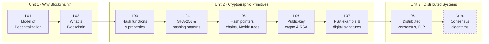
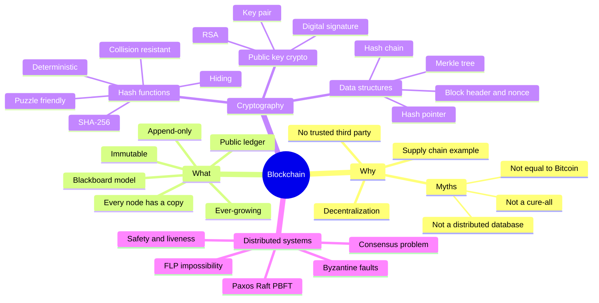
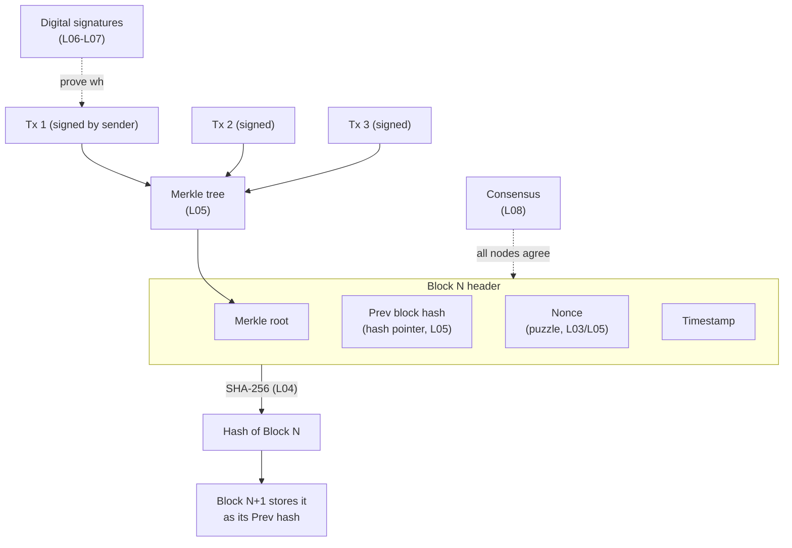

# 🧱 NPTEL Blockchain & its Applications — START HERE

> [!summary] The whole course so far in one minute
> Businesses with many stakeholders (like the **petroleum supply chain**) need to share information **without trusting each other** and **without a central boss** → that's **decentralization** (L01).
> The solution is a shared "**blackboard**" that everyone can read, nobody can erase, and every stakeholder keeps a copy of → that's a **blockchain**: a *decentralized, immutable, append-only, ever-growing public ledger* (L02).
> To make it tamper-proof we need **cryptography**: **hash functions** (L03), especially **SHA-256** and ways of combining hashes (L04), which give us **hash pointers, hash chains and Merkle trees** — the actual structure of a block and the chain (L05).
> To know **who** wrote each entry we need **public-key cryptography / RSA** (L06) and **digital signatures** (L07).
> Finally, since every stakeholder keeps their own copy, they must all **agree** on which block comes next → the **distributed consensus problem** (L08), which leads into consensus algorithms next.

---

## 🧭 The story of the course (read this first)

1. **Problem** – Many independent organisations must coordinate. A central database means everyone must trust whoever runs it, and it is a single point of attack.
2. **Idea** – Replace the central database with a shared, append-only record that *all* parties hold and verify.
3. **Integrity tool** – A *hash* is a fingerprint of data. Change one bit and the fingerprint changes completely. Linking blocks by fingerprints (hash pointers) makes any tampering visible.
4. **Identity tool** – Public/private keys let anyone *verify* that a transaction was really created by its owner (signature) and that the owner cannot deny it later (non-repudiation).
5. **Agreement tool** – Because there is no central authority, nodes run a *consensus protocol* to agree on the next block, even if some nodes crash or lie (Byzantine).

> [!tip] Remember the three pillars
> **Blockchain = Cryptography (hash + signatures) + Distributed Systems (consensus) + (sometimes) Economics (incentives)**

---

## 🗺️ Course roadmap

## 🧠 Concept map of everything

## 🏗️ How the pieces build one block

---

## 📚 Lecture index

| # | Note | One-line idea | Key terms |
|---|------|---------------|-----------|
| 01 | [[L01 - The Model of Decentralization]] | Blockchain is a *technology*; cryptocurrency is one *application*. Decentralization lets untrusting stakeholders cooperate. | Decentralization, myths, upstream/downstream, petroleum supply chain |
| 02 | [[L02 - What Is Blockchain]] | A shared "blackboard" kept by everyone → an immutable, append-only, ever-growing public ledger. | Blackboard model, immutability, append-only, public ledger, consensus problem |
| 03 | [[L03 - Basic Cryptographic Primitives I]] | Hash functions turn any input into a fixed-size fingerprint with special security properties. | Message digest, deterministic, collision resistance, birthday paradox, hiding, puzzle friendliness |
| 04 | [[L04 - Basic Cryptographic Primitives II]] | How SHA-256 works (padding, 512-bit blocks, chained compression) and 5 ways to hash multiple items. | SHA-256, padding, compression function, independent/repeated/combined/sequential/hierarchical hashing |
| 05 | [[L05 - Basic Cryptographic Primitives III]] | Hash pointers → hash chains → Merkle trees → the tamper-evident blockchain. | Hash pointer, hash chain, Merkle tree/root, block header, nonce, difficulty |
| 06 | [[L06 - Basic Cryptographic Primitives IV]] | Encryption basics; symmetric vs public-key crypto; RSA key generation. | Plain/cipher text, symmetric, asymmetric, key entropy, RSA, φ(n) |
| 07 | [[L07 - Basic Cryptographic Primitives V]] | RSA worked example and digital signatures (sign with private key, verify with public key). | Encryption/decryption, digital signature, non-repudiation |
| 08 | [[L08 - Distributed Systems for Decentralization]] | Every node holds a copy, so nodes must reach consensus — hard with crashes, Byzantine nodes and asynchrony. | Distributed consensus, Byzantine fault, FLP impossibility, safety, liveness, Paxos, Raft, PBFT |

---

## 📖 Master glossary

| Term | Meaning (plain English) |
|------|------------------------|
| **Append-only** | You can only add new records at the end, never delete or edit old ones. |
| **Asymmetric (public-key) cryptography** | Each user has two keys: a public key everyone knows and a private key only they know. |
| **Asynchronous system** | No upper limit on how long a message can take to arrive. |
| **Birthday paradox** | In just 23 people there's a >50% chance two share a birthday → collisions are found after ~√N tries, so a 256-bit hash needs ~2¹²⁸ tries. |
| **Block header** | The small summary of a block: previous block's hash, Merkle root, nonce, timestamp. |
| **Blockchain** | A decentralized, immutable, append-only, ever-growing public ledger copied at every participant. |
| **Byzantine fault** | A node that misbehaves arbitrarily — e.g. tells different peers different things. |
| **Ciphertext** | The scrambled (encrypted) version of a message. |
| **Collision** | Two different inputs giving the same hash. A good hash makes this practically impossible to find. |
| **Consensus** | All (honest) nodes agreeing on one value — e.g. the next block. |
| **Crash fault** | A node that simply stops working. |
| **Cryptocurrency** | One application of blockchain (e.g. Bitcoin) — *not* the same thing as blockchain. |
| **Decentralization** | No single authority controls the system; independent stakeholders coordinate directly. |
| **Deterministic (hash)** | Same input always gives the same output. |
| **Digital signature** | Hash of a message encrypted with the sender's private key; proves who sent it and that it wasn't changed. |
| **FLP impossibility** | Fischer–Lynch–Paterson (1985): in a fully asynchronous system, no deterministic algorithm can guarantee consensus if even one node may crash. |
| **Hash function** | Turns input of any size into a fixed-size "fingerprint" (digest). |
| **Hash chain** | Blocks linked one after another by hash pointers; changing one breaks every link after it. |
| **Hash pointer** | A pointer that stores *where* data is **and** the hash of that data, so you can detect if it changed. |
| **Hiding (one-way)** | Given the hash, you cannot work out the input. |
| **Immutable** | Once written, cannot be changed. |
| **Liveness** | The system eventually produces an answer (doesn't get stuck). |
| **Merkle tree** | Binary tree of hashes: leaves = hashes of transactions, each parent = hash of its two children, top = Merkle root. |
| **Message digest** | The output of a hash function. |
| **Non-repudiation** | The signer cannot later deny they signed. |
| **Nonce** | "Number used once" — the value miners change until the block hash meets the difficulty target. |
| **Paxos** | Leslie Lamport's classic crash-fault-tolerant consensus algorithm; favours safety over liveness. |
| **PBFT** | Practical Byzantine Fault Tolerance — consensus that tolerates lying nodes (needs n ≥ 3f + 1). |
| **Plaintext** | The original readable message. |
| **Public ledger** | A record that all participants can read and verify. |
| **Puzzle friendliness** | For a target set, there's no shortcut to find a k so that H(k ‖ x) hits the target — only brute force. Basis of mining. |
| **Raft** | An easier-to-understand crash-fault-tolerant consensus algorithm (leader-based). |
| **RSA** | Public-key algorithm based on the difficulty of factoring n = P × Q. |
| **Safety** | The system never produces a wrong/conflicting answer. |
| **SHA-256** | Secure Hash Algorithm with a 256-bit (64 hex digit) output; designed by the NSA; used by Bitcoin. |
| **Symmetric cryptography** | The same secret key encrypts and decrypts. |
| **Synchronous system** | Messages arrive within a known time bound. |
| **ZooKeeper** | Apache's distributed coordination service (≈2008–09), uses a Paxos-like protocol (ZAB). |

---

## 🧮 Top formulas & facts to memorise

- **SHA-256 output** = 256 bits = 32 bytes = **64 hex digits**.
- **SHA-256 padding**: append `1`, then *k* zeros so that $L + 1 + k \equiv 448 \pmod{512}$, then 64-bit length → total is a multiple of 512.
- **SHA-256 chaining**: $h_i = C(m_i, h_{i-1})$, start from fixed $h_0$, final $h_n$ = digest.
- **Collision effort** for an n-bit hash ≈ $2^{n/2}$ (birthday bound) → $2^{128}$ for SHA-256.
- **RSA keys**: $n = PQ$, $\varphi(n) = (P-1)(Q-1)$, choose $e$ with $\gcd(e,\varphi(n)) = 1$, $d \equiv e^{-1} \pmod{\varphi(n)}$.
- **RSA encrypt / decrypt**: $C = M^e \bmod n$, $M = C^d \bmod n$.
- **RSA worked example**: P=17, Q=11 → n=187, φ=160, e=7, d=23; M=88 → C=11 → back to 88.
- **Encryption** uses the *receiver's public* key; **signature** uses the *sender's private* key.
- **Signature**: $s = \text{Sign}(h(m), K^{priv}_A)$; verify by checking $\text{Verify}(s, K^{pub}_A) = h(m)$.
- **FLP (1985)**: async + 1 crash fault ⇒ deterministic consensus impossible.
- **Byzantine tolerance**: needs $n \ge 3f + 1$ nodes to tolerate $f$ liars.

---

## 📝 How to study these notes

1. Read this page's **summary + story** once.
2. Go through the lectures **in order** — each note starts with a TL;DR and a mind-map; read those first, then the detail.
3. After each lecture, try its **🎯 Exam Corner** without looking (answers are folded).
4. Before the exam: re-read every note's **🔑 Key Points** and this page's **formulas** list.
