# L01 · The Model of Decentralization

> [!summary] TL;DR: the whole lecture in 30 seconds
> This opening lecture by Prof. Sandip Chakraborty (co-taught with Prof. Shamik Sural, IIT Kharagpur) clears away three popular myths: blockchain is **not** Bitcoin, it **cannot** solve every problem, and it is **not** a distributed database. It then asks where blockchain *is* the right tool, and answers with the **petroleum supply chain** in India. That chain has many independent, competing players and no central coordinator, yet they all gain if they share reliable, real-time information. A shared web portal does not work: nobody is trusted to run it, nobody can check the data, and anyone can later deny what they posted. The need for players who **do not trust each other but still cooperate** is called **trustless decentralization**, and that is the problem blockchain is built to solve.

## 🧭 Where this fits

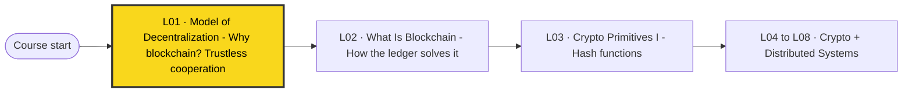

This is the first lecture, so it starts the course. It sets up the **problem** (trustless decentralization). [[L02 - What Is Blockchain]] shows **how blockchain solves it**, and [[L03 - Basic Cryptographic Primitives I]] onwards builds the cryptographic tools behind that solution. See [[00 - START HERE (Course Overview)]] for the full roadmap.

## 🗺️ Structure at a glance

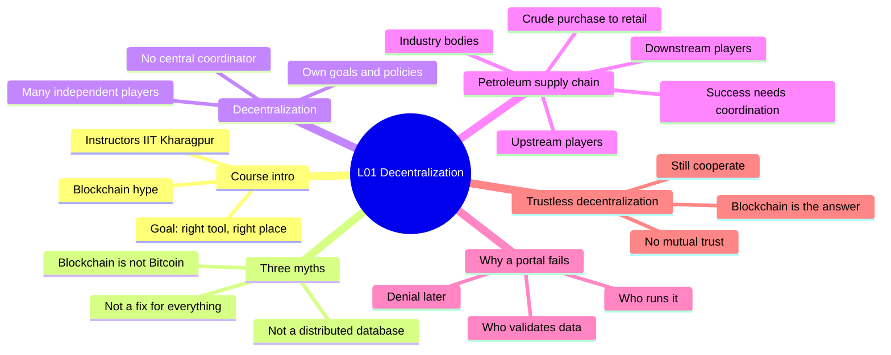

1. **Course introduction and the hype.** Who teaches the course, what it covers, and why blockchain draws so much attention.
2. **Myth 1: Blockchain = Bitcoin/cryptocurrency.** It is the technology underneath, not the application.
3. **Myth 2: Blockchain solves every problem.** No free lunch; weigh the trade-offs.
4. **Myth 3: Blockchain = distributed database.** It is a replicated data structure with its own limits.
5. **Decentralization, the key word.** What it means and why we need a special technology for it.
6. **Use case: the petroleum supply chain.** The flow, the players, and what success needs.
7. **The coordination problem.** Why a central web portal does not work.
8. **Trustless decentralization.** The core idea behind blockchain.

---

## 1. Course Introduction and the Blockchain Hype

**What it is.** *Blockchain and its Applications* is an NPTEL course from **IIT Kharagpur**, taught jointly by **Prof. Sandip Chakraborty** and **Prof. Shamik Sural**. It covers:
- what blockchain is,
- its **architecture** and **functionality**,
- its **use cases**, especially **decentralized applications** beyond cryptocurrency.

**The hype.**
- Blockchain gets huge attention from both **researchers** and **industry**.
- By Google search metrics, "blockchain" has at times been searched **more than** "artificial intelligence" and "deep learning".
- A simple Google search returns millions of articles, and many describe blockchain as a "stellar" technology that can fix everything in life. The course wants to correct this.

> [!example] Analogy
> The hype is like a new "miracle diet" in the news. Everyone talks about it, and some of the claims are true. But you only get real benefit if you understand what it does and what it does not do.

**Course goal.** *Understand the technology well enough to ignore the hype and myths, and apply blockchain only at the right place where it is really needed.*

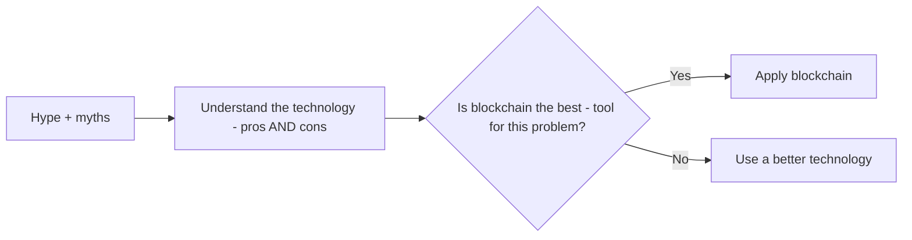

**Why it matters.** The whole course is built around one question: *"What is the right place for blockchain?"* This lecture gives the first answer: **decentralized systems where players do not trust each other**.

---

## 2. Myth 1: Blockchain is the same as Bitcoin / cryptocurrency

**What it is.** Many people think blockchain = Bitcoin. A common question: *"Governments are banning cryptocurrencies, so why learn blockchain?"*

**The fact.** Blockchain is the **technology**. Bitcoin and other cryptocurrencies are **applications** built using that technology.

> [!example] Analogy (from the lecture): Electricity vs an electrical appliance
> - **Blockchain** = the **electricity**.
> - **Bitcoin / a cryptocurrency** = one **electrical appliance** powered by it.
>
> If you argue about whether one appliance is good or legal, you are not arguing about electricity itself. Electricity powers thousands of other appliances too.

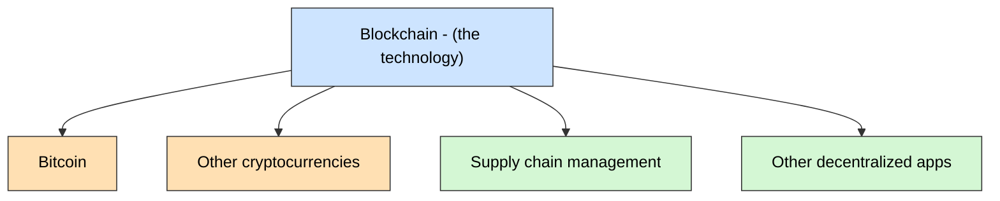

**What the course will and will not do.**

| Covered in the course | Not covered |
|---|---|
| Blockchain technology, architecture, functionality | Whether crypto is or should be legal |
| Cryptocurrency as the **foundational application** (decentralized money), to show the true power of blockchain | How to **trade** cryptocurrency |
| Many non-crypto applications (starting today: supply chain) | Economic / market aspects of crypto |

> [!warning] Common mistake
> "Crypto is banned, so blockchain is useless." Wrong. A ban on one application says nothing about the underlying technology.

> [!tip] Memory trick
> **"Blockchain is the power, Bitcoin is the plug-in."**

---

## 3. Myth 2: Blockchain can solve every problem

**What it is.** The belief that wherever there is **fraud** or **corruption**, blockchain will fix it.

**The fact.** Blockchain is a technology built by cryptographers, computer scientists and economists. Like every technology, it has **advantages and limitations**. It cannot "change society" by itself.

> [!example] Analogy
> A hammer is great for nails. That does not make every problem a nail. For a screw, a screwdriver works better.

**How to decide (the lecture's advice):**
1. List the **pros** of blockchain for your problem.
2. List the **cons** and overheads.
3. Analyze the **trade-off**.
4. If blockchain is the best technology, use it. Otherwise look for a better solution; often you do not need blockchain at all.

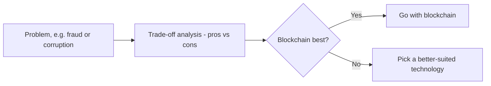

> [!tip] "There is no free lunch"
> No technology only gives benefits. Every gain comes with a cost somewhere.

**Why it matters.** Later lectures show the real costs of blockchain (consensus overhead, slow throughput, limited storage). Knowing them helps you choose wisely.

---

## 4. Myth 3: Blockchain is a distributed database

**What it is.** The belief that any distributed database can simply be replaced by a blockchain.

**The fact.** Blockchain is **not a distributed database**. It is more like a **replicated data structure** (its exact structure comes in later lectures, see [[L05 - Basic Cryptographic Primitives III]]). Databases and blockchains each have their own uses.

| | Database / distributed database | Blockchain |
|---|---|---|
| Nature | General data storage and query system | Replicated data structure (a ledger) |
| Large files | Fine | **Poor use case**; don't store big files on-chain |
| When to use | Data under one trusted owner or trusted parties | Mutually distrusting parties must share a record |
| Replace the other? | No | No |

**Lecture's points:**
- Learning blockchain does **not** mean you can skip a databases course.
- Think about **what** you put on a blockchain and the **overhead** of putting it there.
- You **cannot store any data** on a blockchain; large files are a bad fit.

> [!warning] Common mistake
> Seeing a distributed database and saying "replace it with blockchain". First check whether you even have a trust problem.

> [!summary] Myths in one line
> Blockchain is **not Bitcoin**, **not a magic fix**, **not a database**. In the lecture's words, "blockchain is not equivalent to God", but it does have real use cases.

---

## 5. Decentralization: the key term

**What it is (plain English).** Decentralization is a setup with **many independent players** (businesses, enterprises, government or private bodies, even individuals). Each has **its own goals and policies**, and **no central body** coordinates them.

**Formal idea from the lecture.** A network of different players who:
1. each have their **own interest**,
2. want to fulfil their goals, and gain more if they **cooperate**,
3. but **do not trust each other**.

> [!example] Analogy
> Think of shopkeepers in one market. Each runs a separate shop and competes with the others. If they shared "who has spare stock of what", all of them would sell more. But nobody trusts a rival's numbers, and there is no market manager.

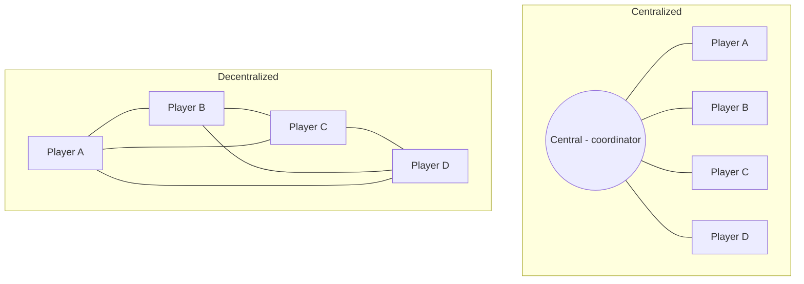

| Feature | Centralized | Decentralized |
|---|---|---|
| Who decides | One central authority | Each player independently |
| Trust | Everyone trusts the centre | Players don't trust each other |
| Information | Collected and checked by the centre | No one to collect or check it |
| Weak point | Single point of control / failure | Hard to coordinate reliably |

**Why it matters.** The lecture's question is: why do we need a special technology to solve the **problem of decentralization**? The petroleum example answers it.

---

## 6. Use Case: Supply Chain Management in the Petroleum Industry

### 6.1 The end-to-end flow (simplified)

**How it works:**
1. **Crude purchase**: buy crude oil.
2. **Crude storage**: transport it to storage.
3. **Refinery**: refine it into **petrol, diesel** and other by-products.
4. **Retailers**: distribute the products for sale.

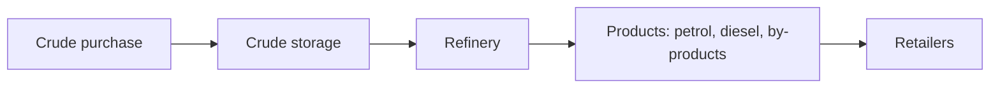

### 6.2 The players (Indian context)

Everything falls under the **Ministry of Petroleum and Natural Gas (MoPNG)**.

- **Upstream** = **exploration and production (E&P)**. They find crude oil, produce it, and supply it to storage.
- **Downstream** = **refining and marketing**. They refine crude and sell the products.
- **Industry bodies** in between handle planning, technology, conservation and safety.

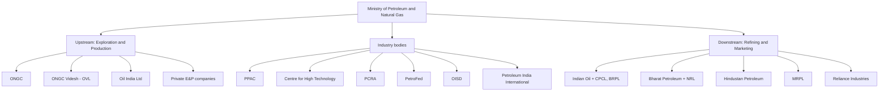

| Segment | Examples (corrected names) | Role |
|---|---|---|
| Upstream | ONGC, ONGC Videsh Ltd (OVL), Oil India Ltd, private companies | Exploration and production of crude |
| Downstream | Indian Oil (IOCL) with subsidiaries CPCL (Chennai Petroleum) and BRPL (Bongaigaon Refinery); Bharat Petroleum (BPCL) with NRL (Numaligarh Refinery); Hindustan Petroleum (HPCL); MRPL (Mangalore Refinery); Reliance Industries | Refining and/or marketing of products |
| Industry bodies | PPAC (Petroleum Planning & Analysis Cell), CHT (Centre for High Technology), PCRA (Petroleum Conservation Research Association), PetroFed, OISD (Oil Industry Safety Directorate), Petroleum India International | Planning, analysis, technology, conservation, safety |

> [!note] Transcript fixes
> The auto-transcript garbles several names: "realize India" = **Reliance Industries**, "industry/Indian petroleum" = **Hindustan Petroleum**, "PRCA" = **PCRA**, "oil industry safety directorate" = **OISD**. Exact refining/marketing role splits vary; what matters for the exam is that there are **many players, some government, some private**, at every level.

**Key observation.** At every level there are different operators, some **government**, some **private**. Companies buy crude from each other, sell to the market, and plan around demand and supply. **The whole system is very complicated.**

### 6.3 What makes a petroleum supply chain successful?

1. **Minimize** material procurement cost.
2. **Maximize** manufacturing capacity and sales.
3. **Meet the demand** numbers.
4. **Respond quickly** to market opportunities by **buying a production shortfall from other players**. Example: if Hindustan Petroleum is short, it can buy from Indian Oil. Companies trade with each other (**cross-business**).
5. Each unit wants to **maximize its own profit, throughput and margin**.

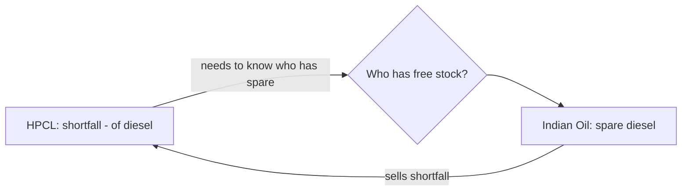

> [!warning] The tension
> Points 1–4 need **strong coordination** across the whole chain: production, distribution, refining, marketing, retail. Point 5 makes them **competitors**. They must cooperate with rivals they don't trust.

> [!example] Analogy
> Rival cricket teams sharing one stadium schedule. Each wants the best slots, but without a shared, honest timetable, everyone loses practice time.

---

## 7. The Coordination Problem: why a central portal fails

**The goal.** Share **real-time information** among stakeholders, such as:
- who holds how much crude oil (in barrels),
- the current crude price,
- how many barrels of petrol and diesel have been produced,
- who has free stock to sell.

With this, everyone can manage the supply chain better.

**Naive solution:** a **web-based portal** where every company posts its numbers.

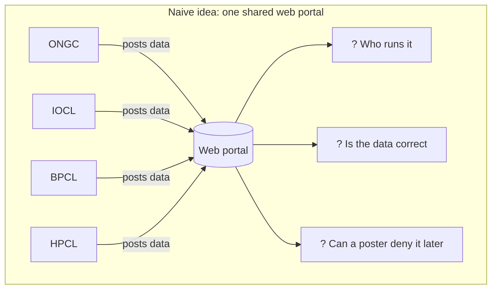

**Three problems (the heart of the lecture):**

| # | Problem | Why it happens | Technical name (used later) |
|---|---|---|---|
| 1 | **Who manages the portal?** | There is no central coordinator, and no player trusts a rival to run it | Central trust / single point of control |
| 2 | **Is the posted information correct? Who validates it?** | No neutral party can check a company's numbers | Data validity / integrity |
| 3 | **What if someone denies their submission later?** ("I never posted that; someone impersonated me") | No proof of who posted what | **Non-repudiation** (solved by digital signatures, see [[L07 - Basic Cryptographic Primitives V]]) |

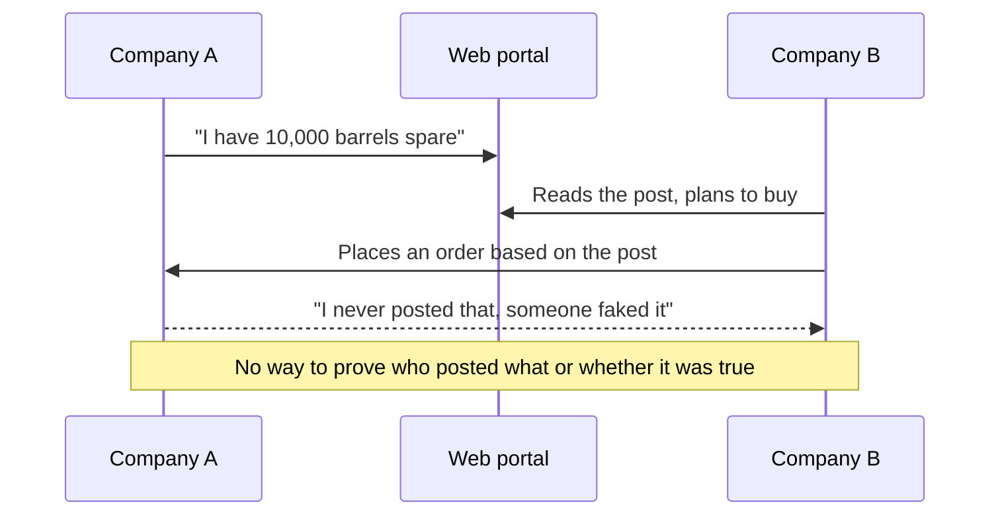

**What we need:** a **decentralized solution** where **no one trusts each other, yet they cooperate**. The lecture's answer: **blockchain**. How it does this is shown in [[L02 - What Is Blockchain]].

**Why it matters.** Without reliable shared information, no one tells you "this many barrels went to company X, so take your shortfall from X". If the information were available **reliably**, the whole business platform would grow together, helping the players and **society as a whole**.

---

## 8. Trustless Decentralization: the core of blockchain

**What it is.** A **decentralized architecture in a trustless setup**: stakeholders who **do not trust each other** can still **coordinate**, without a central authority.

> [!important] Definition to memorize
> **Trustless decentralization** = independent stakeholders who do not trust one another can still cooperate and share reliable information, with **no central coordinator**. This is the basic idea behind the design of blockchain.

> [!example] Analogy
> A group of strangers playing a board game with no referee. If the rules are built into the board so nobody *can* cheat (and any cheating attempt is visible to everyone), they don't need to trust each other. Blockchain is that "board".

**How the pieces connect:**

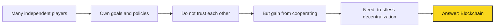

**Before vs after (preview of what blockchain will provide):**

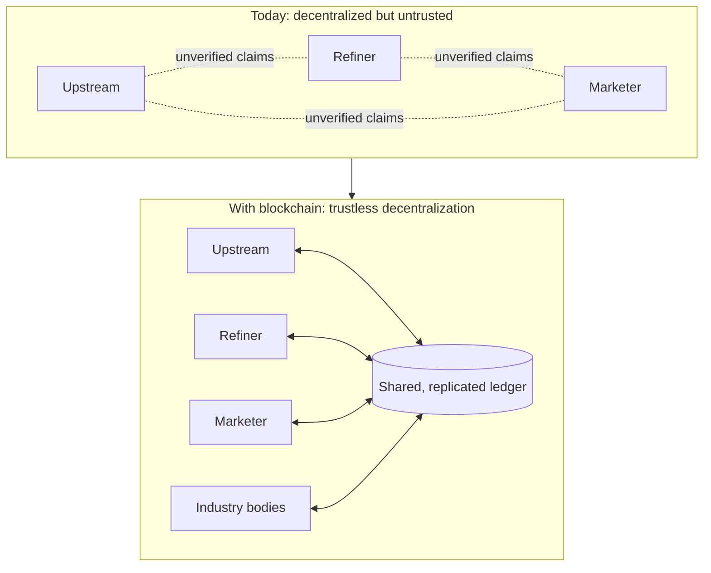

> [!tip] Memory trick
> **"Don't trust, still cooperate."** Decentralization is the setting; the *trustless* part is what blockchain adds.

> [!warning] Common mistake
> "Decentralized" does **not** mean disorganized or without rules. It means **no single controller**: the players are organized, but independent.

---

## 🔑 Key Points (short)

- Course: NPTEL *Blockchain and its Applications*, IIT Kharagpur, Prof. Sandip Chakraborty & Prof. Shamik Sural.
- Blockchain is hugely hyped; at times searched more than AI and deep learning.
- **Myth 1:** Blockchain ≠ Bitcoin. Blockchain is the electricity; crypto is an appliance.
- The course covers crypto only as the foundational application, not trading, legality or economics.
- **Myth 2:** Blockchain does not solve everything; "no free lunch", so analyze trade-offs first.
- **Myth 3:** Blockchain is not a distributed database; it is a replicated data structure. Don't store large files on it.
- Goal of the course: apply blockchain only at the right place.
- **Decentralization** = many independent players with own goals, no central coordinator, no mutual trust.
- Petroleum chain: crude purchase → storage → refinery → products → retailers.
- Upstream = exploration & production (ONGC, OVL, Oil India); downstream = refining & marketing (IOCL, BPCL, HPCL, MRPL, Reliance); all under MoPNG.
- Success needs strong coordination, e.g. buying a shortfall from a rival, but each firm maximizes its own profit.
- A web portal fails: who runs it, who validates data, and posters can deny submissions (repudiation).
- **Trustless decentralization** = cooperate without trust and without a central authority; this is blockchain's purpose.
- Reliable cooperation benefits the players **and society as a whole**.

## 📖 Glossary

| Term | Meaning (plain English) |
|---|---|
| Blockchain | A technology for keeping a shared, replicated record among parties who don't trust each other |
| Cryptocurrency | Digital money (e.g. Bitcoin) built using blockchain, one application of it |
| Bitcoin | The first and best-known cryptocurrency |
| Distributed database | A database spread over many machines, usually under trusted control; not the same as blockchain |
| Replicated data structure | The same data kept as copies at many participants |
| Decentralization | Many independent players with no central coordinator |
| Centralized system | One authority controls and coordinates everything |
| Central coordinator | A single trusted body that collects info and directs others; absent in decentralized systems |
| Stakeholder | Any player with an interest in the system (company, government body, individual) |
| Trustless | Not needing to trust the other party for the system to work |
| Trustless decentralization | Players who don't trust each other still cooperate, with no central authority |
| Supply chain | The path a product takes from raw material to the customer |
| Upstream | Exploration and production of crude oil |
| Downstream | Refining crude and marketing the products |
| Shortfall | When a company has less product than it needs to meet demand |
| Repudiation | Denying later that you did something (e.g. posted data) |
| Non-repudiation | Being able to prove someone did something so they can't deny it |
| Trade-off | Weighing pros against cons before choosing a solution |
| MoPNG | Ministry of Petroleum and Natural Gas, India |
| PPAC | Petroleum Planning & Analysis Cell |
| OISD | Oil Industry Safety Directorate |

## 🎯 Exam Corner

### Likely questions

**Q1. Is blockchain the same as Bitcoin? Explain with an analogy.**
No. Blockchain is the underlying technology; Bitcoin is one application. Blockchain is like electricity and Bitcoin like one appliance it powers.

**Q2. State the three myths about blockchain discussed in the lecture.**
(1) Blockchain = Bitcoin/cryptocurrency. (2) Blockchain can solve every problem. (3) Blockchain is a distributed database.

**Q3. What does "there is no free lunch" mean for blockchain?**
Every technology has costs as well as benefits. Analyze the trade-off and use blockchain only if it is the best solution.

**Q4. Define decentralization as used in the lecture.**
A network of independent players (businesses, government/private bodies, individuals), each with its own interests and policies, with no central coordinator, who do not trust each other but would gain by cooperating.

**Q5. Distinguish upstream and downstream players in the petroleum supply chain, with examples.**
Upstream = exploration and production of crude (ONGC, OVL, Oil India). Downstream = refining and marketing (Indian Oil, BPCL, HPCL, MRPL, Reliance).

**Q6. Why does a shared web portal fail to coordinate the petroleum supply chain?**
There is no trusted party to run it, no way to validate the posted data, and no proof of who posted what, so a company can deny its submission later.

**Q7. What is trustless decentralization?**
A decentralized setup where stakeholders who don't trust one another can still coordinate reliably with no central authority. It is the core idea behind blockchain.

**Q8. Why is storing large files on a blockchain a bad idea?**
Blockchain has overhead and is not a general database; it should hold only what needs shared, trusted agreement.

### MCQs

**1.** What is the relationship between blockchain and cryptocurrencies?
A) Same technology B) Blockchain is the foundational technology for cryptocurrencies C) Cryptocurrencies are more important D) Blockchain is a type of cryptocurrency
> [!check]- Answer
> **B.** Blockchain powers cryptocurrencies, like electricity powers an appliance.

**2.** Which is a myth about blockchain?
A) It has limitations B) It is equivalent to Bitcoin C) It supports non-crypto applications D) It needs trade-off analysis
> [!check]- Answer
> **B.** Treating blockchain and Bitcoin as the same is Myth 1.

**3.** How does the lecture relate blockchain to distributed databases?
A) Blockchain is a distributed database B) They are interchangeable C) Blockchain is not a distributed database; both have their own uses D) Databases are obsolete
> [!check]- Answer
> **C.** Blockchain is a replicated data structure, not a replacement for databases.

**4.** "Decentralization" in the lecture refers to:
A) Centralized control of data B) A network where no single entity has control C) A method to raise profits D) Eliminating competition
> [!check]- Answer
> **B.** Independent players, no central coordinator.

**5.** A key challenge in petroleum supply chain management is:
A) High production cost B) Coordination among many stakeholders C) Lack of technology D) Overproduction
> [!check]- Answer
> **B.** Many competing players must coordinate without a central body.

**6.** What is a critical factor for the success of the petroleum supply chain?
A) Heavy regulation B) Strong coordination among players C) Centralized decision-making D) No competition
> [!check]- Answer
> **B.** Production, refining, marketing and retail must all be coordinated.

**7.** What problem does the lecture point out with sharing information through a portal in a decentralized system?
A) Info is always accurate B) No need to share C) Reliability of the info cannot be guaranteed D) Info is too hard to collect
> [!check]- Answer
> **C.** No one can validate it, and posters can deny it later.

**8.** "Trustless decentralization" means:
A) Everyone trusts everyone B) Parties cooperate without needing to trust each other C) A centralized system needing trust D) Removing all forms of trust
> [!check]- Answer
> **B.** Cooperation without mutual trust or a central authority.

**9.** How should you approach applying blockchain to a problem?
A) Apply it everywhere B) Analyze whether it is the best solution first C) Use it only for finance D) Avoid it
> [!check]- Answer
> **B.** Analyze the trade-off; "no free lunch".

**10.** Which example does the lecture use to illustrate a blockchain application?
A) Online banking B) Petroleum supply chain management C) Social media D) E-commerce
> [!check]- Answer
> **B.** The Indian petroleum supply chain, a non-crypto use case.

## 📝 Summary

Lecture 1 opens the course by separating blockchain from its hype. It busts three myths: blockchain is not Bitcoin (it is the "electricity" behind crypto "appliances"), it is not a fix for every problem ("no free lunch"), and it is not a distributed database. To find where blockchain truly fits, the lecture studies the Indian petroleum supply chain: crude purchase, storage, refining, products and retail, run by many upstream, downstream and regulatory players under MoPNG. These players compete to maximize their own profits, yet they all gain from coordination, such as buying a shortfall from a rival. A shared web portal does not help because nobody is trusted to run it, nobody can validate the data, and anyone can deny what they posted. This need for independent, mutually distrusting players to cooperate without a central coordinator is **trustless decentralization**, the problem blockchain is designed to solve. Next, [[L02 - What Is Blockchain]] shows how blockchain's architecture actually delivers this.
