# L02 · What Is Blockchain

> [!summary] TL;DR — the whole lecture in 30 seconds
> In L01 we saw that a supply chain has many stakeholders who must coordinate but **do not trust each other**. This lecture solves that with a thought experiment: a magical shared **blackboard** that everyone can read, where writing is permanent and nothing can be erased. The blackboard gives auditing, matchmaking and non-repudiation, but raises a new question: **who keeps the board?** The answer is that **everyone keeps their own copy**. That creates the **consensus problem** (how do we keep all the copies the same?). Swap the blackboard for a data structure and you have a **blockchain**: a *decentralized, immutable, append-only public ledger*.

---

## 🧭 Where this fits

```mermaid
flowchart LR
    L01["L01 · Model of Decentralization"] -->|"why we need it"| L02["L02 · What Is Blockchain"]
    L02 -->|"tools to build it"| L03["L03 · Crypto Primitives I: Hash functions"]
    L03 --> L04["L04 · SHA-256 & hashing patterns"]
    L04 --> L05["L05 · Hash pointers, Merkle trees, blocks"]
    L05 --> L06["L06 · Symmetric / Asymmetric crypto"]
    L06 --> L07["L07 · RSA & digital signatures"]
    L07 --> L08["L08 · Distributed consensus"]
    classDef current fill:#f9d71c,stroke:#b8860b,stroke-width:3px,color:#000
    class L02 current
```

[[L01 - The Model of Decentralization]] described the **problem**: competing petroleum supply-chain players with no central coordinator. This lecture gives the **idea of the solution** (the blockchain). Next, [[L03 - Basic Cryptographic Primitives I]] (taught by Prof. Shamik Sural) starts building the cryptographic tools that make the "blackboard" properties real. The consensus problem raised here is solved properly in [[L08 - Distributed Systems for Decentralization]]. Back to [[00 - START HERE (Course Overview)]].

---

## 🗺️ Structure at a glance

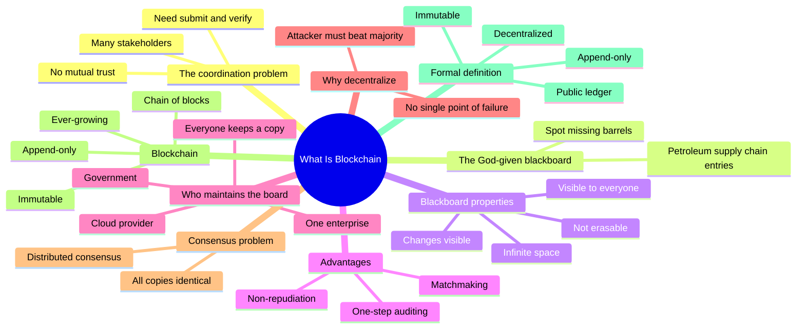

1. **The coordination problem** – stakeholders who don't trust each other still need a place to submit and verify information.
2. **The blackboard thought experiment** – a shared, permanent board recording the whole supply chain.
3. **Four properties of the blackboard** – infinite space, visible to all, changes visible, not erasable.
4. **Advantages of the blackboard** – automated auditing, matchmaking, non-repudiation.
5. **Who maintains the blackboard?** – why every central option fails.
6. **Why decentralization improves security** – the majority (51 of 100) argument.
7. **Everyone keeps a copy → the consensus problem.**
8. **From blackboard to blockchain** – immutable, append-only, ever-growing chain of blocks.
9. **Formal definition** – decentralized, immutable, append-only public ledger.
10. **Conclusion** – a non-cryptocurrency use case; next come cryptographic primitives.

---

## 1. The Coordination Problem (Recap of L01)

**What it is** – A supply chain works only if all its players coordinate well. But the players (oil producers, distributors, refineries, retailers) are **competitors** and **do not trust each other**, and there is **no central coordinator**.

**What they need** at minimum:
1. A place where every stakeholder can **submit** information.
2. A way for anyone to **verify** that information.

> [!example] Analogy
> Imagine a group project where the members don't trust each other and there is no teacher in charge. You still need one shared record of who did what, and every member must be able to check it.

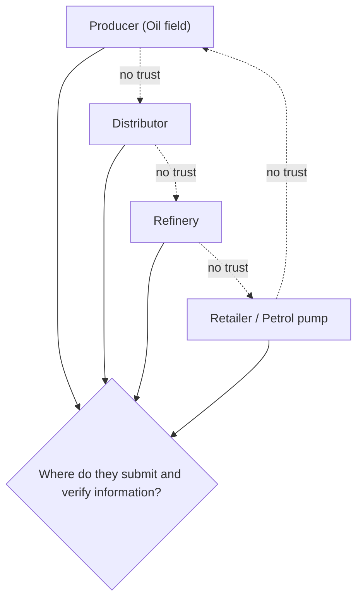

**Why it matters** – If they can coordinate, every player gets a better view of the whole business and can grow. Blockchain is the tool that allows this coordination *without* trust in a central party.

---

## 2. The Blackboard Thought Experiment

**What it is** – Imagine a **blackboard "provided by God"**:
- Everyone can access it.
- Whatever is written on it becomes **permanent**; no one can change it.
- All stakeholders of the **end-to-end** supply chain write every event on it.

**How it works (petroleum supply-chain example from the lecture)**
1. The producer writes: *"1,20,432 barrels produced at Mumbai High on 26 December 2020."*
2. The distributor writes: *"16,467 barrels transported from Mumbai High to HPCL refinery on 26 December 2020 at 2:30 pm."*
3. The refinery writes how much petrol, diesel etc. it produced from that crude.
4. Every later step (storage, transport, retail) is also written.
5. Anyone can read the full board and **trace** the oil: how much was produced, where it went, which refinery processed it, what products came out.

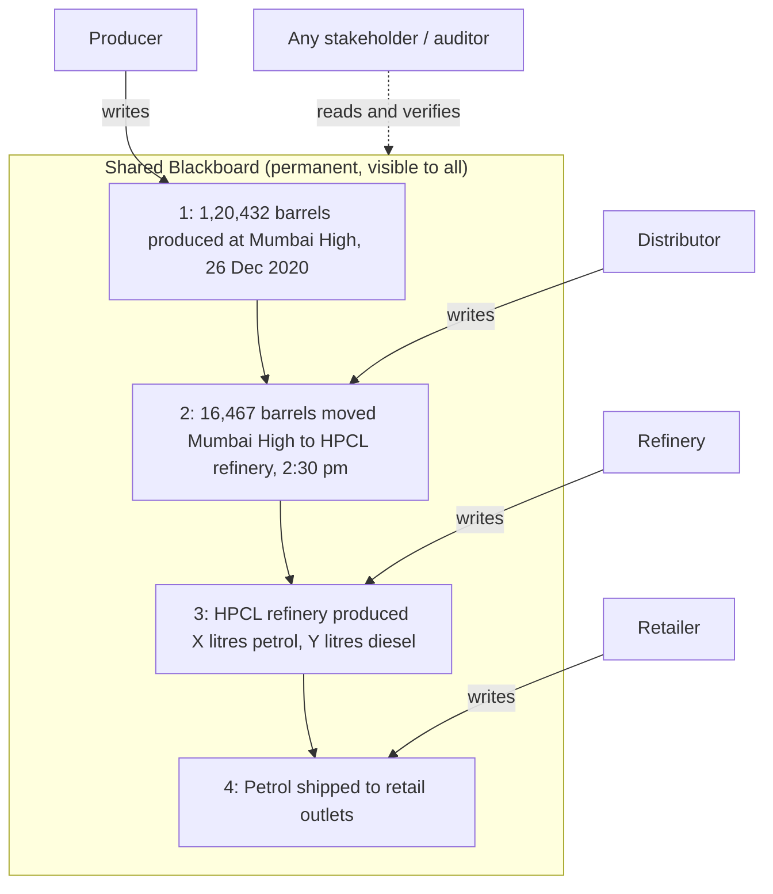

### Worked example: catching a discrepancy

The board shows:

| Entry | Barrels |
|---|---|
| Produced | 100 |
| Transported to refinery X | 40 |
| Transported to refinery Y | 20 |

Step by step:
1. Total transported $= 40 + 20 = 60$ barrels.
2. Unaccounted $= 100 - 60 = 40$ barrels.
3. Anyone can immediately ask: **"Where did the remaining 40 barrels go?"**

$$\text{Missing} = \text{Produced} - \sum \text{Transported} = 100 - (40 + 20) = 40$$

> [!note]
> The transcript mixes up the numbers here ("60 to X and 20 to Y" and then "40 plus 20"). The lecture's point is the same: transported < produced, so the gap is visible to everyone. The 40 + 20 version above is consistent.

**Why it matters** – This is why people say blockchain can **detect fraud and corruption**: when the full history is public and permanent, simple arithmetic exposes gaps.

> [!example] Analogy
> A family expense notebook kept on the fridge, written in pen. If ₹1000 was withdrawn and only ₹600 of spending is written down, everyone can see ₹400 is missing.

---

## 3. Four Properties of the Blackboard

| # | Property | Meaning | What it enables |
|---|---|---|---|
| 1 | **Infinite space** | Never need to erase old entries to make room | Complete **history** is kept, so past events can be verified |
| 2 | **Visible to everyone** | Every stakeholder can read the board | **Transparency** and verification by anyone |
| 3 | **Any change is visible** | Mistakes are corrected by writing a *new* correction entry, not by erasing | Everyone sees both the old claim and the correction |
| 4 | **Not erasable** | Once written, it stays forever | **Non-repudiation**: nobody can later deny what they wrote |

### 3.1 Infinite space
- You never erase old information, so **all historical information** stays on the board.
- Anyone can look back and check whether a discrepancy happened.

### 3.2 Visible to everyone
- We want **verification**, so information must be **transparent**: anyone can see it and check it.

### 3.3 Changes are visible (correction, not erasure)

**How a mistake is fixed:**
1. Organisation writes entry #100 with a wrong value.
2. It discovers the mistake.
3. It is **not** allowed to erase #100.
4. It writes a new entry: *"Entry #100 was a mistake; the correct value is ..."*
5. Everyone now sees both what was claimed earlier and the correction. The deviation itself is transparent.

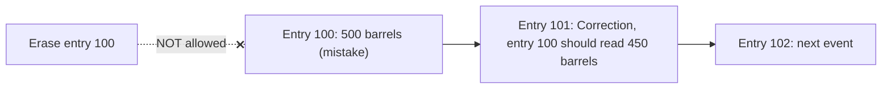

> [!tip] Memory trick
> Like a bank passbook: a wrong debit is not erased, it is reversed with a new credit entry. Both lines stay printed.

### 3.4 Not erasable → non-repudiation
- If nobody can erase anything, **nobody can deny later** that they wrote it.
- Each writer also puts their **signature** on the entry (preview of **digital signatures**, [[L07 - Basic Cryptographic Primitives V]]).

**Why this beats the web portal from L01:**

| Problem with a central web portal | How the blackboard fixes it |
|---|---|
| "I never submitted that, someone **impersonated** me" | Every entry carries the writer's signature |
| "The portal owner **changed my data** fraudulently" | Nothing can be changed or erased |
| A central person controls the data | No one controls it; everyone sees it |

> [!warning] Common mistake
> "Immutable" does **not** mean errors can never be fixed. It means errors are fixed by **appending** a correction, never by **deleting or overwriting** the original.

---

## 4. Advantages of the Blackboard

### 4.1 One-step (automated) auditing
- No need to collect paper records from every organisation and check them by hand.
- A **simple computer program** can scan all entries and flag discrepancies (like the missing 40 barrels).
- Auditing becomes **automatic**.

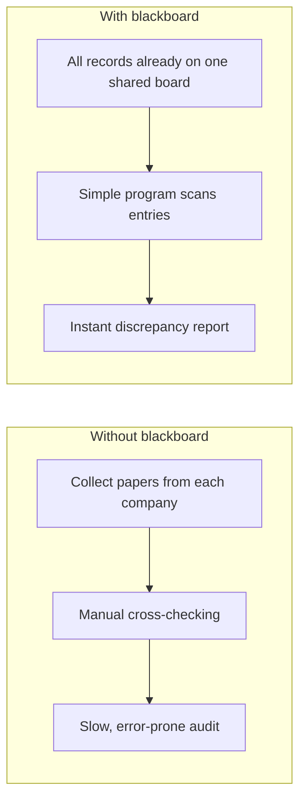

### 4.2 Matchmaking
By reading the board, a business can find trading partners:
- *"Company X has extra barrels; I am short of petrol, so I can approach X."*
- *"Company Y is selling petrol at a lower price, so I can buy from Y."*

Simple programs can do this **matchmaking** automatically.

### 4.3 Non-repudiation
Covered above: what you write and sign, you cannot later deny.

> [!example] Analogy
> A public notice board in a market where every seller posts stock and prices in permanent ink. Buyers find the best deal, and inspectors check totals in seconds.

**Why it matters** – These are the business benefits that make blockchain useful for **enterprises**, not just cryptocurrency.

---

## 5. Who Maintains the Blackboard?

**The catch** – The blackboard looks a lot like the **web portal** from L01, just with extra rules. **Someone still has to maintain it**, and the supply chain has **no central coordinator**.

Options considered in the lecture:

| Option | Why it fails / is debated |
|---|---|
| **Government** maintains it | Trust and security worries. Example: **Aadhaar** database debates (what if my personal data is stolen?). The lecture says Aadhaar-like systems are themselves a blockchain use case, covered later. |
| **Third-party cloud** (e.g. Amazon) | Who pays Amazon? Who manages it? We don't want a third party holding data on our behalf. |
| **One of the enterprises** in the chain | They are all **competitors**; no guarantee the keeper isn't a fraud. |
| **Everyone keeps their own copy** | ✅ Fully decentralized, but creates a new problem (Section 7). |

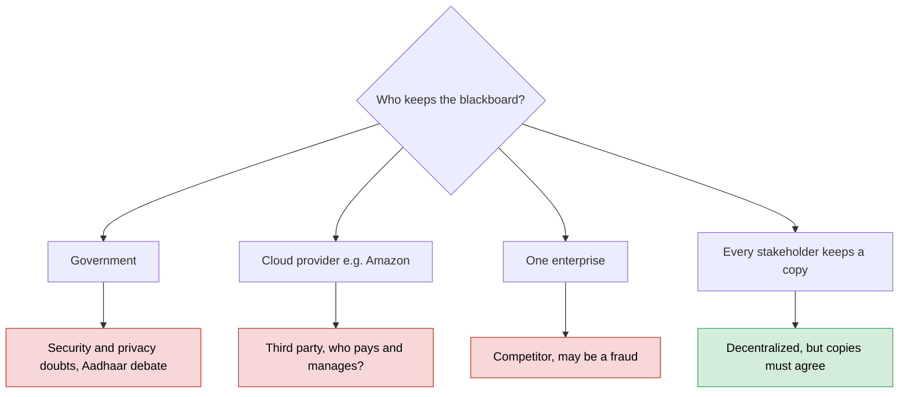

> [!warning] Problems with any single central keeper
> - **Not scalable / not fail-safe:** if the central authority fails, all information and all coordination are lost (**single point of failure**).
> - **Easy target:** attackers know exactly where to strike.

---

## 6. Why Decentralization Improves Security

**What it is** – If many independent parties keep the same information and we trust the **majority**, an attacker has to corrupt the majority, not just one party.

**How it works (lecture example):**
1. **Centralized:** 1 source holds the data. Attacker compromises **1** source → all data is false.
2. **Decentralized:** 100 sources hold the same data. We accept what the **majority** says.
3. To make the majority lie, the attacker must compromise more than half:

$$\text{Sources to compromise} = \left\lfloor \frac{N}{2} \right\rfloor + 1 = \left\lfloor \frac{100}{2} \right\rfloor + 1 = 51$$

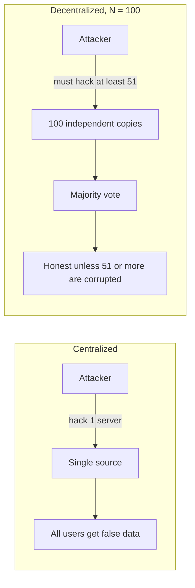

> [!tip] Memory trick
> One lock vs. 100 locks where you need 51 keys. Decentralization multiplies the attacker's work.

> [!warning] There is no free lunch
> Decentralization has **overheads** (communication, agreement, speed). The lecture notes these costs are discussed later. Its gains are **fail-safety** and **security**.

**Why it matters** – This majority idea is the root of "51% attack" discussions in Bitcoin and of consensus protocols later in the course.

---

## 7. Everyone Keeps a Copy → The Consensus Problem

**What it is** – Instead of *one* blackboard kept by someone, **every organisation keeps its own copy**, independently. No one is the sole owner of the data; everyone has a copy; there is **no central database**.

**The new problem:** what guarantees that **every local copy holds exactly the same information at the same instant**? Board A must never say one thing while board B says something else.

This is the **distributed consensus problem** from classical distributed systems.

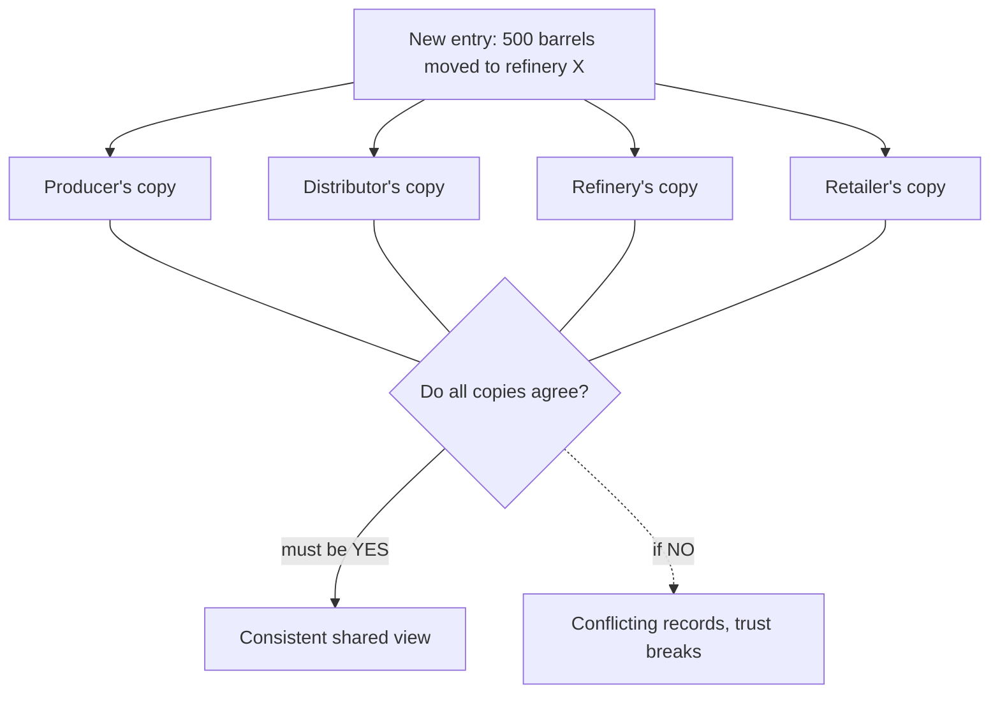

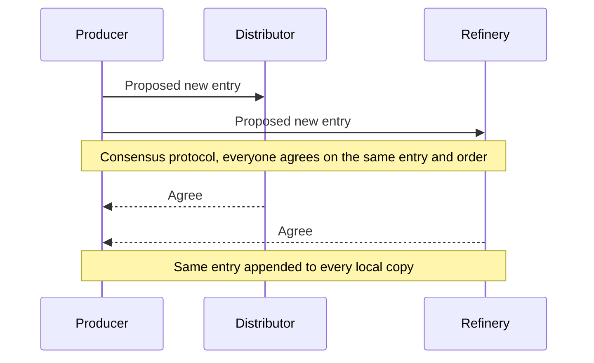

| | Single shared board | Everyone keeps a copy |
|---|---|---|
| Who owns data | One keeper | No one alone; everyone has a copy |
| Central database | Yes | No |
| Single point of failure | Yes | No |
| Main challenge | Trusting the keeper | Keeping all copies **consistent** (consensus) |

**Why it matters** – Solving consensus is the "backend protocol" of every blockchain. It is studied in [[L08 - Distributed Systems for Decentralization]] (consensus, FLP, Paxos) and later in Bitcoin's proof-of-work.

> [!tip]
> We traded one problem ("who keeps the board?") for another ("how do the copies agree?"). The second is solvable with distributed-systems techniques.

---

## 8. From Blackboard to Blockchain

**What it is** – Replace the blackboard with a **data structure** called a blockchain:

> **A blockchain is an immutable, append-only, ever-growing chain of data. Data once added cannot be deleted or modified later.**

Each property mirrors a blackboard property:

| Blockchain property | Meaning | Blackboard property it copies |
|---|---|---|
| **Immutable** | No one can change existing data | Not erasable |
| **Append-only** | You can only add, never delete | Changes visible (corrections appended) |
| **Ever-growing** | New blocks keep getting added | Infinite space |
| **Copy at every player** (transparent) | Everyone sees the same data | Visible to everyone |

**How it works:**
1. Every player (producer, refinery, distributors...) **keeps its own copy** of the blockchain.
2. Each player **processes data locally**: to answer a question, query your own copy.
3. New information is grouped into a **block**.
4. A protocol (taught later) **appends the same block to every local copy**.
5. The protocol ensures **every party has the same view** of the blockchain at all times.
6. So anyone can verify and validate using the history in its own copy, just like the blackboard.

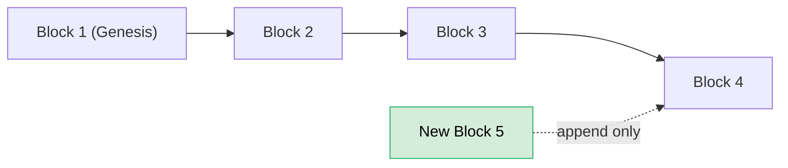

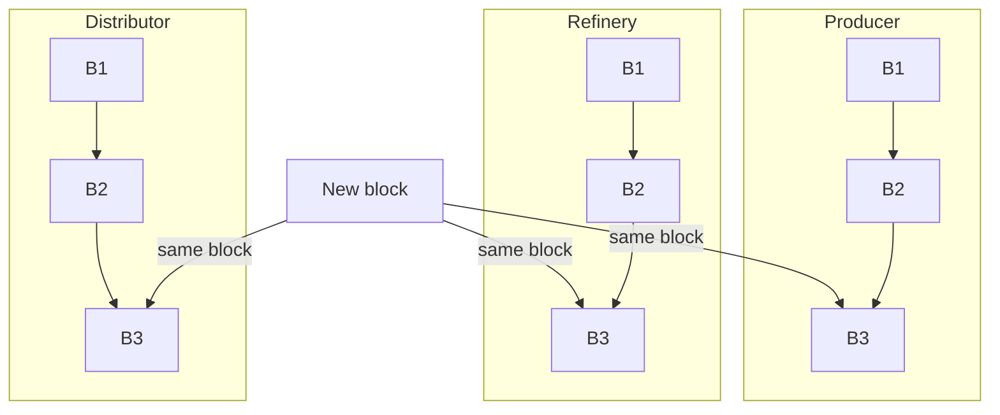

**Why "blockchain"?** Information is added in **blocks**, and each block is linked to the previous one, so the whole structure is a **chain of blocks**. Hence the name.

**Open questions (answered in later lectures):**
- What does a block contain? → [[L05 - Basic Cryptographic Primitives III]] (block structure, Merkle trees)
- How are blocks chained so changes are detectable? → hash pointers, [[L03 - Basic Cryptographic Primitives I]] to [[L05 - Basic Cryptographic Primitives III]]
- How do all parties keep the same copy? → consensus, [[L08 - Distributed Systems for Decentralization]]

> [!example] Analogy
> A train where you can only attach new coaches at the back. Coaches already attached can't be removed or swapped, and every station has an identical model of the full train.

---

## 9. Formal Definition of Blockchain

> [!important] Definition
> **Blockchain is a decentralized, immutable, append-only public ledger.**

| Keyword | Meaning | Why |
|---|---|---|
| **Decentralized** | No single owner; every participant holds a copy | Removes the untrusted central keeper |
| **Immutable** | Existing data can't be changed | Non-repudiation, fraud detection |
| **Append-only** | You can only add new data | Full history kept; corrections visible |
| **Public ledger** | A record book everyone can see; entries are logged publicly | Transparency and verification |

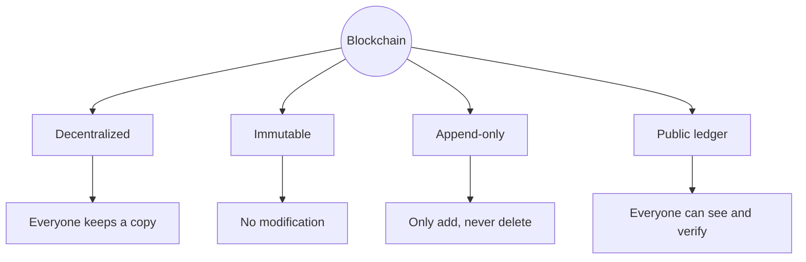

> [!tip] Memory trick: **"DIAP"**, or "**D**on't **I**gnore **A**ny **P**age"
> **D**ecentralized · **I**mmutable · **A**ppend-only · **P**ublic ledger.

> [!note] Transcription fix
> The transcript says "public **laser**" and "append**antly**". The correct terms are **public ledger** and **append-only**. A *ledger* is an accounting record book.

> [!warning] Myth check (from L01)
> Blockchain ≠ Bitcoin. This lecture's example is a **non-cryptocurrency** use case (petroleum supply chain). Cryptocurrencies come later in the course.

---

## 10. Conclusion and What's Next

- We built a broad idea of blockchain and its use, from a **non-cryptocurrency** business problem.
- In **enterprise** settings, blockchain gives building blocks (auditing, matchmaking, non-repudiation) that make open marketplaces more effective and efficient.
- **Next:** Prof. Shamik Sural teaches the **fundamental cryptographic techniques** (hash functions, digital signatures). Then the course returns to the detailed design: what blocks look like, how chains are formed, and the end-to-end blockchain structure.

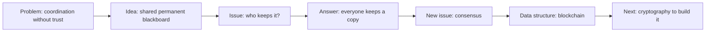

---

## 🔑 Key Points (short)

- Supply-chain stakeholders must coordinate but **don't trust each other** and have **no central coordinator**.
- Minimum need: a place to **submit** information and a way to **verify** it.
- The thought experiment: a God-given **blackboard**, readable by all, where writing is **permanent**.
- Four blackboard properties: **infinite space, visible to all, changes visible, not erasable**.
- Mistakes are fixed by **appending a correction**, never by erasing.
- Not erasable + signatures → **non-repudiation** (no one can deny what they wrote).
- Advantages: **one-step automated auditing**, **matchmaking**, fraud detection (e.g. 100 produced, 60 shipped → 40 missing).
- Central keepers (government, cloud, one enterprise) are a **single point of failure** and need trust.
- With 100 copies and majority rule, an attacker must compromise **51**. Decentralization improves security.
- Decentralization has **overheads**; it isn't free.
- **Everyone keeps a copy**, which creates the **distributed consensus problem**: all copies must be identical at all times.
- Blockchain = **immutable, append-only, ever-growing chain of data**; it's called a block**chain** because data is added in blocks that are chained together.
- Each player **processes data locally** on its own copy.
- **Formal definition:** blockchain is a **decentralized, immutable, append-only public ledger**.
- This lecture's use case is **not cryptocurrency**; next come cryptographic primitives.

---

## 📖 Glossary

| Term | Meaning (plain English) |
|---|---|
| Stakeholder | Any organisation taking part in the system (producer, distributor, refinery, retailer) |
| Decentralization | No single party controls the data or the system |
| Blackboard (analogy) | Imaginary shared board where everyone writes permanently and everyone can read |
| End-to-end supply chain | The full path from oil production to the final petrol pump |
| Transparency | Everyone can see the information |
| Non-repudiation | You cannot later deny something you wrote/signed |
| Auditing | Checking records for errors or fraud |
| Matchmaking | Finding a suitable trading partner from public information |
| Single point of failure | One component whose failure brings down the whole system |
| Majority (51 of 100) | More than half of the sources; what we trust in a decentralized system |
| Consensus | All participants agreeing on the same data |
| Distributed consensus problem | Keeping every independent copy identical without a central authority |
| Block | A bundle of new information added to the chain at once |
| Blockchain | A chain of blocks; immutable, append-only, ever-growing |
| Immutable | Cannot be changed once written |
| Append-only | You can only add new data, never delete or modify |
| Ever-growing | Keeps getting longer as new blocks are added |
| Ledger | A record book of transactions/events |
| Public ledger | A ledger everyone can see and verify |
| Mumbai High | India's largest offshore oil field (lecture's example producer) |
| HPCL | Hindustan Petroleum Corporation Ltd., the refinery in the lecture's example |
| Aadhaar | India's national ID database, mentioned as a debated centrally-maintained system |

---

## 🧮 Formulas & Numbers

| Formula / Number | Meaning |
|---|---|
| $\text{Missing} = \text{Produced} - \sum \text{Transported}$ | Simple audit check on the board |
| $100 - (40 + 20) = 40$ | Lecture example: 40 barrels unaccounted |
| $\lfloor N/2 \rfloor + 1$ | Sources an attacker must compromise to control a majority of $N$ |
| $N = 100 \Rightarrow 51$ | Lecture example: 51 out of 100 |
| 1,20,432 barrels | Crude produced at Mumbai High, 26 Dec 2020 (example entry) |
| 16,467 barrels | Moved from Mumbai High to HPCL refinery, 26 Dec 2020, 2:30 pm (example entry) |
| 4 | Blackboard properties (infinite space, visible, changes visible, not erasable) |
| 4 | Keywords in the formal definition (decentralized, immutable, append-only, public ledger) |

---

## 🎯 Exam Corner

### Likely questions

**Q1. What are the four properties of the "blackboard" used to motivate blockchain?**
(1) Infinite space, so history is never erased. (2) Visible to everyone, for transparency. (3) Any change is visible: corrections are appended, not erased. (4) Not erasable, so no one can deny what they wrote.

**Q2. How is a mistake corrected on the blackboard / blockchain?**
By adding a new entry saying the earlier one was wrong and giving the correct value. The original entry stays, so everyone sees both.

**Q3. Give the formal definition of blockchain.**
A blockchain is a **decentralized, immutable, append-only public ledger**.

**Q4. Why not let the government, a cloud provider or one enterprise maintain the board?**
Each is a trusted central party. Governments raise security/privacy concerns (the Aadhaar debate), cloud means a paid third party holds your data, and enterprises are competitors who might commit fraud. Any of them is also a single point of failure.

**Q5. How does decentralization improve security?**
With 1 central source, an attacker compromises 1 server. With 100 copies and majority rule, the attacker must compromise at least 51, which is much harder.

**Q6. What new problem appears when every stakeholder keeps its own copy?**
The **distributed consensus problem**: ensuring all copies hold exactly the same information at the same time.

**Q7. Why is it called a "blockchain"?**
New data is added as **blocks**, and each block is appended to (linked with) the existing chain, so the structure is a chain of blocks.

**Q8. How does the blackboard help auditing? Give an example.**
All records are public and permanent, so a simple program can check totals. For example, if 100 barrels were produced but only 40 + 20 = 60 were transported, 40 barrels are unaccounted for.

### MCQs

**1. Which of the following is NOT one of the four keywords in the formal definition of blockchain?**
a) Decentralized b) Immutable c) Encrypted d) Append-only
> [!check]- Answer
> **c) Encrypted.** The definition is decentralized, immutable, append-only public ledger. Blockchain data is public, not necessarily encrypted.

**2. In the blackboard analogy, "infinite space" mainly ensures that:**
a) Anyone can write anonymously b) Historical information is never erased c) Writing is faster d) Only the government can read it
> [!check]- Answer
> **b)** You never need to erase old entries, so the full history stays available for verification.

**3. A stakeholder wrote a wrong value on the blackboard. What is allowed?**
a) Erase and rewrite it b) Ask the admin to delete it c) Append a correction entry d) Nothing; the wrong value stays without any correction
> [!check]- Answer
> **c)** Corrections are appended. The original stays visible, so the change itself is transparent.

**4. The property that prevents an organisation from later saying "I never submitted that" is:**
a) Scalability b) Non-repudiation c) Anonymity d) Matchmaking
> [!check]- Answer
> **b) Non-repudiation**, which comes from entries being non-erasable and signed by the writer.

**5. If 100 independent sources keep the same data and majority is trusted, how many must an attacker compromise?**
a) 1 b) 50 c) 51 d) 100
> [!check]- Answer
> **c) 51**, more than half: $\lfloor 100/2 \rfloor + 1 = 51$.

**6. When every organisation keeps its own copy of the board, the main challenge becomes:**
a) Storage cost b) The distributed consensus problem c) Choosing a central admin d) Encryption speed
> [!check]- Answer
> **b)** All copies must stay identical at the same time. That is distributed consensus.

**7. "Ever-growing" in the blockchain definition means:**
a) Block size keeps increasing b) New blocks keep being appended, so the chain keeps getting longer c) The number of users must grow d) Data is compressed over time
> [!check]- Answer
> **b)** Because it is append-only, the chain only grows as new blocks are added.

**8. Produced: 100 barrels; to refinery X: 40; to refinery Y: 20. What does an auditor reading the board conclude?**
a) Everything is fine b) 20 barrels missing c) 40 barrels unaccounted for d) 60 barrels missing
> [!check]- Answer
> **c)** $100 - (40 + 20) = 40$ barrels unaccounted for.

**9. The use case discussed in this lecture is:**
a) Bitcoin payments b) Petroleum supply chain c) Smart-contract gaming d) Mining hardware
> [!check]- Answer
> **b)** A deliberately **non-cryptocurrency** enterprise use case.

**10. Why is a single central maintainer of the board undesirable?**
a) It is a single point of failure and an easy target for attackers b) It is too decentralized c) It makes auditing impossible d) It uses too much storage
> [!check]- Answer
> **a)** If it fails or is attacked, all information and coordination are lost, and attackers know exactly where to strike.

---

## 📝 Summary

Supply-chain players need to coordinate, but they compete, don't trust each other and have no central coordinator. The lecture imagines a God-given blackboard that everyone can read, with infinite space, visible corrections and no erasing. Such a board gives automated one-step auditing (spotting missing barrels), matchmaking between businesses, and non-repudiation. A single keeper of the board (government, cloud provider or one enterprise) brings back trust problems and a single point of failure. So every stakeholder keeps its own copy, which also improves security, because an attacker must corrupt a majority (51 of 100). That creates the distributed consensus problem: all copies must stay identical. Replacing the blackboard with a data structure gives the blockchain, an immutable, append-only, ever-growing chain of blocks, formally a **decentralized, immutable, append-only public ledger**. Next, [[L03 - Basic Cryptographic Primitives I]] introduces the cryptographic tools (hash functions, later digital signatures) that make these properties possible.
