# L03 · Basic Cryptographic Primitives – I

> [!summary] TL;DR: the whole lecture in 30 seconds
> A blockchain is built from a few **cryptographic primitives**. The first and most important one is the **cryptographic hash function**. It takes an input of any size and quickly produces a fixed-size "fingerprint" (the **message digest**), usually 256 bits (for example, SHA-256).
> A good hash function is **deterministic**, **collision resistant**, **hiding / one-way**, and **puzzle friendly**.
> These properties let us compare huge documents by their small digests, commit to a value now and check it later, and run Bitcoin's **mining puzzle** (proof of work). Lectures 03–07 cover hash functions and digital signatures, the two building blocks of every blockchain.

**Instructor:** Prof. Shamik Sural, Dept. of CSE, IIT Kharagpur.

---

## 🧭 Where this fits

```mermaid
flowchart LR
    L01["L01: Model of Decentralization"] --> L02["L02: What Is Blockchain"]
    L02 --> L03["L03: Hash functions and properties"]
    L03 --> L04["L04: SHA-256 and hashing patterns"]
    L04 --> L05["L05: Hash pointers, Merkle trees"]
    L05 --> L06["L06: Symmetric and asymmetric crypto"]
    L06 --> L07["L07: RSA and digital signatures"]
    L07 --> L08["L08: Distributed systems and consensus"]
    classDef current fill:#f9d71c,stroke:#333,stroke-width:3px,color:#000
    class L03 current
```

[[L02 - What Is Blockchain]] described the blockchain as an **immutable, append-only ledger** (the "blackboard" that everybody can read and nobody can erase). That raised the question of what actually makes it tamper-proof. This lecture starts the answer with **hash functions**. [[L04 - Basic Cryptographic Primitives II]] goes inside **SHA-256** and common hashing patterns, and [[L05 - Basic Cryptographic Primitives III]] uses hashes to build hash pointers, hash chains and Merkle trees, which is the actual block structure. Course map: [[00 - START HERE (Course Overview)]].

---

## 🗺️ Structure at a glance

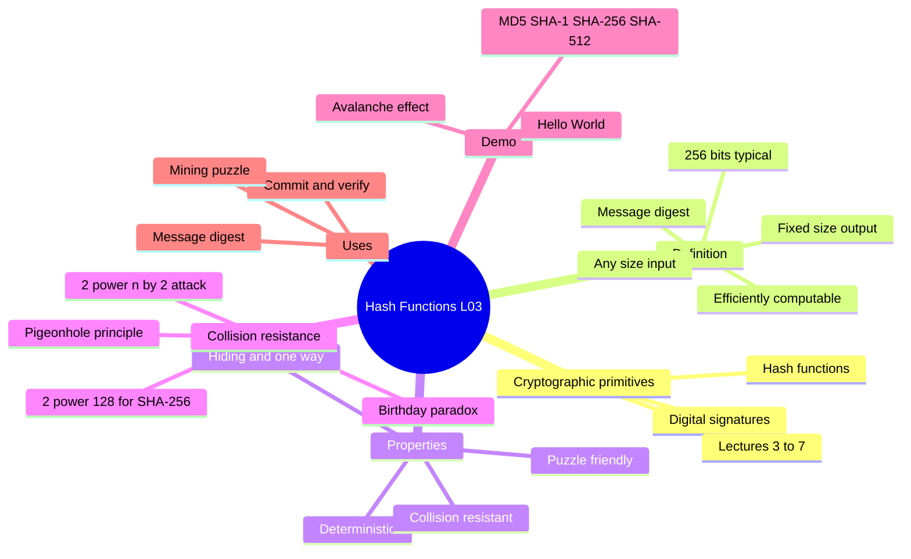

1. **Cryptographic primitives**: what "primitive" means and the plan for Lectures 03–07.
2. **What is a cryptographic hash function**: input, output, digest, efficiency.
3. **The four core properties**: deterministic, collision resistant, hiding, puzzle friendly.
4. **One-way functions**: easy forward, infeasible backward (cube / cube-root analogy).
5. **Collision resistance and the birthday paradox**: why 256 bits gives 2^128 security.
6. **Hash as a message digest**: compare big files by comparing small hashes.
7. **Live demo**: "Hello World" vs "Hello World 1" and the avalanche effect.
8. **Information hiding and commitment**: commit now, verify later (Alice, Bob and others).
9. **Puzzle friendliness and mining**: why brute-force search is the only strategy.

---

## 1. Cryptographic Primitives: the Building Blocks

**What it is.** A *primitive* is a basic, well-studied cryptographic tool that bigger systems are built from. Blockchain is not a new kind of cryptography. It is a clever arrangement of old primitives.

**The two primitives this course needs (Lectures 03–07):**

| Primitive | What it gives | Real-world equivalent | Where used in blockchain |
|---|---|---|---|
| **Cryptographic hash function** | A short, unique fingerprint of data | A fingerprint or tamper seal | Linking blocks, Merkle trees, mining, addresses |
| **Digital signature** | Proof of *who* created or approved data | A handwritten signature | Signing transactions ("I really sent this coin") |

> [!example] Analogy
> Think of LEGO. Hash functions and digital signatures are the basic bricks. A blockchain is the castle built from them. To understand the castle you first study the bricks.

**Digital signature (preview).** A manual signature on a document does two things:
1. **Authentication**: anyone checking later knows it really came from me.
2. **Non-repudiation**: I **cannot deny** later that I signed it.

A digital signature does the same for digital data, and others can check that it is authentic. (Details come in [[L06 - Basic Cryptographic Primitives IV]] and [[L07 - Basic Cryptographic Primitives V]].)

> [!warning] Transcript fix
> The auto-transcript says "one can deny about their own activities". The correct statement is that with digital signatures one **cannot** deny one's own activities. That is non-repudiation.

**Why it matters.** The way hash functions are combined to connect blocks "in a tamper-proof way" is what essentially **defines** a blockchain.

---

## 2. What Is a Cryptographic Hash Function?

**What it is (plain English).** A hash function is a machine that eats any data, whether one word or a 10 GB movie, and always produces a short output of the **same fixed length**. That output is called the **message digest** (or hash, or fingerprint).

**Formal definition.**
$$H : \{0,1\}^{*} \rightarrow \{0,1\}^{n}$$
- Input $M$ (the **message**): a bit string of **arbitrary** length.
- Output $H(M)$ (the **message digest**): exactly $n$ bits. In blockchain we usually take $n = 256$.
- $H(M)$ must be **efficiently computable**: fast, because a blockchain computes hashes again and again.

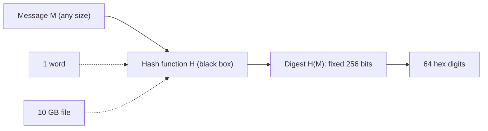

**The three basic requirements (before the security properties):**
1. Takes an **arbitrarily sized** string as input.
2. Produces a **fixed size** output (for example 256 bits).
3. Is **efficiently computable**: the digest is generated very fast.

> [!example] Analogy
> A meat grinder (or a juicer). You can put in any amount of fruit, and out comes a cup of juice of a fixed size. You cannot rebuild the fruit from the juice. The same fruit always gives the same juice.

> [!warning] Common mistake: hashing is not encryption
> Encryption is **reversible** if you have the key. Hashing has **no key and no way back**. You never "decrypt" a hash.

**Common hash functions** (seen in the demo):

| Function | Output size | Hex digits | Status |
|---|---|---|---|
| MD5 | 128 bits | 32 | Broken (collisions found), do not use for security |
| SHA-1 | 160 bits | 40 | Broken (practical collision shown in 2017) |
| **SHA-256** | **256 bits** | **64** | Secure; used by **Bitcoin** |
| SHA-512 | 512 bits | 128 | Secure |

> [!tip] Hex-digit trick
> One hex digit = 4 bits. So 256 bits ÷ 4 = **64 hex digits**. That is why a SHA-256 digest always looks like 64 characters.

---

## 3. The Four Core Properties of a Cryptographic Hash Function

Overview first, then each property in detail.

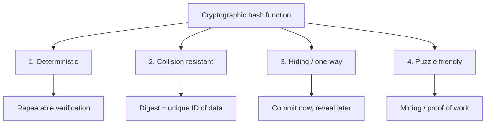

| # | Property | Plain-English meaning | Correct formal statement | Blockchain use |
|---|---|---|---|---|
| 1 | **Deterministic** | Same input always gives same output | $M_1 = M_2 \Rightarrow H(M_1) = H(M_2)$, with no randomness | Anyone can re-check a hash |
| 2 | **Collision resistant** ("collision free") | Practically impossible to find two inputs with the same hash | Infeasible to find $x \neq y$ with $H(x) = H(y)$ | Digest identifies data uniquely; tamper evidence |
| 3 | **Hiding** (related: one-way / pre-image resistance) | Hash reveals nothing useful about the input | Given $H(r \Vert x)$ with secret random $r$, infeasible to find $x$ | Commitments; hiding data |
| 4 | **Puzzle friendly** | No shortcut to make the hash hit a target; only guessing works | For any target $y$ and random $k$, finding $x$ with $H(k \Vert x) = y$ takes about $2^n$ tries | Bitcoin mining puzzle |

### 3.1 Deterministic

**What it is.** For a given hash function and a given message $M$, you **always** get the same digest $H(M)$. There is no randomness inside.

**Why.** We must be able to apply the hash again later, to the same message, and get the same digest. Otherwise verification would be impossible.

> [!example] Analogy
> Your fingerprint is the same every time you press your thumb. If it changed each time, fingerprint locks would be useless.

### 3.2 Collision Resistant ("Collision Free")

**What the lecture says.** If $M_1 \neq M_2$ then $H(M_1) \neq H(M_2)$.

**The precise (correct) definition.** Collisions **must exist**, because inputs are unlimited but there are only $2^{256}$ outputs (pigeonhole principle). So the real requirement is:

> It is **computationally infeasible** to find any pair $x \neq y$ such that $H(x) = H(y)$.

"Free" means "no one can **find** one", not "none exist". The lecture itself clarifies: "difficult to find means there could be certain collisions … but it is going to happen very, very rarely."

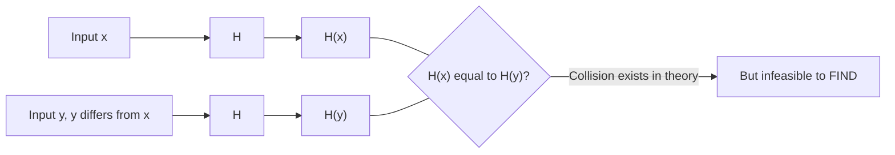

> [!warning] Myth
> "SHA-256 has no collisions." **False.** Infinitely many collisions exist. Nobody has ever found one, and finding one by brute force would take about $2^{128}$ work.

Details and the birthday paradox are in **Section 5**.

### 3.3 Hiding (Original Message Information Is Hidden)

**What the lecture says.** From $H(M_1)$ and $H(M_2)$ you should not be able to work out the messages. Even if $M_1$ and $M_2$ differ only slightly, their digests should **not** look similar. So knowing $M_1$ and $H(M_1)$ does not help you predict $H(M_2)$ for a nearby $M_2$. (That last part is the **avalanche effect**, Section 7.)

**The precise definitions (know both):**
- **Pre-image resistance (one-way):** given $y$, it is infeasible to find any $x$ with $H(x) = y$.
- **Hiding (formal, Narayanan et al.):** if $r$ is chosen from a distribution with **high min-entropy** (very random) and kept secret, then given $H(r \Vert x)$ it is infeasible to find $x$.

> [!tip] Why add a random $r$?
> If the input comes from a small set, for example "YES" or "NO", an attacker just hashes both and compares. Adding a long secret random value $r$ makes guessing impossible. This is the basis of **commitments** (Section 8).

### 3.4 Puzzle Friendly

**What the lecture says.** Given $x$ (a message) and $y$ (a target), find $k$ such that
$$y = H(x \Vert k)$$
where $\Vert$ means **concatenation** (joining strings). In practice $y$ is not one value but a **set** of acceptable values (for example "starts with many zeros").

**Precise definition.** For every possible output $y$, if $k$ is chosen from a high min-entropy distribution, it is infeasible to find $x$ such that $H(k \Vert x) = y$ in time significantly less than $2^n$.

**What it really means:** there is **no clever shortcut**. The best strategy is **random (brute-force) search**. Detail and the mining loop are in **Section 9**.

---

## 4. One-Way Functions

**What it is.** A hash function is a **one-way function**:
- Given $x$, computing $H(x)$ is **easy** (efficient).
- Given $H(x)$ and **not knowing** $x$, finding $x$ is **infeasible**.

This is one of the main reasons it is called a *cryptographic* hash function.

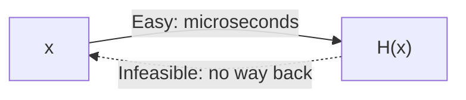

> [!example] Lecture analogy: cube vs cube root
> Cubing is easy: $3^3 = 27$. Finding the cube root of an arbitrary large number is **harder**. But note the lecture's own caveat: you **can** still compute a cube root, so cubing is **not truly one-way**. It only shows the *idea* of "easy one way, harder the other way." A real hash function cannot be reversed at all in practice.

> [!example] Everyday analogy
> Mixing paint. Mixing blue and yellow into green is easy. Separating green back into exact blue and yellow is practically impossible.

**Also hard (a consequence of collision resistance):** finding two messages $x \neq y$ with the same hash.

| Easy direction | Hard direction |
|---|---|
| $x \rightarrow H(x)$ | $H(x) \rightarrow x$ (pre-image) |
| Check if $H(x) = H(y)$ | Find $x \neq y$ with $H(x) = H(y)$ (collision) |

---

## 5. Collision Resistance and the Birthday Paradox

### 5.1 Pigeonhole principle: collisions must exist

If there are 365 days in a year (non-leap), then with **366 people** two of them must share a birthday. With a leap year (366 days) you need **367 people**. That is the **pigeonhole principle**: more pigeons than holes means some hole holds two.

The same applies to hashes: infinitely many inputs, only $2^{256}$ outputs, so collisions exist.

### 5.2 Birthday paradox: collisions come much sooner than you think

**Question.** In a room of $n$ random people, what is the probability that **some two** share a birthday?

**Surprising answer:**

| People in room | P(at least one shared birthday) |
|---|---|
| 23 | ≈ 0.507 (just over 50%) |
| 70 | ≈ 0.999 (99.9%) |
| 366 (non-leap) | 1 (certain, pigeonhole) |

> [!warning] Transcript / slide fix
> The lecture says 70 people gives "0.9999". The exact value is about **0.9992** (99.9%). Exams usually quote "**23 people → 50%**, **70 people → 99.9%**".

**How the 23-person number is computed (every step):**
1. P(nobody shares) = $\dfrac{365}{365} \times \dfrac{364}{365} \times \dfrac{363}{365} \times \cdots \times \dfrac{365-n+1}{365}$
2. For $n = 23$ this product ≈ 0.493.
3. P(some pair shares) = $1 - 0.493 \approx 0.507$.

**Why so few?** We are not asking "does someone share **my** birthday" (that needs about 253 people). We are asking about **any pair**. 23 people make $\binom{23}{2} = 253$ pairs, and each pair is a chance for a match.

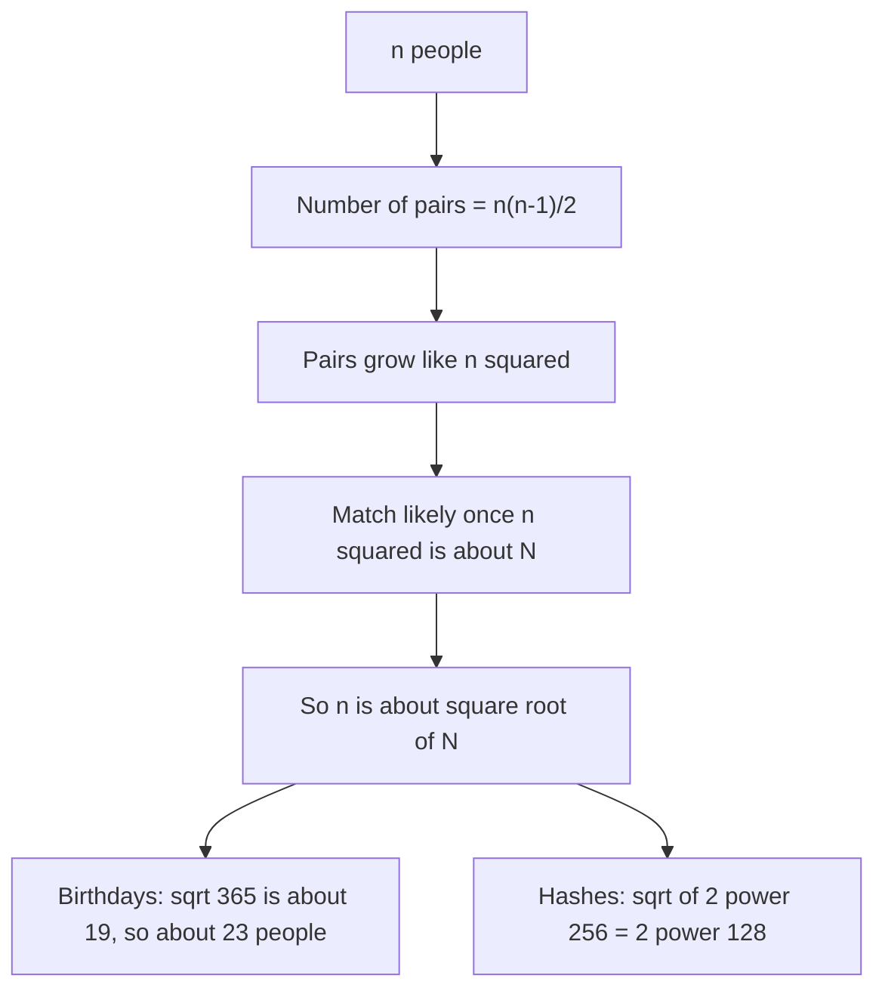

### 5.3 Birthday attack on hash functions

For a hash with $n$-bit output there are $N = 2^n$ possible digests. By the birthday argument an attacker hashing random inputs expects to find a collision after about
$$\sqrt{N} = \sqrt{2^{n}} = 2^{n/2} \text{ hash computations.}$$

The lecture states that the attacker needs about $2^{n/2}$ hash operations on random inputs to find two matching outputs with high probability (quoted as > 0.98).

> [!note] Precision
> With exactly $2^{n/2}$ tries the success probability is about $1 - e^{-1/2} \approx 0.39$. A few times more, around $2^{n/2+2}$, pushes it above 0.99. The **order of magnitude** $2^{n/2}$ is what matters, and that is what exams test.

**For SHA-256 ($n = 256$):**
1. Work ≈ $2^{256/2} = 2^{128} \approx 3.4 \times 10^{38}$ hashes.
2. At 1 hash per microsecond ($10^{6}$ per second): $3.4 \times 10^{38} / 10^{6} = 3.4 \times 10^{32}$ seconds.
3. One year ≈ $3.15 \times 10^{7}$ s, so time ≈ $1.08 \times 10^{25}$ **years**. The lecture says "close to $10^{25}$ years."
4. The universe is about $1.4 \times 10^{10}$ years old. So finding a collision is **practically impossible**.

> [!tip] Memory trick
> **"Halve the bits."** An $n$-bit hash gives only $n/2$ bits of collision security. 256-bit → 128-bit security. This is why MD5 (128 bits → only $2^{64}$ work, now broken) is too short.

> [!warning] Common mistake
> Collision security is **not** $2^{256}$. It is $2^{128}$, because of the birthday paradox. ($2^{256}$ is roughly the cost of a **pre-image** attack, which means finding an input for one *given* hash.)

| Attack | Goal | Generic cost for n-bit hash | SHA-256 |
|---|---|---|---|
| Pre-image | Given $y$, find $x$ with $H(x)=y$ | $2^{n}$ | $2^{256}$ |
| Second pre-image | Given $x$, find $x' \neq x$ with $H(x')=H(x)$ | $2^{n}$ | $2^{256}$ |
| Collision (birthday) | Find **any** $x \neq y$ with $H(x)=H(y)$ | $2^{n/2}$ | $2^{128}$ |

**Why it matters.** If an attacker could find two transactions with the same hash, they could swap one for the other inside a block without the hash changing. Collision resistance stops this.

---

## 6. Hash as a Message Digest

**What it is.** Because collisions are practically impossible to find:
$$H(x) = H(y) \;\Rightarrow\; \text{it is safe to assume } x = y$$
So the digest acts as a **unique representation** (ID) of the original message.

**How it works:**
1. You have a very long document $D_1$.
2. Instead of remembering all of $D_1$, store its digest $H(D_1)$, which is only 256 bits.
3. To check whether two messages $x$ and $y$ are the same, **compare $H(x)$ with $H(y)$** instead of comparing the full documents.
4. This is efficient: the documents may be gigabytes, but digests are always the same short length.

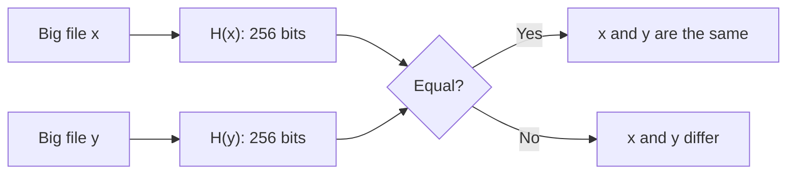

> [!example] Analogy
> Checking a download: the website publishes the SHA-256 of the file. You hash your downloaded copy. If the 64 characters match, your file is exactly the original, and you never had to compare gigabytes byte by byte.

**Why it matters.** A block can store the **hash of the previous block** instead of the whole previous block. Any change to old data changes its hash, so tampering shows up immediately. ([[L05 - Basic Cryptographic Primitives III]])

---

## 7. Live Demo: "Hello World" and the Avalanche Effect

The professor used the online hash calculator that accompanies the book **"Blockchain Basics: A Non-Technical Introduction in 25 Steps" by Daniel Drescher**.

**Steps of the demo:**
1. Type `Hello World` and click **Calculate hash value**.
2. The site shows MD5, SHA-1, SHA-256 and SHA-512 digests, which have **different lengths**.
3. The SHA-256 digest has **64 hex digits** (starting `a591…`), so it is $64 \times 4 = 256$ bits.
4. Change the input to `Hello World 1` (add a space and 1) and recalculate.
5. The new digest is **completely different**.

```text
Input            SHA-256 digest (64 hex digits = 256 bits)
---------------  ----------------------------------------------------------------
Hello World      a591a6d40bf420404a011733cfb7b190d62c65bf0bcda32b57b277d9ad9f146e
Hello World 1    1aed4d8555515c961bffea900d5e7f1c1e4abf0f6da250d8bf15843106e0533b
hello world      b94d27b9934d3e08a52e52d7da7dabfac484efe37a5380ee9088f7ace2efcde9
```
(Even changing only the capital letters gives an unrelated digest.)

**Three observations the lecture highlights:**
1. **Efficiently computable**: the hashes appear instantly on clicking.
2. **Lengths depend on the function**: MD5 is shorter than SHA-512.
3. **Avalanche effect** (transcribed as "balance effect"): a tiny change in input gives a totally different output. About half the output bits flip.

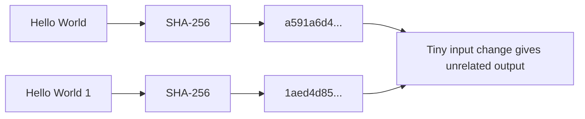

> [!tip] Why avalanche helps hiding
> If similar inputs gave similar hashes, you could "walk" toward the original message by small changes. Avalanche destroys any visible pattern, so knowing the hash of `Hello World` tells you nothing about which message gave `1aed4d85…`.

> [!example] Analogy
> One drop of a different colour in a huge vat of paint changes the colour of the whole vat completely, not just one corner.

---

## 8. Information Hiding Through Hashing (Commit and Verify)

**What it is.** Since finding $x$ from $H(x)$ is infeasible (and harder the longer the digest), a hash lets you **commit** to a value now and **check it later**, without revealing it at first.

**How it works:**
1. **Commit:** take value $x$, compute $H(x)$, and store or publish **only the hash**.
2. **Claim:** later someone says "the stored value was $y$."
3. **Verify:** compute $H(y)$ and compare with the stored $H(x)$.
4. If $H(y) = H(x)$, then $y$ **is** the original value. If not, the claim is false.
5. This works only if the stored hash itself was **not tampered with**.

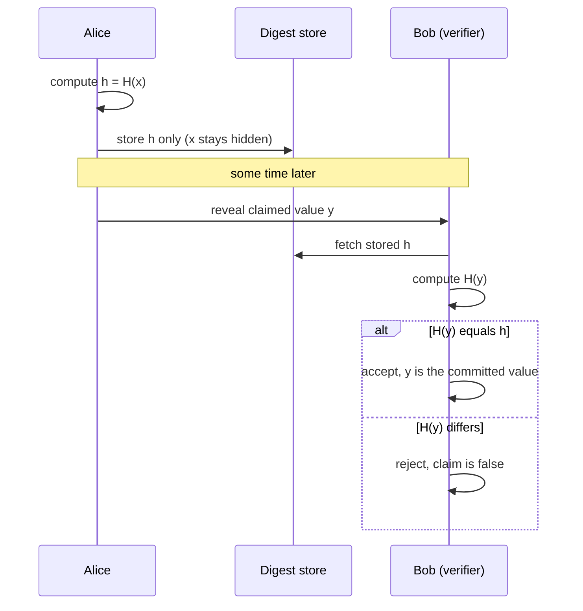

**Lecture's Alice example:**
1. Alice has message $m$ and her **public key** $K_A$ (public keys come in [[L06 - Basic Cryptographic Primitives IV]]).
2. She stores the hash $H(m \Vert K_A)$.
3. $m$, $K_A$ and the stored hash are passed to **Bob**.
4. Bob runs the same hash on $m$ and $K_A$ and checks it against the stored hash.
5. **Any other party** can repeat the exact same check (deterministic property).
6. Later, with signatures, we will see that Alice also **cannot deny** that she stored it.

> [!example] Analogy: sealed envelope
> You write your exam-result prediction, seal it in an envelope and hand it to a friend. Nobody can read it now (hiding), and you cannot swap it later (binding, which comes from collision resistance). At the end you open it and everyone checks.

> [!warning] Precision
> A secure commitment uses a **random secret nonce**: $\text{com} = H(\text{nonce} \Vert m)$. Without it, if $m$ comes from a small set, someone can just guess and hash every option. The two properties are:
> - **Hiding**: the commitment reveals nothing about $m$.
> - **Binding**: you cannot later open it to a different $m'$ (this follows from collision resistance).

**Why it matters.** Blockchains store hashes of data and transactions. Anyone can later prove that some data is exactly what was originally recorded.

---

## 9. Puzzle Friendliness and Mining

**What it is (lecture).** Let message $m$ come from a widely spread distribution. It is computationally difficult to find $K$ such that
$$z = H(m \Vert K)$$
where $m$ and $z$ are known beforehand. $K$ is the **solution to the puzzle**.

In real use, $z$ is **not a single value** but a **set** of acceptable values, defined by a property. For example, "the hash must be below a target", which means it starts with many zero bits.

**Key consequence:** puzzle friendliness implies that **random searching is the best strategy**. No algorithm does better than trying $K$ values one by one.

**The search puzzle (as used in Bitcoin proof of work):**
1. Take the fixed data $m$ (in Bitcoin, the block header: previous hash, Merkle root, time and so on).
2. Pick a candidate $K$ (the **nonce**).
3. Compute $H(m \Vert K)$.
4. If the result is in the target set $Y$ (for example, below the target), you have **solved** the puzzle. Broadcast the block.
5. Otherwise change $K$ and go back to step 3.
6. Expected tries ≈ $\dfrac{2^{n}}{|Y|}$. A smaller target set means a harder puzzle.

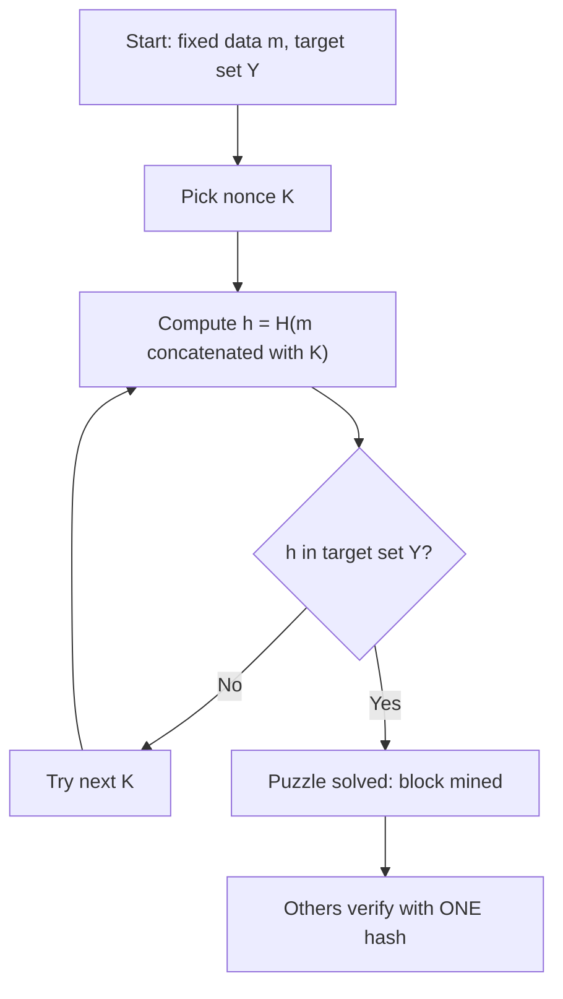

> [!example] Analogy: lottery tickets
> Mining is like scratching lottery tickets. There is no trick to know which ticket wins. You must scratch ticket after ticket. Whoever scratches fastest (most hashing power) wins most often. But checking a winning ticket takes one glance.

> [!tip] Asymmetry to remember
> **Hard to solve, easy to verify.** A miner needs billions of hashes, while anyone verifies the solution with **one** hash. This asymmetry is what makes proof of work useful.

> [!warning] Common confusion
> Puzzle friendliness is **not** "puzzles are easy." The word "friendly" means the hash is *suitable for building puzzles*: there is no shortcut, so the difficulty can be tuned precisely by the size of the target set.

**Why it matters.** This property is the heart of **mining** and **proof of work** in Bitcoin (and similar ideas in other blockchains). It is covered in depth in the Bitcoin lectures.

---

## 🔑 Key Points (short)

- A **cryptographic primitive** is a basic building block. The blockchain uses **hash functions** and **digital signatures** (Lectures 03–07).
- Hash function: **any-size input → fixed-size output** (the **message digest**), and it is **efficiently computable**.
- Blockchain usually uses **256-bit** digests (**SHA-256**, used by Bitcoin) = **64 hex digits**.
- **Deterministic**: same input → same output, with no randomness.
- **Collision resistant**: collisions *exist* (pigeonhole) but are **infeasible to find**.
- **Birthday paradox**: **23 people → ~50%**, **70 → ~99.9%**, **366/367 → 100%** (pigeonhole).
- Birthday attack cost: **$2^{n/2}$**. For 256 bits that is **$2^{128}$**, about **$10^{25}$ years** at 1 hash per µs.
- **One-way**: $x \to H(x)$ is easy, $H(x) \to x$ is infeasible. Cube/cube-root is only a rough analogy.
- **Avalanche effect**: a tiny input change gives a completely different hash.
- **Message digest use**: $H(x) = H(y) \Rightarrow x = y$, so compare small hashes instead of big files.
- **Hiding / commitment**: store $H(x)$ now, verify a later claim $y$ by checking $H(y) = H(x)$.
- **Puzzle friendly**: no shortcut to find $K$ with $H(m \Vert K) \in Y$. **Random search is the best strategy.**
- Puzzle friendliness powers **Bitcoin mining / proof of work**: hard to solve, easy to verify.
- Hashing ≠ encryption: there is **no key and no reversal**.
- Digital signatures give **authentication** and **non-repudiation** (the signer cannot deny).

---

## 📖 Glossary

| Term | Meaning (plain English) |
|---|---|
| Avalanche effect | A tiny change in input flips about half the output bits, so the hash looks totally different |
| Birthday attack | Finding a hash collision by hashing about $2^{n/2}$ random inputs |
| Birthday paradox | In a group of just 23 people, there is a 50% chance two share a birthday |
| Collision | Two different inputs that give the same hash |
| Collision resistance | It is infeasible to find any collision (even though collisions exist) |
| Commitment | Publishing $H(x)$ now to lock in $x$, and revealing $x$ later for checking |
| Concatenation ($\Vert$) | Joining two strings end to end |
| Cryptographic primitive | A basic, well-studied crypto tool used to build bigger systems |
| Deterministic | No randomness: the same input always gives the same output |
| Digital signature | Digital equivalent of a handwritten signature: proves who signed, and the signer cannot deny it |
| Hash function | A function from arbitrary-length input to fixed-length output |
| Hiding | The hash gives no useful information about the input |
| Message digest | The fixed-size output of a hash function, a "fingerprint" of the message |
| Min-entropy (high) | The value is so random that no guess is likely to be right |
| Mining | Searching for a nonce so the block hash meets a target (proof of work) |
| Non-repudiation | You cannot later deny something you signed |
| Nonce ($K$) | A number the miner keeps changing while searching for a valid hash |
| One-way function | Easy to compute forward, infeasible to reverse |
| Pigeonhole principle | More items than boxes means some box gets two items |
| Pre-image resistance | Given a hash $y$, it is infeasible to find any $x$ with $H(x)=y$ |
| Proof of work | Showing you spent computation by presenting a solved hash puzzle |
| Puzzle friendliness | There is no shortcut to make a hash land in a target set, so brute force is the only way |
| SHA-256 | Secure Hash Algorithm with a 256-bit output, used by Bitcoin |

---

## 🧮 Formulas & Numbers

| Formula / number | Meaning of symbols |
|---|---|
| $H : \{0,1\}^{*} \rightarrow \{0,1\}^{n}$ | Hash maps any-length bit string to an $n$-bit digest |
| $n = 256$ | Digest length in bits for SHA-256 (64 hex digits, 32 bytes) |
| 1 hex digit = 4 bits | So 256 bits = 64 hex digits |
| $x \neq y,\ H(x)=H(y)$ | A collision. Collision resistance means it is infeasible to find one |
| $P(\text{no match}) = \prod_{i=0}^{k-1} \frac{365-i}{365}$ | Birthday problem with $k$ people |
| $k=23 \Rightarrow P \approx 0.507$; $k=70 \Rightarrow P \approx 0.999$ | Birthday paradox values |
| 366 (or 367 in a leap year) | People needed for certainty (pigeonhole) |
| $2^{n/2}$ | Generic collision (birthday) attack cost for an $n$-bit hash |
| $2^{128} \approx 3.4 \times 10^{38}$ | Collision work for SHA-256 |
| ≈ $10^{25}$ years | Time for $2^{128}$ hashes at 1 hash per µs |
| $2^{n}$ | Generic pre-image attack cost |
| $z = H(m \Vert K)$, $z \in Y$ | Puzzle: given $m$ and target set $Y$, find nonce $K$ |
| Expected tries ≈ $2^{n}/\lvert Y \rvert$ | Puzzle difficulty. A smaller target set means harder |

---

## 🎯 Exam Corner

### Likely questions

**Q1. Define a cryptographic hash function.**
A function that maps an input of arbitrary size to a fixed-size output (the message digest, for example 256 bits). It is efficiently computable, deterministic, collision resistant, hiding/one-way and puzzle friendly.

**Q2. Why must a hash function be deterministic?**
So that anyone can recompute the hash of the same message at any time and get the same digest. Without this, verification and comparison would be impossible.

**Q3. Do collisions exist for SHA-256? Then what does "collision free" mean?**
Yes. Infinite inputs map to only $2^{256}$ outputs (pigeonhole). "Collision free / resistant" means it is **computationally infeasible to find** $x \neq y$ with $H(x)=H(y)$.

**Q4. Explain the birthday paradox and its effect on hash length.**
Only 23 people are needed for a 50% chance of a shared birthday, because the number of pairs grows like $n^2$. In the same way, an $n$-bit hash has collisions findable in about $2^{n/2}$ tries. So we need large digests: 256 bits gives $2^{128}$, which is about $10^{25}$ years at 1 µs per hash.

**Q5. What is a one-way function? Is cubing one?**
Easy to compute $H(x)$ from $x$, infeasible to get $x$ from $H(x)$. Cubing is only an analogy: cube roots are harder to compute but still computable, so cubing is not truly one-way.

**Q6. How are hashes used as message digests?**
Since $H(x)=H(y)$ implies $x=y$ (practically), we store or compare the small digest instead of the large document. This is efficient because digests have a fixed length.

**Q7. Explain information hiding / commitment with hashes.**
Store $H(x)$ now. Later a claimed value $y$ is checked by computing $H(y)$ and comparing. A match means $y$ was the committed value, and a mismatch exposes a false claim.

**Q8. What is puzzle friendliness and where is it used?**
Given $m$ and a target set, there is no faster way to find $K$ with $H(m \Vert K)$ in the target than random search. It is the basis of Bitcoin's mining puzzle (proof of work).

### MCQs

**1.** The output of a cryptographic hash function is called the:
A) Cipher text B) Message digest C) Data signature D) Key

> [!check]- Answer
> **B**. The fixed-size output is the message digest.

**2.** Which property ensures that the same input always gives the same hash?
A) Collision resistance B) Puzzle friendliness C) Determinism D) Hiding

> [!check]- Answer
> **C**. A deterministic function has no randomness.

**3.** A SHA-256 digest shown in hexadecimal has how many digits?
A) 32 B) 64 C) 128 D) 256

> [!check]- Answer
> **B**. 256 bits ÷ 4 bits per hex digit = 64.

**4.** "Collision resistance" means:
A) No two inputs ever have the same hash B) It is infeasible to find two different inputs with the same hash C) The hash cannot be computed twice D) Hashes are encrypted

> [!check]- Answer
> **B**. Collisions exist (pigeonhole) but cannot feasibly be found.

**5.** With how many people does the probability of a shared birthday first reach about 0.5?
A) 183 B) 70 C) 23 D) 366

> [!check]- Answer
> **C**. 23 people gives ≈ 50.7%. (70 gives ≈ 99.9%, and 366 gives certainty.)

**6.** For a 256-bit hash, roughly how many hash operations does a birthday attack need?
A) $2^{256}$ B) $2^{128}$ C) $2^{64}$ D) $256^2$

> [!check]- Answer
> **B**. Generic collision cost is $2^{n/2} = 2^{128}$.

**7.** The analogy used for one-way functions in the lecture is:
A) Square root B) Cube vs cube root C) Factorial D) Logarithm

> [!check]- Answer
> **B**. Cubing is easy and the cube root is harder (an analogy only, since cube roots are still computable).

**8.** Changing "Hello World" to "Hello World 1" gives a totally different SHA-256 hash. This illustrates:
A) Determinism B) Avalanche effect C) Pigeonhole principle D) Non-repudiation

> [!check]- Answer
> **B**. A small input change gives a completely different output.

**9.** Puzzle friendliness implies that the best way to find $K$ with $H(m \Vert K)$ in a target set is:
A) Reverse the hash B) Use a secret key C) Random / brute-force search D) Binary search

> [!check]- Answer
> **C**. No shortcut exists, so random search is optimal. This is the basis of mining.

**10.** Which is NOT used in this course as a primitive for blockchain?
A) Hash functions B) Digital signatures C) Hash pointers built from hashes D) Lossy compression

> [!check]- Answer
> **D**. The course builds blockchain from hashes (and structures made from them) plus digital signatures.

---

## 📝 Summary

Blockchain rests on a few cryptographic primitives, and this lecture introduces the first one: the cryptographic hash function, which maps input of any size to a fixed-size digest (256 bits for SHA-256) and is fast to compute. A good hash is deterministic, collision resistant, hiding/one-way, and puzzle friendly. Collisions must exist by the pigeonhole principle, but the birthday paradox shows the generic attack costs $2^{n/2}$, which is $2^{128}$ (about $10^{25}$ years) for SHA-256, so in practice they cannot be found. That is why a digest can stand in for a whole document: compare hashes instead of files, and commit to a value now and verify it later. The "Hello World" demo showed hashes are instant to compute and show the avalanche effect. Puzzle friendliness means random search is the only way to make a hash land in a target set, which is exactly Bitcoin's mining puzzle. Next, [[L04 - Basic Cryptographic Primitives II]] looks inside SHA-256 and common hashing patterns, leading to hash pointers and Merkle trees in [[L05 - Basic Cryptographic Primitives III]].
