# L04 · Basic Cryptographic Primitives – II

> [!summary] TL;DR: the whole lecture in 30 seconds
> Prof. Shamik Sural looks inside **SHA-256**, the hash function behind Bitcoin. Any message is first **padded** (append a `1`, then zeros, then a 64-bit length) so its length becomes a multiple of **512 bits**. It is then cut into 512-bit blocks, and each block is split into **16 words of 32 bits**. The blocks go through a **compression function** one after another, starting from a fixed initial value: $h_i = C(m_i, h_{i-1})$. This chaining is the **Merkle–Damgård** construction. The second half shows **five patterns** for hashing more than one piece of data: independent, repeated, combined, sequential and hierarchical. Hash chains and Merkle trees (next lecture) are built from these patterns.

---

## 🧭 Where this fits

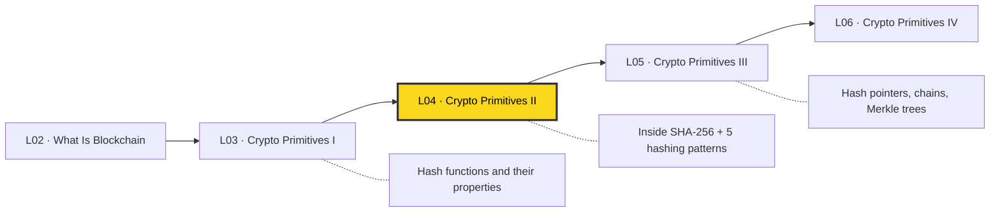

[[L03 - Basic Cryptographic Primitives I]] explained **what** a hash function is and which properties it needs (fixed-size output, pre-image resistance, collision resistance, avalanche effect). This lecture shows **how** SHA-256 produces that output and how to hash **several** items together. [[L05 - Basic Cryptographic Primitives III]] uses the patterns directly: sequential hashing gives **hash chains**, and hierarchical hashing gives **Merkle trees**.

Course map: [[00 - START HERE (Course Overview)]] · [[L01 - The Model of Decentralization]] · [[L02 - What Is Blockchain]] · [[L03 - Basic Cryptographic Primitives I]] · **L04** · [[L05 - Basic Cryptographic Primitives III]] · [[L06 - Basic Cryptographic Primitives IV]] · [[L07 - Basic Cryptographic Primitives V]] · [[L08 - Distributed Systems for Decentralization]]

---

## 🗺️ Structure at a glance

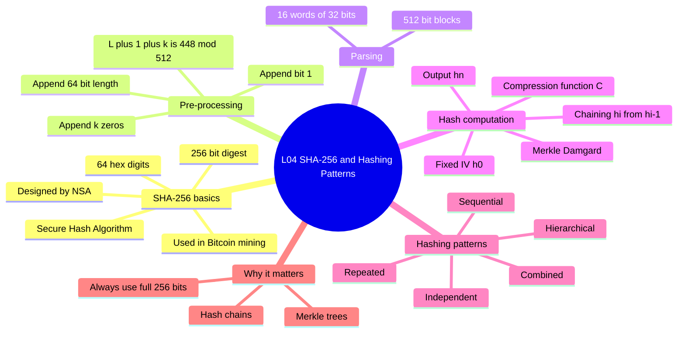

1. **SHA-256: what and why**: name, output size, who designed it, where Bitcoin uses it.
2. **Pre-processing (padding)**: how any message is stretched to a multiple of 512 bits, with worked examples.
3. **Parsing into blocks and words**: 512-bit blocks $m_1 \dots m_n$, each cut into 16 × 32-bit words.
4. **Hash computation (Merkle–Damgård chaining)**: $h_0$, the compression function, $h_i = C(m_i, h_{i-1})$.
5. **Recap of hash properties**: easy to compute forward, infeasible to reverse.
6. **Patterns of hashing data**: the five patterns, each with the lecture's "Hello" / "World!" example.
7. **Comparison of the patterns and where blockchain uses them.**
8. **The "8 hex digits" warning**: why slides shorten hashes, and why you never should.

---

## 1. SHA-256: what and why

**What it is**
- **SHA-256** = **S**ecure **H**ash **A**lgorithm with a **256-bit** output (the *message digest*).
- It takes input of almost any length (formally up to $2^{64}-1$ bits) and always returns exactly **256 bits**.
- 256 bits = 64 hexadecimal digits, because each hex digit encodes 4 bits ($256 / 4 = 64$).
- It belongs to the **SHA-2 family** (SHA-224, SHA-256, SHA-384, SHA-512, ...). The family was designed by the US **National Security Agency (NSA)** and published by **NIST** as a standard (FIPS 180-2, 2001; current version FIPS 180-4).

> [!example] Analogy: a meat grinder with a fixed-size mould
> Put in one grape or a whole watermelon. What comes out is always the same size of pressed patty (256 bits). You cannot rebuild the watermelon from the patty, and two different fruits will not give the same patty.

**Why it matters**
- Bitcoin uses SHA-256 for **mining** (proof-of-work), for **block hashes** and for **transaction IDs**. It also builds the **Merkle root** with it. Bitcoin actually applies it twice: SHA-256(SHA-256(x)), which is the *repeated hashing* pattern below.
- The blockchain's immutability (from [[L02 - What Is Blockchain]]) depends on hash properties. Change one bit of old data and its hash changes completely, so the tampering is easy to see.

| Item | Value |
|---|---|
| Full name | Secure Hash Algorithm, 256-bit |
| Family | SHA-2 |
| Designer / Standard | NSA / NIST (FIPS 180-4) |
| Output | 256 bits = 32 bytes = 64 hex digits |
| Block size | 512 bits |
| Word size | 32 bits |
| Words per block | 16 |
| Length field | 64 bits |
| Rounds per block | 64 |
| Max input | $2^{64}-1$ bits |

> [!tip] Memory trick: "256 / 512 / 32 / 16 / 64"
> **Out 256, block 512, word 32, 16 words per block, 64-bit length field (and 64 rounds).**
> Every number is a power of two except the 448 target, and 448 = 512 − 64.

---

## 2. Pre-processing (padding)

**What it is.** SHA-256 can only process input in **512-bit chunks**. A message of arbitrary length $L$ bits is therefore **padded** until its length is an exact multiple of 512. The padding also records the original length.

> [!example] Analogy: shipping containers
> A port only accepts goods in full 512-unit containers. You put a "**END**" marker (the `1` bit) after your goods. You fill the empty space with packing foam (the `0` bits). In the last 64 units you write a label saying how much real cargo there was (the length $L$).

### How it works (step by step)

Let $L$ = length of message $M$ in **bits**.

1. **Append a single `1` bit** to the end of the message.
2. **Append $k$ zero bits**, where $k$ is the **smallest non-negative** integer such that
   $$L + 1 + k \equiv 448 \pmod{512}$$
   That leaves exactly 64 bits of room in the last block.
3. **Append $L$ as a 64-bit big-endian binary number.**
4. The total length is now $L + 1 + k + 64 \equiv 448 + 64 = 512 \equiv 0 \pmod{512}$.

Closed form for $k$:
$$k = (448 - (L + 1)) \bmod 512 = (447 - L) \bmod 512$$

### Bit layout (ASCII)

```
 One padded message (total length = multiple of 512 bits)

 |<-------------- L bits -------------->|<1>|<---- k bits ---->|<---- 64 bits ---->|
 +--------------------------------------+---+------------------+-------------------+
 |        original message M            | 1 | 0 0 0 ... 0 0 0  |   L in binary     |
 +--------------------------------------+---+------------------+-------------------+
 |<------------- L + 1 + k  ≡ 448 (mod 512) ---------------->|<--- length field --->|
 |<----------------------- total ≡ 0 (mod 512) -------------------------------------->|
```

### Worked example 1: "abc" (fits in one block)

"abc" in ASCII = `01100001 01100010 01100011`, so $L = 24$ bits.

| Step | Computation | Result |
|---|---|---|
| Message | "abc" = 3 bytes | $L = 24$ |
| Append `1` | $24 + 1$ | 25 bits |
| Find $k$ | $25 + k \equiv 448 \pmod{512}$, so $k = 448 - 25$ | $k = 423$ |
| After zeros | $25 + 423$ | 448 bits |
| Append length | 64-bit binary of 24 = `000…00011000` (hex `00…0018`) | +64 bits |
| Total | $24 + 1 + 423 + 64$ | **512 bits = 1 block** |

```
 Block m1 (512 bits) for "abc":
 +--------------------------+---+---------------------+--------------------------+
 | 01100001 01100010 01100011| 1 |  423 zero bits      | 0x0000000000000018 (=24) |
 +--------------------------+---+---------------------+--------------------------+
   24 bits                   1 bit  423 bits              64 bits
```

### Worked example 2: $L = 448$ (padding spills into a new block)

- $L + 1 = 449$, which is already past 448.
- Smallest $k \ge 0$ with $449 + k \equiv 448 \pmod{512}$: $449 + k = 960$, so $k = 511$.
- Total $= 448 + 1 + 511 + 64 = 1024$ bits, i.e. **2 blocks**.

### Worked example 3: $L = 512$ (already a multiple of 512)

- $k = (447 - 512) \bmod 512 = (-65) \bmod 512 = 447$.
- Total $= 512 + 1 + 447 + 64 = 1024$ bits, i.e. **2 blocks**.

> [!warning] Common mistake: "no padding if $L$ is already a multiple of 512"
> The lecture describes padding as the fix for when $L \bmod 512 \neq 0$. In the **actual SHA-256 standard, padding is ALWAYS applied**, even when $L$ is already a multiple of 512 (example 3). Otherwise "message" and "message + padding-looking bits" could collide. The `1` bit and the length field must always be present.

> [!warning] Other traps
> - $k$ is counted in **bits**, not bytes.
> - The target is **448**, not 512. The last 64 bits are reserved for the length.
> - The 64-bit field stores the **original** length $L$, not the padded length.
> - If $L \bmod 512 > 447$, the padding needs an **extra block**.

**Why it matters.** Padding makes every input fit the 512-bit machinery. Encoding the length (called *MD-strengthening*) is part of what makes the Merkle–Damgård chain collision-resistant.

---

## 3. Parsing into blocks and words

**What it is.** The padded message is cut into $n$ blocks of 512 bits: $m_1, m_2, \dots, m_n$. Each block $m_i$ is cut into **16 words of 32 bits**: $m_{i,0}, m_{i,1}, \dots, m_{i,15}$ (the lecture writes them as $m_i^0 \dots m_i^{15}$).

**How it works**
1. Number of blocks: $n = \dfrac{\text{padded length}}{512}$.
   - Padded length 1024 gives 2 blocks: $m_1, m_2$.
   - Padded length 2048 gives 4 blocks: $m_1, m_2, m_3, m_4$.
2. Words per block: $512 / 32 = 16$.

```
 Padded message:   | m1 (512) | m2 (512) | ... | mn (512) |

 One block mi:
 +--------+--------+--------+-- ... --+--------+
 | mi,0   | mi,1   | mi,2   |         | mi,15  |   16 words
 +--------+--------+--------+-- ... --+--------+
   32 bit   32 bit   32 bit             32 bit     16 × 32 = 512
```


> [!tip]
> Inside the compression function, SHA-256 expands the 16 words into a **64-word message schedule** $W_0 \dots W_{63}$, one word per round. The lecture does not go into this; just know that 16 words go in and 64 rounds run.

---

## 4. Hash computation: Merkle–Damgård chaining

**What it is.** The blocks are processed **one at a time, in order**. Each step mixes the current block with the result of the previous step. The very first step uses a fixed constant $h_0$, called the **initial hash value** or **initialization vector (IV)**. This "chain of compressions" design is the **Merkle–Damgård construction**.

$$h_0 = \text{IV (fixed)}, \qquad h_i = C(m_i,\, h_{i-1}) \quad \text{for } i = 1, \dots, n, \qquad \text{SHA-256}(M) = h_n$$

- $C$ = the **SHA-256 compression function**. It takes a 512-bit block and a 256-bit chaining value and returns a new 256-bit chaining value.
- On the slide, "**+**" means **addition modulo $2^{32}$**, applied word by word (the transcript's "modular 2-restricted path 32 addition" is a mis-transcription of this). In full detail, SHA-256 adds the old chaining value back after the rounds: $h_i = h_{i-1} + C_{m_i}(h_{i-1})$, computed per 32-bit word mod $2^{32}$. This "feed-forward" step is why the slide shows a "+".
- $h_0$ is **not random**. It is eight fixed 32-bit words: the first 32 bits of the fractional parts of the square roots of the first 8 primes (2, 3, 5, 7, 11, 13, 17, 19). For example, the first word is `6a09e667`.

> [!example] Analogy: a relay race with a baton
> Every runner (block $m_i$) takes the baton ($h_{i-1}$) from the runner before, runs their leg (compression $C$), and hands over a new baton ($h_i$). The first runner gets a standard baton from the organiser ($h_0$). The baton at the finish line ($h_n$) is the hash. If any runner earlier in the race changes, every later baton changes too.

### How it works (step by step)

1. Pad and parse $M$ into $m_1, \dots, m_n$ (sections 2–3).
2. Set the chaining value to the fixed IV $h_0$.
3. Compute $h_1 = C(m_1, h_0)$.
4. Compute $h_2 = C(m_2, h_1)$, then $h_3 = C(m_3, h_2)$, and so on.
5. After the last block, $h_n = C(m_n, h_{n-1})$ is the **256-bit digest** of $M$.

For a 1024-bit padded message ($n = 2$): $h_1 = C(m_1, h_0)$, $h_2 = C(m_2, h_1)$, and $\text{SHA-256}(M) = h_2$.

### Diagram: the Merkle–Damgård chain

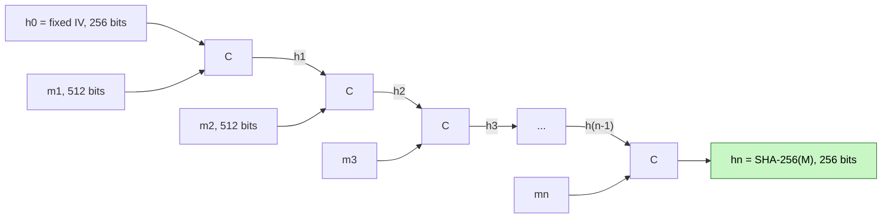

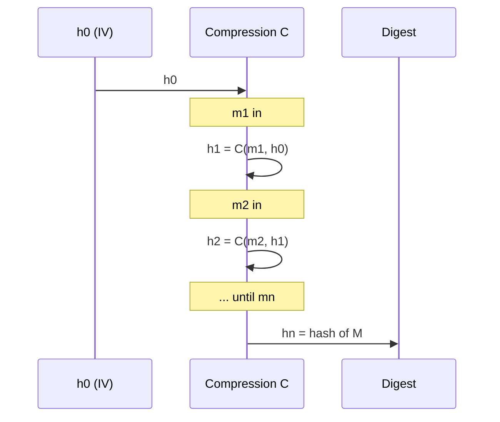

**Why it matters**
- One compression function that works on a fixed size can now hash **messages of any length**.
- Every block affects every later chaining value, so changing **any** bit anywhere changes $h_n$.
- If $C$ is collision-resistant, the whole hash is collision-resistant, thanks to the length padding. This is the Merkle–Damgård theorem.
- The same "carry the previous result forward" idea comes back at a larger scale in a **blockchain**: each block stores the hash of the previous block ([[L05 - Basic Cryptographic Primitives III]]).

> [!warning]
> SHA-256 is **sequential** across blocks. You cannot compute $h_3$ before $h_2$. This makes hashing a long message one linear pass, not a parallel job.

---

## 5. Recap: properties that make SHA-256 useful

The lecture briefly recaps [[L03 - Basic Cryptographic Primitives I]].

| Property | Meaning | Blockchain use |
|---|---|---|
| Deterministic | Same input always gives the same output | Everyone can verify the same hash |
| Fast to compute | Message to digest is quick | Nodes verify blocks cheaply |
| Pre-image resistant (one-way) | Digest to message is infeasible ("would take years and years") | Hides data; puzzle-friendly for mining |
| Second pre-image resistant | Given $x$, it is hard to find $x' \neq x$ with $H(x') = H(x)$ | You cannot swap a transaction for a forged one |
| Collision resistant | It is hard to find any $x \neq y$ with $H(x) = H(y)$ | Hash works as a unique fingerprint |
| Avalanche effect | 1-bit change gives about half the output bits flipped | Tampering is obvious |


---

## 6. Patterns of hashing data

**What it is.** When there is **more than one piece of data**, there are several ways to combine them before or after hashing. The lecture covers **five patterns**, using the textbook example (Daniel Drescher, *Blockchain Basics*) with two inputs: **"Hello"** and **"World!"**. Different patterns give **completely different** final hashes. A blockchain uses each pattern for a specific job.

> [!note] About the numbers below
> Slides show only the **first 8 hex digits** for brevity. The textbook's web tool hashes the **text** of a previous hash (uppercase hex characters) when you paste it in. The values below were recomputed with real SHA-256 to match the lecture.
>
> - $H(\text{"Hello"})$ = `185F8DB3…` (full: `185f8db32271fe25f561a6fc938b2e264306ec304eda518007d1764826381969`)
> - $H(\text{"World!"})$ = `514B6BB7…` (full: `514b6bb7c846ecfb8d2d29ef0b5c79b63e6ae838f123da936fe827fda654276c`)

### 6.1 Independent hashing

**What it is.** Each piece of data is hashed **separately**. You get one hash per item and they are not linked.

$$h_A = H(A), \quad h_B = H(B)$$

**Example.** $H(\text{"Hello"}) = $ `185F8DB3…` and $H(\text{"World!"}) = $ `514B6BB7…`. Two separate fingerprints.

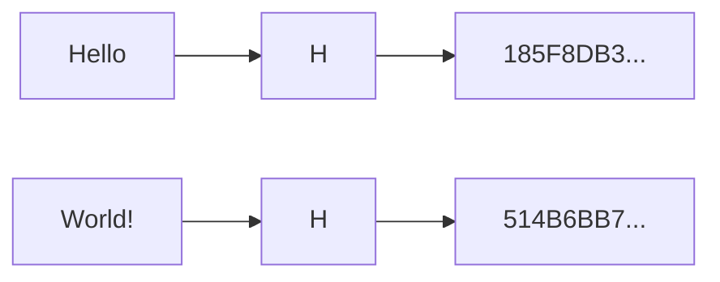

> [!example] Analogy
> Two people each get their own fingerprint taken. Nothing ties the two prints together.

**Use.** Fingerprinting individual transactions (transaction IDs). It is also the **first level** of a Merkle tree.

### 6.2 Repeated hashing

**What it is.** Hash the data, then **hash the hash** (possibly several times).

$$h = H(H(x))$$

**Example from the lecture**
1. $H(\text{"Hello World!"})$ = `7F83B165…` (full: `7f83b1657ff1fc53b92dc18148a1d65dfc2d4b1fa3d677284addd200126d9069`).
2. Hash that output again.
   - Hashing the **full** 64-hex-digit output gives `E6C02075…`.
   - Hashing only the **8 shown digits** `7F83B165` gives `45A47BE7…`. This is the value printed on the slide.
3. The professor showed that the two results differ. The slide value is only reproduced if you feed in the truncated 8 digits.

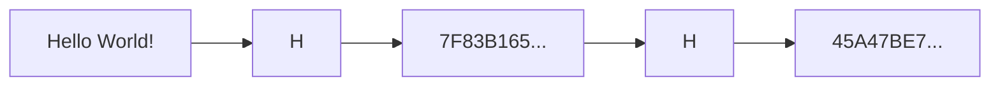

> [!example] Analogy
> Photocopying a photocopy. Each copy depends entirely on the previous copy.

**Use.** Bitcoin's **double SHA-256**, $\text{SHA-256}(\text{SHA-256}(x))$, for block hashes and TXIDs. Repeated hashing is also used for key stretching (making password guessing slower).

### 6.3 Combined hashing

**What it is.** **Concatenate** all the pieces first, then hash **once**.

$$h = H(A \,\|\, B)$$

**Example**
- $H(\text{"Hello"} \,\|\, \text{"World!"}) = H(\text{"HelloWorld!"})$ = `729E344A…`
- The lecture refers back to $H(\text{"Hello World!"})$ = `7F83B165…`, which has a **space** in it. One extra space gives a completely different hash (avalanche effect).

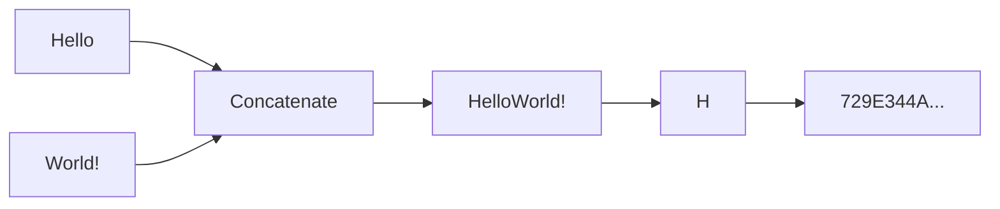

> [!example] Analogy
> Staple two pages together and take one fingerprint of the bundle.

**Use.** Hashing several fields together, e.g. a block header (version, previous hash, Merkle root, time, bits, nonce) is concatenated and hashed as one unit.

> [!warning]
> To check the hash you need **all** pieces, in the **exact** order and format. You cannot verify one piece on its own.

### 6.4 Sequential hashing

**What it is.** Hash the first piece. **Concatenate its hash with the next piece** and hash again. Repeat. It is a running hash that grows step by step.

$$h_1 = H(A), \quad h_2 = H(B \,\|\, h_1), \quad h_3 = H(C \,\|\, h_2), \dots$$

**Example from the lecture**
1. $H(\text{"Hello"})$ = `185F8DB3…`
2. Write "World!" followed by that hash, giving `World!185F8DB3`.
3. $H(\text{"World!185F8DB3"})$ = `5947C20F…`
4. In the live demo, the professor accidentally typed a space (`World! 185F8DB3`) and got `5795A986…`. He correctly blamed the extra space. Formatting matters.

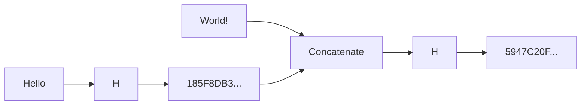

> [!example] Analogy
> A diary in which every new page starts by copying a summary seal of the previous page. To fake page 3 you would also have to redo the seals on pages 4, 5, 6, ...

**Use.** This is the core of a **blockchain / hash chain**: each new block includes the hash of the previous block, so altering old data breaks every later link. It has the same shape as Merkle–Damgård inside SHA-256 (section 4).

### 6.5 Hierarchical hashing

**What it is.** Hash each piece **independently**, then **concatenate the hashes** and hash that. With more data this repeats level by level, which forms a **tree**.

$$h = H\big(H(A) \,\|\, H(B)\big)$$

**Example from the lecture**
1. $H(\text{"Hello"})$ = `185F8DB3…`
2. $H(\text{"World!"})$ = `514B6BB7…`
3. Concatenate the two hashes and hash the result.
   - Using only the 8 shown digits, `185F8DB3514B6BB7`, gives `8BA15B1B…`.
   - Using the **full** 256-bit hashes (64 + 64 hex characters, i.e. the "512-bit" concatenated string from the demo) gives `A9CF82B6…`. This is the correct hierarchical hash.
4. Order matters. $H(H(B) \,\|\, H(A))$ gives a different result.

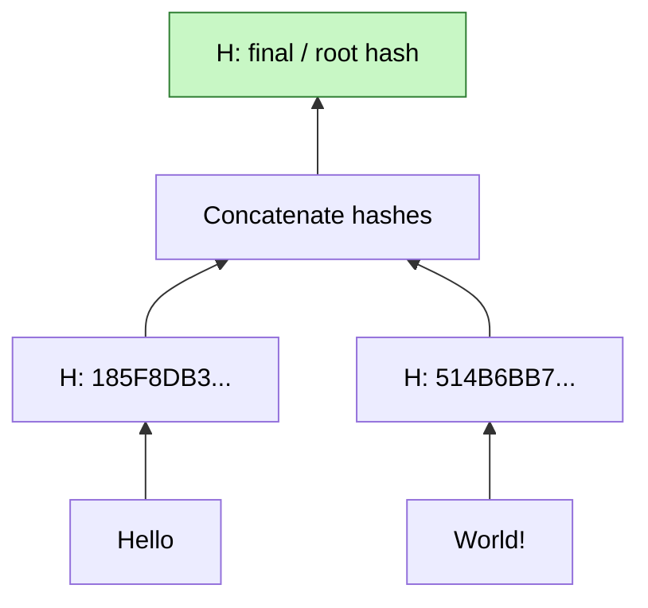

With four items it becomes a tree, which is exactly a **Merkle tree** (next lecture):

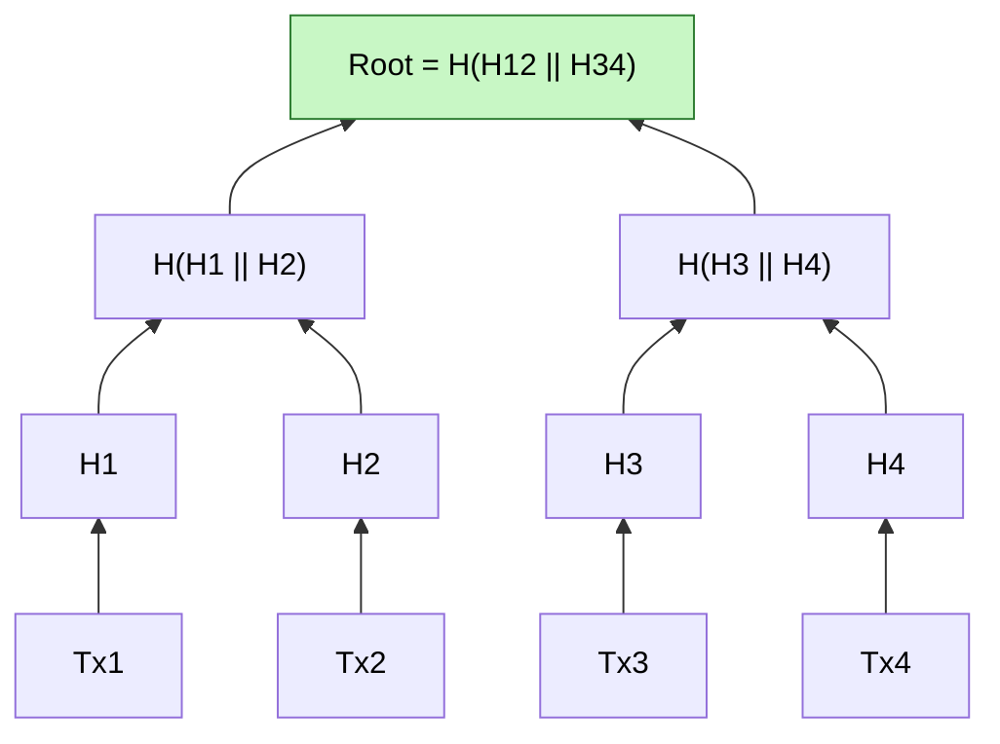

> [!example] Analogy
> A tournament bracket. Players (data) win matches in pairs (hashes of pairs) until one champion (root hash) remains. Change one player and the champion changes.

**Use.** **Merkle trees** in Bitcoin blocks. One root hash in the block header commits to every transaction. A light client can prove a transaction is included using only about $\log_2 n$ hashes.

---

## 7. Comparing the five patterns

| Pattern | Formula (2 items) | Number of outputs | Hash calls | Lecture example (first 8 hex) | Typical blockchain use |
|---|---|---|---|---|---|
| Independent | $H(A)$, $H(B)$ | 2 (unlinked) | 2 | `185F8DB3`, `514B6BB7` | Transaction IDs, leaf hashes |
| Repeated | $H(H(x))$ | 1 | 2 | `7F83B165` then `45A47BE7` | Bitcoin double SHA-256 |
| Combined | $H(A \,\|\, B)$ | 1 | 1 | `729E344A` ("HelloWorld!") | Hashing a block header |
| Sequential | $H(B \,\|\, H(A))$ | 1 | 2 | `185F8DB3` then `5947C20F` | Hash chain / blockchain links |
| Hierarchical | $H(H(A) \,\|\, H(B))$ | 1 (root) | 3 | `185F8DB3`, `514B6BB7`, then root | Merkle tree / Merkle root |

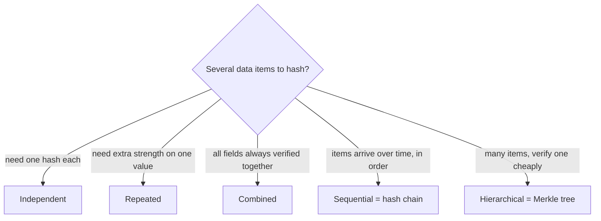

> [!tip] Memory trick: "I Rarely Cook Sunday Hotpot"
> **I**ndependent → **R**epeated → **C**ombined → **S**equential → **H**ierarchical (lecture order).
> - Sequential = **chain** (a line).
> - Hierarchical = **tree** (a pyramid).

> [!note] Beyond two items
> With three or more items you can **mix and match**. For example, combine some items, hash others in sequence, and build a tree over the rest. The lecture invites you to try such combinations yourself.

---

## 8. The "first 8 hex digits" warning

The professor stressed this point several times:

> [!warning] Hashes are NEVER 8 hex digits
> Slides and textbooks print only the **first 8 hex digits** (32 bits) so they fit on the page. Every real SHA-256 output is **64 hex digits (256 bits)**. When you chain hashes (repeated, sequential, hierarchical), you must feed in the **full** 256-bit value. Otherwise you get a different and wrong answer, as the live demo showed (`45A47BE7` from the truncated input vs `E6C02075` from the full one).

Other practical lessons from the demo:
- **Spaces and case matter.** "Hello World!" ≠ "HelloWorld!" ≠ "hello world!".
- **Order matters.** $H(A \| B) \ne H(B \| A)$.
- **Text vs bytes.** The web tool hashes the *hex text* of a previous hash. Real systems such as Bitcoin hash the raw 32 *bytes*. Both are valid, but you must use the same convention everywhere.

---

## 🔑 Key Points (short)

- SHA-256 = Secure Hash Algorithm with a 256-bit digest (64 hex digits, 32 bytes). It is in the SHA-2 family, designed by the NSA and standardised by NIST.
- Bitcoin uses SHA-256 for mining, block hashes, TXIDs and Merkle roots (as double SHA-256).
- Padding: append `1`, then $k$ zeros with $L + 1 + k \equiv 448 \pmod{512}$, then $L$ as a 64-bit number.
- $k = (447 - L) \bmod 512$, the smallest non-negative solution.
- In the real standard, padding is always applied, even if $L$ is already a multiple of 512.
- The padded message is split into $n$ blocks of 512 bits. Each block has 16 words of 32 bits.
- Merkle–Damgård: $h_0$ = fixed IV, $h_i = C(m_i, h_{i-1})$, and the digest is $h_n$.
- "+" in SHA-256 means word-wise addition mod $2^{32}$.
- $h_0$ is a fixed standard constant, not random.
- Forward hashing is fast. Reversing it is computationally infeasible.
- Five patterns: independent, repeated, combined, sequential, hierarchical.
- Sequential hashing gives hash chains (blockchain). Hierarchical hashing gives Merkle trees.
- Order, spaces and truncation all change the final hash.
- Always use full 256-bit hashes. The 8-digit versions are only for display.

---

## 📖 Glossary

| Term | Meaning (plain English) |
|---|---|
| Hash function | Turns any input into a fixed-size "fingerprint" |
| Message digest | The output of a hash function (256 bits for SHA-256) |
| SHA | Secure Hash Algorithm, a family of standard hash functions |
| SHA-2 | Family containing SHA-224/256/384/512 |
| NSA / NIST | US agency that designed SHA-2 / US body that publishes the standard |
| Pre-processing / padding | Adding `1`, zeros and the length so the message fits 512-bit blocks |
| Length field | Last 64 bits of padding, holding the original length $L$ |
| Block | A 512-bit chunk of the padded message ($m_i$) |
| Word / sub-block | A 32-bit piece of a block; 16 per block ($m_{i,0}..m_{i,15}$) |
| Initial hash value / IV ($h_0$) | Fixed starting value of the chain |
| Compression function ($C$) | Mixes one block with the current chaining value to give a new 256-bit value |
| Chaining value ($h_i$) | Intermediate result after processing block $i$ |
| Merkle–Damgård construction | Building a hash for any length by chaining a fixed-size compression function |
| Addition mod $2^{32}$ | Add two 32-bit numbers and drop any carry beyond 32 bits |
| Concatenation ($\|$) | Joining two strings end to end |
| Independent hashing | Hash each item separately |
| Repeated hashing | Hash of a hash |
| Combined hashing | Join items, then hash once |
| Sequential hashing | Hash, attach the next item, hash again (chain) |
| Hierarchical hashing | Hash items, then hash the hashes (tree) |
| Merkle tree | Tree of hierarchical hashes; root commits to all leaves |
| Double SHA-256 | Bitcoin's SHA-256(SHA-256(x)) |
| Avalanche effect | Tiny input change gives a totally different hash |

---

## 🧮 Formulas & Numbers

| Formula / Number | Meaning of symbols |
|---|---|
| Output = 256 bits = 64 hex = 32 bytes | 1 hex digit = 4 bits; 1 byte = 8 bits |
| $L + 1 + k \equiv 448 \pmod{512}$ | $L$ = message length in bits; 1 = the appended `1` bit; $k$ = number of zero bits |
| $k = (447 - L) \bmod 512$ | Smallest non-negative $k$ satisfying the above |
| Padded length $= L + 1 + k + 64$ | Always a multiple of 512 |
| $448 = 512 - 64$ | Space left for the 64-bit length field |
| $n = \text{padded length} / 512$ | Number of blocks |
| 16 words × 32 bits = 512 bits | Words per block |
| $h_0 = \text{IV}$ | Fixed initial hash (8 × 32-bit words, `6a09e667 …`) |
| $h_i = C(m_i, h_{i-1})$ | $C$ = compression function; $m_i$ = $i$-th block; $h_{i-1}$ = previous chaining value |
| $h_i = h_{i-1} + C_{m_i}(h_{i-1})$ | Full form with feed-forward; "+" = word-wise mod $2^{32}$ addition |
| $\text{SHA-256}(M) = h_n$ | Final chaining value is the digest |
| Max input $< 2^{64}$ bits | Limited by the 64-bit length field |
| 64 rounds per block | Rounds inside $C$ |
| "abc": $L=24 \Rightarrow k=423$, total 512 | Worked padding example |
| $L=448 \Rightarrow k=511$, total 1024 | Padding spills into a second block |

---

## 🎯 Exam Corner

### Likely questions

**Q1. What does SHA-256 stand for, and what is its output size?**
Secure Hash Algorithm, 256-bit. The output is always 256 bits (64 hex digits), whatever the input length.

**Q2. Describe SHA-256 pre-processing.**
Append a `1` bit. Append $k$ zero bits, where $k$ is the smallest non-negative integer with $L + 1 + k \equiv 448 \pmod{512}$. Append $L$ as a 64-bit binary number. The total is now a multiple of 512.

**Q3. A message is 24 bits long. How many zero bits are added, and what is the padded length?**
$k = 448 - 25 = 423$. Padded length $= 24 + 1 + 423 + 64 = 512$ bits (one block).

**Q4. How is a 512-bit block divided, and why?**
Into 16 words of 32 bits ($m_{i,0} \dots m_{i,15}$). The compression function works on 32-bit words.

**Q5. Explain $h_i = C(m_i, h_{i-1})$.**
Blocks are processed in order. Each compression step combines block $m_i$ with the previous chaining value $h_{i-1}$, starting from the fixed IV $h_0$. The final $h_n$ is the hash of the whole message. This is the Merkle–Damgård construction.

**Q6. Is $h_0$ random?**
No. It is a fixed constant defined in the standard (from square roots of the first 8 primes), so everyone gets the same hash.

**Q7. Difference between combined and hierarchical hashing?**
Combined: $H(A \| B)$, joining the raw data and hashing once. Hierarchical: $H(H(A) \| H(B))$, hashing each item first and then hashing the joined hashes. Hierarchical hashing leads to Merkle trees.

**Q8. Which hashing pattern builds a blockchain, and which builds a Merkle tree?**
Sequential hashing (each block includes the previous hash) builds the chain. Hierarchical hashing builds the Merkle tree.

### MCQs

**1.** How many bits does SHA-256 output?
A) 128 B) 192 C) 256 D) 512
> [!check]- Answer
> **C.** 256 bits, shown as 64 hex digits.

**2.** Who designed the SHA-2 family (including SHA-256)?
A) NIST B) NSA C) ENISA D) ISO
> [!check]- Answer
> **B.** The NSA designed it; NIST published it as a standard.

**3.** What is the first padding step?
A) Append a 0 B) Append a 1 C) Split into blocks D) Append the length
> [!check]- Answer
> **B.** A single `1` bit is appended first, then the zeros, then the length.

**4.** $k$ zeros are chosen so that $L + 1 + k \equiv$ ? (mod 512)
A) 0 B) 64 C) 448 D) 512
> [!check]- Answer
> **C.** 448. This leaves 64 bits for the length field.

**5.** What do the final 64 bits of the padded message contain?
A) The hash value B) The original length $L$ in binary C) A checksum D) Random bits
> [!check]- Answer
> **B.** The original message length in bits.

**6.** How many 32-bit words make up one 512-bit block?
A) 8 B) 16 C) 32 D) 64
> [!check]- Answer
> **B.** $512 / 32 = 16$.

**7.** What is the role of $h_0$?
A) Final output B) Fixed starting value for the chain C) The input message D) Not used
> [!check]- Answer
> **B.** It is the fixed initial hash value (IV).

**8.** In SHA-256, "+" denotes:
A) XOR B) Concatenation C) Addition modulo $2^{32}$ D) Ordinary integer addition
> [!check]- Answer
> **C.** Word-wise addition mod $2^{32}$ (the transcript's "modular 2-restricted path 32 addition").

**9.** Hashing "Hello" and "World!" separately, then hashing the concatenation of the two hashes, is:
A) Combined B) Sequential C) Repeated D) Hierarchical
> [!check]- Answer
> **D.** Hierarchical. It is the basis of the Merkle tree.

**10.** Computing $H(H(x))$ is:
A) Independent B) Repeated C) Combined D) Sequential
> [!check]- Answer
> **B.** Repeated hashing, the "hash of a hash". Bitcoin uses double SHA-256.

---

## 📝 Summary

This lecture opened up SHA-256, the 256-bit Secure Hash Algorithm designed by the NSA and used throughout Bitcoin. Any message is first padded with a `1` bit, then $k$ zeros so that $L + 1 + k \equiv 448 \pmod{512}$, then a 64-bit length field. This makes the total a multiple of 512. The padded message is split into 512-bit blocks of 16 × 32-bit words. The blocks are processed in sequence from a fixed IV with $h_i = C(m_i, h_{i-1})$ (Merkle–Damgård), and the last value $h_n$ is the digest. The lecture then showed five ways to hash several items: independent, repeated, combined, sequential and hierarchical. Each one gives a different result, and order, spaces and truncation all matter. Real hashes are always the full 256 bits; the 8-digit versions on slides are only for display. Next, [[L05 - Basic Cryptographic Primitives III]] turns sequential hashing into hash pointers and hash chains, and hierarchical hashing into Merkle trees, the backbone of a block's structure.
