# L05 · Basic Cryptographic Primitives – III

> [!summary] TL;DR: the whole lecture in 30 seconds
> A normal pointer tells you **where** data is. A **hash pointer** also tells you **what the data was**, because it stores the hash of that data. So any change to the data is caught. When blocks are linked with hash pointers you get a **hash chain**: change one block and every later link breaks. A **nonce** forces each hash to meet a rule (for example "starts with k zeros"), so redoing the hashes takes real computing work. **Merkle trees** pack all of a block's transactions into one **Merkle root**. That root, the previous block's hash and the nonce sit in the **block header**. Put these together and you have a blockchain.

## 🧭 Where this fits

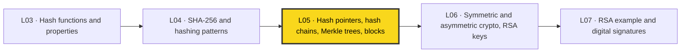

[[L03 - Basic Cryptographic Primitives I]] gave us the properties of hash functions (one-way, collision resistant, puzzle friendly). [[L04 - Basic Cryptographic Primitives II]] showed SHA-256 and patterns such as hierarchical hashing. This lecture uses those tools to **build the chain of blocks**. Next, [[L06 - Basic Cryptographic Primitives IV]] moves on from hashing to encryption and public/private keys, which digital signatures in [[L07 - Basic Cryptographic Primitives V]] need. Course overview: [[00 - START HERE (Course Overview)]].

## 🗺️ Structure at a glance

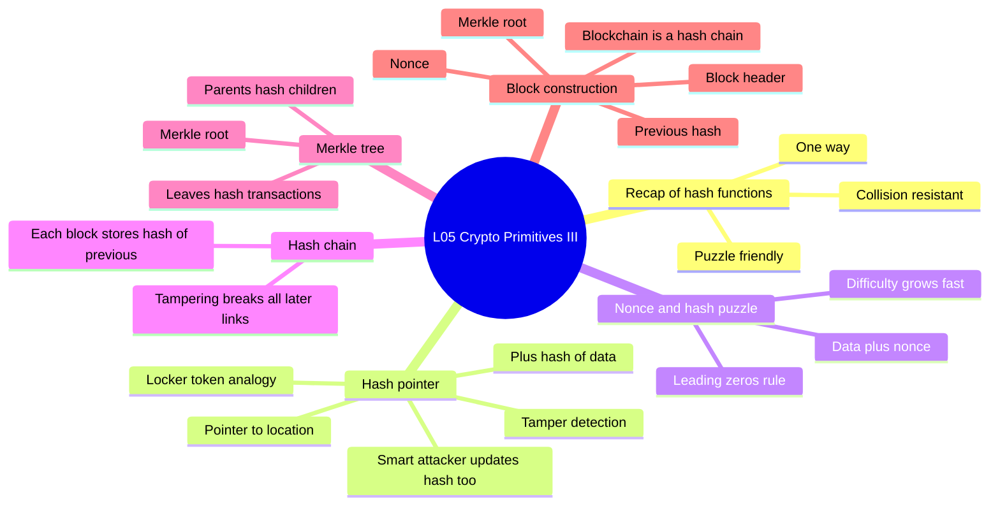

1. **Recap: cryptographic hash functions**: the three properties this lecture relies on.
2. **Hash pointers**: a pointer plus a hash, used to retrieve data and check it.
3. **Tamper detection and the smart attacker**: "Hello World!" changed to "Hello World?".
4. **Nonce and the hash puzzle**: leading-zero rules make hashes expensive to compute (live demo).
5. **Hash chains**: linking blocks so one change breaks the whole tail.
6. **Merkle trees**: a binary tree of hashes over transactions, ending in one Merkle root.
7. **Block construction**: the block header, and why a blockchain is a hash chain.

---

## 1. Recap: Cryptographic Hash Functions

**What it is**: a hash function $h$ takes a message $m$ of **any length** and returns a **fixed-size** digest $d$:

$$d = h(m)$$

"Hash function" in this course always means a **cryptographic** hash function (for example SHA-256 from L04).

**The properties used today**

| Property | What it means | Why today's lecture needs it |
|---|---|---|
| **One-way (pre-image resistance)** | Given $d$, you cannot find $m$ | You check data by **re-hashing** it, never by "un-hashing" the digest |
| **Collision resistance** | It is infeasible to find $m_1 \neq m_2$ with $h(m_1)=h(m_2)$ | Same digest means (in practice) the same data, so a changed message gives a changed digest |
| **Puzzle friendliness** | Given part of the input, the only way to hit an output target is brute-force search | It is the basis of the nonce / leading-zeros puzzle |

**How the lecture uses collision resistance**
1. Let $d_1 = h(m_1)$ and $d_2 = h(m_2)$.
2. If $d_1 = d_2$ → treat $m_1$ and $m_2$ as **the same** message.
3. If $d_1 \neq d_2$ → $m_1$ and $m_2$ are **definitely different**.

> [!warning] Precise version
> Point 3 is always true: the same input always gives the same output. Point 2 is true **in practice only**. Collisions must exist (there are infinitely many inputs and only $2^{256}$ outputs), but no one can *find* one. So "equal digests means equal data" is a safe assumption, not a mathematical guarantee.

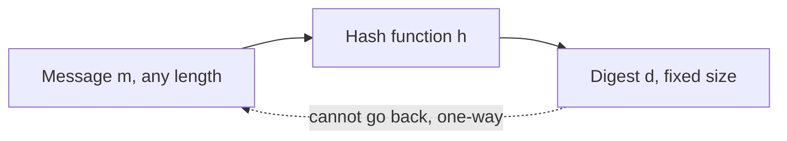

---

## 2. Hash Pointers

**What it is**: a **hash pointer** (also called a **cryptographic hash pointer** or **hash reference**) is:
1. a **pointer** to the place where some information is stored, **plus**
2. the **hash of that information**, saved at the moment the pointer was made.

A normal pointer answers "where is it?". A hash pointer answers "where is it, **and what should it look like**?"

> [!example] Analogy: the library / department-store locker token
> You leave your bag at the counter and get **token no. 5**. Locker 5 is the pointer. If someone swaps your backpack for a handbag, a token that only says "5" cannot prove anything. Now suppose the token says **"5, red backpack"**. You can spot a swap right away. Every extra detail you add (colour, brand…) makes a fake harder to pass off. The description on the token is the **hash** stored in the hash pointer.

**Two uses of a hash pointer**
1. **Retrieve** the information: follow the pointer, as with any pointer.
2. **Verify** that it has not been changed: **recompute the digest** of what you got back and compare it with the stored digest.

**How verification works (step by step)**
1. At store time, put message $m$ at some location and compute $d = h(m)$.
2. Build the hash pointer: (address of $m$, $d$).
3. Later, follow the address and fetch the stored value $m'$.
4. Compute $h(m')$.
5. Compare: if $h(m') = d$, the data is **untampered**. If $h(m') \neq d$, it has been **tampered with**.

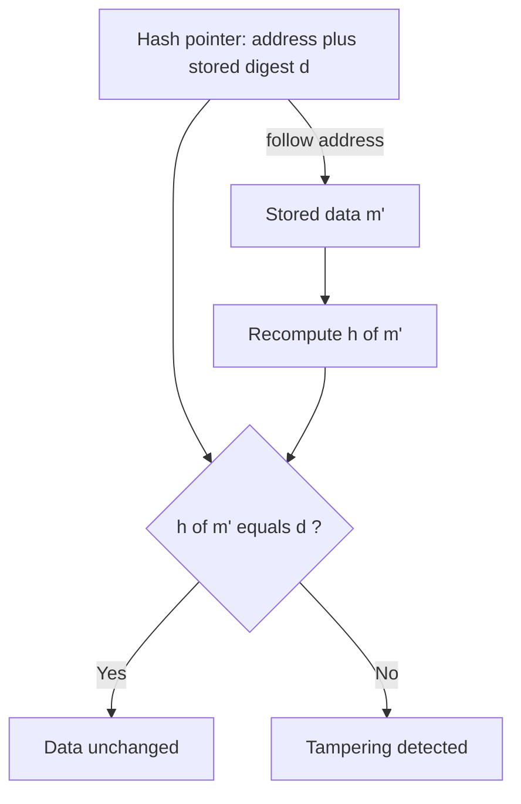

> [!warning] Common mistake
> You **cannot** "decrypt" $d$ back to $m$ and compare the two messages. Hashing is one-way. The check always goes **forward**: re-hash the data you fetched and compare the two digests.

### Hash pointers look like a linked list
Think of a **singly linked, non-circular** linked list. Each node holds data and a pointer to the next node. Swap every ordinary pointer for a hash pointer and you get a list where **any change to any node can be detected** as you walk along it.

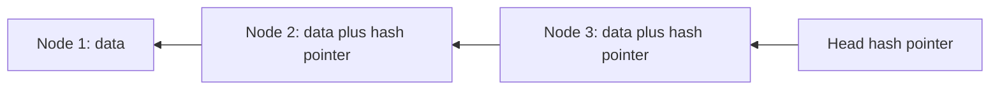

> [!tip] When are hash pointers useful?
> When data is **written once and should never change**, but must be retrievable and checkable later. If your application needs to edit data often, hash pointers get in the way. A blockchain is exactly the write-once kind of application: an **append-only ledger**.

---

## 3. Tamper Detection and the "Smart Attacker"

### Case A: naive attacker (caught)
1. Data: `Hello World!`. Hash pointer **R1** points to it and stores $h(\text{Hello World!})$.
2. The attacker changes the data to `Hello World?` (`!` becomes `?`).
3. A verifier follows R1 and computes $h(\text{Hello World?})$.
4. This does **not** match the digest stored in R1, so the pointer **"breaks"** and the tampering is detected.

### Case B: smart attacker (not caught by a plain hash pointer)
1. The attacker changes the data to `Hello World?` **and also** replaces R1 (shown grey on the slide) with a new R1 (shown black) that stores $h(\text{Hello World?})$.
2. The verifier follows the new R1, re-hashes `Hello World?`, and the digests **match**.
3. The tampering **goes undetected**.

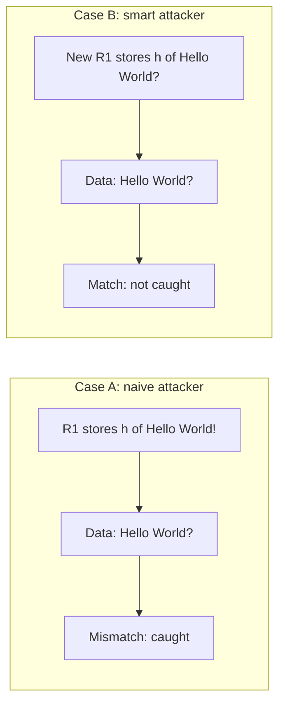

**Why Case B is easy (so far):** hash functions such as SHA-256 are public and fast. Anyone can compute a new hash in microseconds. To stop the smart attacker we have two tools:
- make **every hash expensive to compute**, using a **nonce** (Section 4), and
- **chain** many hash pointers, so the attacker must redo **many** expensive hashes (Section 5).

> [!warning] Myth
> "A hash pointer alone makes data tamper-proof." It does not. It makes tampering **detectable** only if the pointer itself is trusted. The real protection comes from making the hashes **costly** (nonce puzzle) and **chained**, and, in later lectures, from **many nodes** holding copies of the chain.

---

## 4. Nonce and the Hash Puzzle (Leading Zeros)

**What it is**: a **nonce** is a "**n**umber used only **once**". It is attached (concatenated) to the data before hashing. We then put a **restriction** on the output, for example *"the hash must begin with $k$ zero hex digits"*. The only way to meet the rule is to **try nonce = 0, 1, 2, …** until one works.

$$\text{find nonce such that } h(\text{data} \,\|\, \text{nonce}) \text{ starts with } k \text{ zero hex digits}$$

($\|$ means concatenation.)

> [!example] Analogy: a combination lock with no hints
> You must open a lock by turning the dial one number at a time. Nothing tells you whether you are "getting closer". Each extra zero in the rule is like a dial with 16 times more positions.

**How it works (the search loop)**
1. Fix the data, for example `Hello World!`.
2. Start with nonce $= 0$.
3. Compute $h(\text{data}\|\text{nonce})$.
4. Check whether the first $k$ hex digits are `0`.
5. If yes, **done**. This nonce is the proof of work. If no, increase the nonce and go back to step 3.

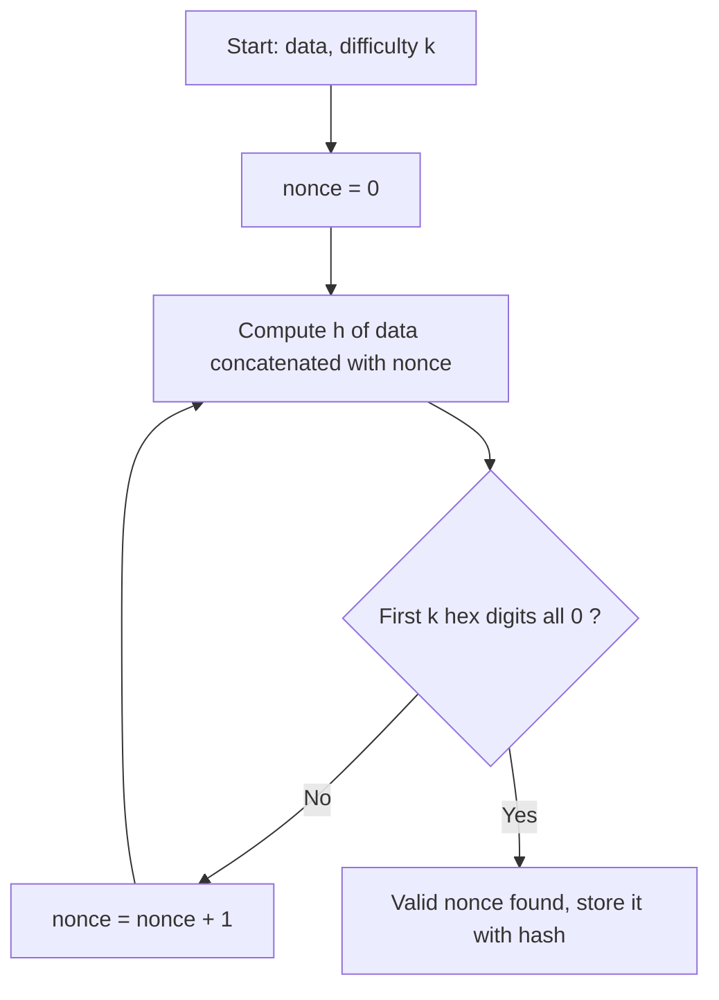

### The lecture's live demo (hash-puzzle website from the *Blockchain Basics* book)
Data = `Hello World!`. Restriction = number of leading **hexadecimal** zeros.

| Leading zeros required ($k$) | Nonce found | Rough effort |
|---|---|---|
| 0 (no rule) | any (e.g. 0) | instant |
| 1 | **3** (nonces 0, 1, 2 failed; the first hex digit of nonce 1's hash was 3) | instant |
| 2 | **57** | very fast |
| 3 | **614** | fast |
| 5 | **1,006,908** | noticeable wait, about a million tries |

**Why the effort explodes**: each hex digit has 16 values. A random hash starts with $k$ zero hex digits with probability $(1/16)^k$, so on average you need

$$E[\text{tries}] \approx 16^{k} = 2^{4k}$$

- $k=1$: about 16 tries
- $k=2$: about 256 tries
- $k=3$: about 4,096 tries
- $k=5$: about 1,048,576 tries. The demo's 1,006,908 fits this almost exactly.

Each extra zero means **about 16 times more work**. Checking an answer still takes **one** hash. Hard to find, easy to verify: that asymmetry is the whole trick.

> [!tip] Memory trick
> "**One more zero, sixteen times more slog.**" Finding the nonce takes millions of hashes. Verifying it takes one.

**Link to puzzle friendliness**: this only works because the hash function is **puzzle friendly**. No shortcut predicts which nonce gives leading zeros, so brute force is the only option. That is the puzzle from L03. In blockchains the restriction is usually about leading zeros (strictly, Bitcoin requires the hash to be **below a target number**, and "more leading zeros" is a simple way to picture a lower target).

**Why it matters**: if every hash pointer needs a puzzle-solving nonce (say 10 leading zeros), the smart attacker from Section 3 can no longer just recompute R1. They must **solve the puzzle again**. How long that takes depends on their computing power.

---

## 5. Hash Chains

**What it is**: a **hash chain** is a series of data blocks linked by hash pointers. Each block stores the **hash of the previous block**, and the previous block's hash covers *its* data, *its* nonce and *its own* stored hash. So the newest hash depends on **everything before it**.

> [!example] Analogy: a stack of sealed envelopes
> Each envelope holds a letter **plus the wax-seal imprint of the envelope before it**. If you open and reseal an old envelope, its seal changes. The next envelope then records the wrong imprint, and so does the one after that, all the way to the top.

**Structure (lecture slide: blocks $i$, $i+1$, $i+2$)**

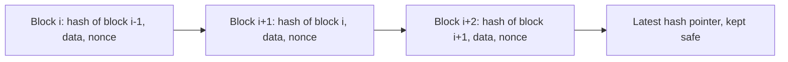

**How tampering propagates**
1. The attacker edits the **data in block $i$**.
2. The hash of block $i$ changes, so the hash stored in block $i+1$ **no longer matches**. The link breaks.
3. To hide this, the attacker recomputes block $i$'s hash, **solving a new nonce puzzle**, and writes it into block $i+1$.
4. That changes block $i+1$, so its hash changes too, and block $i+2$'s link breaks.
5. This repeats for **every later block**, each needing a fresh puzzle solution.
6. Meanwhile honest participants keep adding new blocks, so the attacker is chasing a moving target.

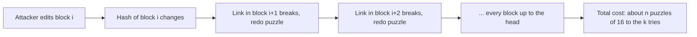

$$\text{Attacker cost} \approx (\text{blocks after the edit}) \times 16^{k} \text{ hashes}$$

> [!tip] Key insight
> **Plain hash pointer:** the smart attacker fixes one hash, which is cheap. **Hash chain + nonce puzzle:** the attacker must re-solve **every later puzzle**, which costs a lot. The deeper the block sits in the chain, the safer it is.

> [!warning] Mistake to avoid
> Tampering does **not** affect earlier blocks (blocks $< i$). Hash pointers point **backwards**, so a change spreads **forward** only, toward the newest block.

---

## 6. Merkle Trees

**What it is**: a **Merkle tree** (the transcript's "mortal tree" / "Markle tree" is a transcription error) is a **binary tree of hashes**:
- **Leaf nodes** store the hash of each transaction.
- **Each internal node** stores the hash of its two children's hashes joined together.
- The top node is the **Merkle root** (root hash). It is one digest that depends on **every** transaction.

It is the **hierarchical hashing** pattern from L04, organised as hash pointers in a tree.

> [!example] Analogy: an exam result sheet
> Each student's mark is summarised into a section total. Section totals roll up into a class total, and class totals into one school total. Change one student's mark and that section, that class and the school total all change. Here the "totals" are hashes, so they cannot be faked.

**How it is built (lecture example: 4 transactions T1–T4)**
1. Hash each transaction (level 0, the leaves):
   - $H_{00} = h(T_1)$, $H_{01} = h(T_2)$, $H_{10} = h(T_3)$, $H_{11} = h(T_4)$
2. Hash pairs (level 1):
   - $H_{0} = h(H_{00} \,\|\, H_{01})$
   - $H_{1} = h(H_{10} \,\|\, H_{11})$
3. Hash the last pair (root):
   - $\text{Root} = h(H_{0} \,\|\, H_{1})$

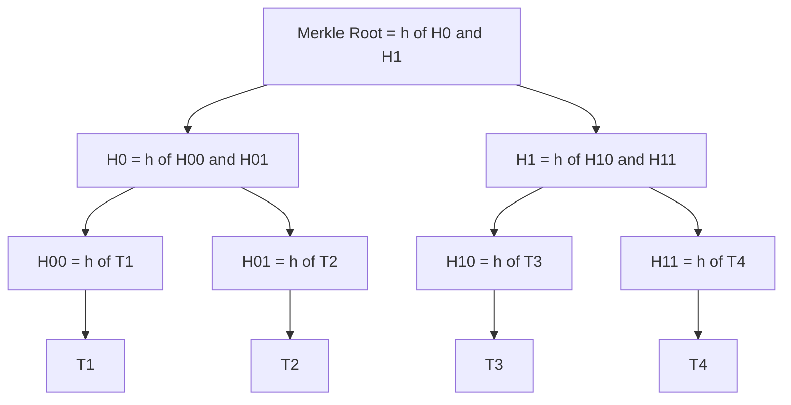

### Tampering in a Merkle tree
Change $T_3$, and $H_{10}$ changes. That changes $H_1$, which changes the **Merkle root**. The block header stores the root, so the change is caught.

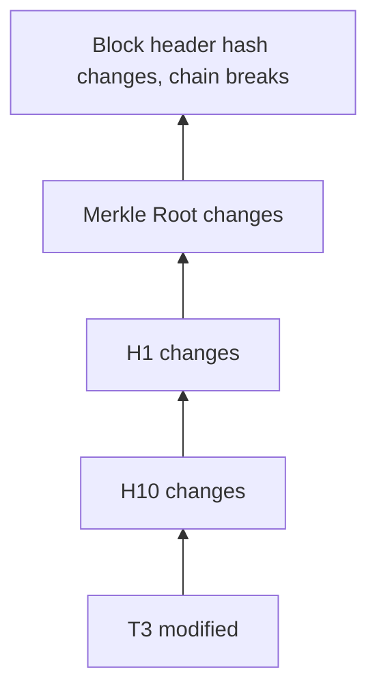

### Merkle proof (membership verification), important extra
*(The lecture only mentions "efficient verification". This is how it works, and exams often ask about it.)*
To prove that **T3** is in the block, a light client that has only the Merkle root needs just the **sibling hashes along the path**:

1. Compute $H_{10} = h(T_3)$.
2. Receive sibling $H_{11}$ and compute $H_1 = h(H_{10}\|H_{11})$.
3. Receive sibling $H_0$ and compute $\text{Root}' = h(H_0\|H_1)$.
4. If $\text{Root}' = $ the trusted Merkle root, T3 is **definitely** in the block.

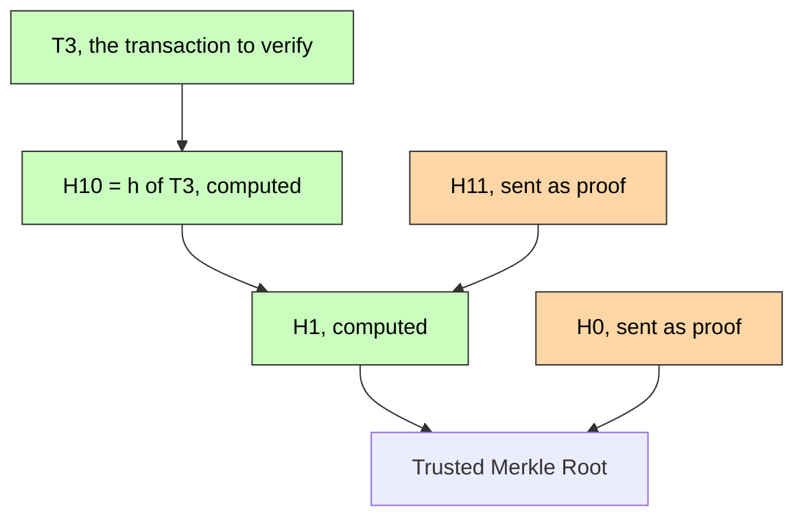

| | Without Merkle tree | With Merkle tree |
|---|---|---|
| Data needed to verify 1 of $n$ transactions | all $n$ transactions | $\log_2 n$ sibling hashes |
| Example $n = 1024$ | 1024 transactions | 10 hashes |
| What goes in the block header | hash of all data | one 32-byte Merkle root |

> [!tip] Remember
> **Leaves = hashes of transactions** (not the raw transactions). **Proof size = $\log_2 n$.** If the number of nodes at a level is odd, Bitcoin duplicates the last hash to make a pair.

**Why it matters**: the block header stays tiny and fixed in size however many transactions the block holds, yet it still "seals" every one of them. Lightweight wallets (SPV clients) can check payments without downloading whole blocks.

---

## 7. Block Construction: Putting It Together

**What it is**: a **block** = **block header** + **body** (the list of transactions, organised as a Merkle tree). A **blockchain** = a **hash chain of block headers**, where each header carries a hash pointer to the previous header.

**Block header fields (lecture, with the real Bitcoin layout added)**

| Field | Role |
|---|---|
| **Previous block hash** | Hash pointer to the previous block. This makes it a chain |
| **Merkle root** | Seals all transactions in this block |
| **Nonce** | The puzzle solution that makes the header hash meet the difficulty rule |
| **Timestamp** | When the block was created (Bitcoin header) |
| **Difficulty target (nBits)** | How many "leading zeros" the hash needs (Bitcoin header) |
| **Version** | Protocol version (Bitcoin header) |

> [!warning] Correction
> The slide lists "hash of this block itself" inside the header. In real systems such as Bitcoin, a block's own hash is **not stored inside it**. It is **computed** from the header, and the **next** block stores it as "previous hash". Bitcoin hashes the 80-byte header with **double SHA-256**: $\text{SHA256}(\text{SHA256}(\text{header}))$.

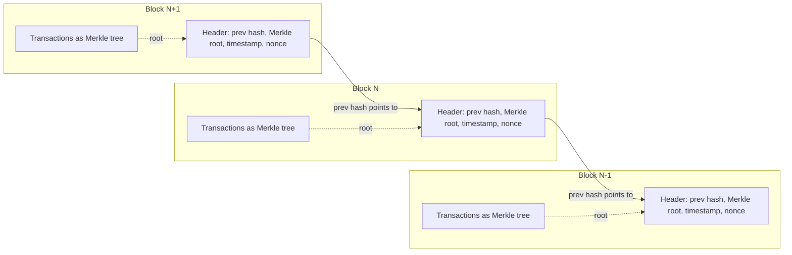

```
 +------------------------- Block N header -------------------------+
 | Version | Prev Block Hash | Merkle Root | Timestamp | Target | Nonce |
 +------------------------------------------------------------------+
                                  ^
                                  |  root of
             +--------------------+--------------------+
             |          Merkle tree of Tx1 ... Txn     |
             +-----------------------------------------+
   Block hash = h(header)  must satisfy  difficulty (leading zeros)
```

**How a new block is made (the full picture)**
1. Collect transactions and build their Merkle tree to get the **Merkle root**.
2. Fill the header: previous block's hash, Merkle root, timestamp, difficulty.
3. Run the **nonce search loop** (Section 4) on the header until $h(\text{header})$ meets the difficulty.
4. Publish the block. The next block will store its hash as "previous hash".

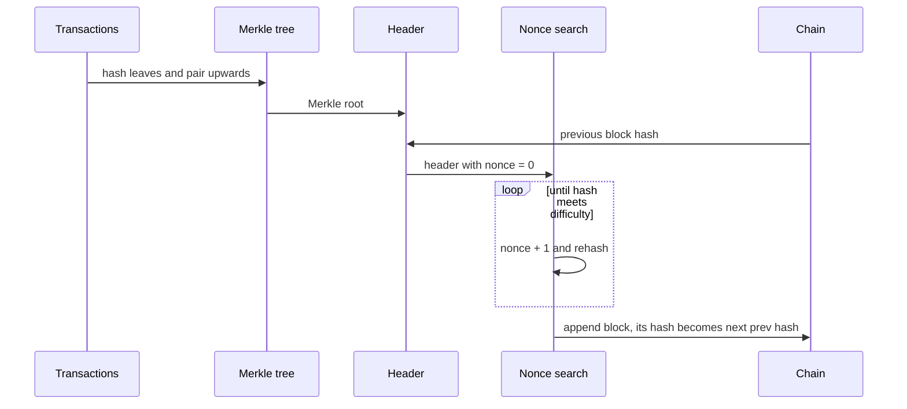

**Why tampering is so hard (all layers together)**
1. Change a transaction → its leaf hash changes → the Merkle root changes.
2. The Merkle root changes → the header changes → the block hash changes, and the nonce puzzle must be **solved again**.
3. The block hash changes → the next block's "prev hash" breaks → **every later block** must be re-mined.
4. (Later lectures) Thousands of nodes keep honest copies, so the attacker must also out-compute the whole network.

> [!tip] One-line definition for exams
> **"A blockchain is a hash chain of blocks. Each block header holds the previous block's hash, the Merkle root of its transactions and a nonce that solves a hash puzzle."**

---

## 🔑 Key Points (short)

- A hash function maps any-length input to a fixed-size digest. It is one-way, collision resistant and puzzle friendly.
- **Hash pointer = pointer to data + hash of that data.** It lets you retrieve the data **and** verify it.
- Verify by **re-hashing** the fetched data and comparing digests. You never "invert" a hash.
- Changing `Hello World!` to `Hello World?` breaks the hash pointer, so tampering is detected.
- A smart attacker can change the data **and** the stored hash. A plain hash pointer cannot stop this.
- A **nonce** (number used once) is added to the data so the hash must meet a rule, such as $k$ leading zeros.
- Demo: 1 zero → nonce 3, 2 zeros → 57, 3 zeros → 614, 5 zeros → 1,006,908.
- Expected work is about $16^k$ hashes: each extra hex zero means about 16 times more effort. Verifying takes one hash.
- **Hash chain**: each block stores the previous block's hash. Editing block $i$ forces you to redo every later block.
- Tampering spreads **forward** only (toward the newest block), never backward.
- **Merkle tree**: leaves = hashes of transactions, internal nodes = hash of the two children, top = Merkle root.
- A Merkle proof needs only $\log_2 n$ sibling hashes.
- **Block header**: previous hash, Merkle root, nonce (plus timestamp, difficulty and version in Bitcoin).
- **Blockchain = hash chain of blocks**, made tamper-evident by hash pointers and costly to rewrite because of nonce puzzles.
- References: *Blockchain Basics* (Daniel Drescher); *Cryptography and Network Security* (William Stallings).

## 📖 Glossary

| Term | Meaning (plain English) |
|---|---|
| Block | A container holding a header and a list of transactions |
| Block header | The small summary part of a block: prev hash, Merkle root, nonce, timestamp, etc. |
| Blockchain | A hash chain of blocks |
| Collision resistance | Nobody can find two different inputs with the same hash |
| Difficulty | How strict the hash rule is (how many leading zeros or how low a target) |
| Digest | The output of a hash function, also called the hash value |
| Hash chain | Blocks linked so that each one stores the hash of the previous one |
| Hash pointer / hash reference | A pointer that also stores the hash of the data it points to |
| Hash puzzle | Find a nonce so that $h(\text{data}\|\text{nonce})$ meets a rule |
| Leading zeros | Zero hex digits at the start of a hash, the usual puzzle rule |
| Merkle proof | The sibling hashes needed to show that one transaction is under a Merkle root |
| Merkle root | The single hash at the top of a Merkle tree |
| Merkle tree | A binary tree in which each parent is the hash of its children and the leaves are transaction hashes |
| Nonce | "Number used once", the value you change while searching for a valid hash |
| One-way function | Easy to compute forwards, infeasible to reverse |
| Puzzle friendliness | No shortcut exists for hitting a target hash, so brute force is the only option |
| Tamper-evident | Any change can be detected |
| Transaction | One record (for example a payment) stored in a block |

## 🧮 Formulas & Numbers

| Formula / number | Meaning |
|---|---|
| $d = h(m)$ | Digest $d$ of message $m$ under hash function $h$ |
| $h(m') \stackrel{?}{=} d$ | Integrity check: re-hash the fetched data and compare with the stored digest |
| $h(\text{data}\,\|\,\text{nonce})$ starts with $k$ zeros | Hash-puzzle condition ($\|$ = concatenation) |
| $E[\text{tries}] \approx 16^k = 2^{4k}$ | Average nonces to try for $k$ leading **hex** zeros |
| 3, 57, 614, 1,006,908 | Demo nonces for 1, 2, 3, 5 leading zeros on "Hello World!" |
| Attacker cost $\approx n \times 16^k$ | Re-solving puzzles for the $n$ blocks after the edited one |
| $H_{00}=h(T_1),\ H_0=h(H_{00}\|H_{01}),\ \text{Root}=h(H_0\|H_1)$ | Merkle tree construction for 4 transactions |
| Proof size $= \lceil \log_2 n \rceil$ hashes | Merkle membership proof for $n$ transactions |
| 256 bits = 64 hex digits | SHA-256 digest size (L04). One hex digit = 4 bits |

## 🎯 Exam Corner

**Likely questions**

1. **What is a hash pointer and how is it different from a normal pointer?**
   A normal pointer stores only an address. A hash pointer stores the address **and the hash of the data** there, so you can retrieve the data and also check that it has not changed.
2. **How does a hash pointer detect tampering?**
   Follow the pointer, re-hash the data you fetch, and compare with the stored digest. A mismatch means tampering. (Example: "Hello World!" changed to "Hello World?".)
3. **Why is a plain hash pointer not enough against a smart attacker?**
   The attacker can change the data and also recompute the stored hash, because hash functions are public and fast. Nonce puzzles and chaining make that recomputation costly.
4. **What is a nonce, and what role does it play?**
   A number used once, concatenated with the data, chosen so the hash meets a rule (leading zeros). Finding it takes brute force, which makes each hash expensive to produce or redo.
5. **Why does adding one leading zero make the puzzle about 16 times harder?**
   Each hex digit has 16 values, so the chance that a hash meets the rule drops by a factor of 16. The lecture demo grew from nonce 3 to 57, 614, and then about 1 million.
6. **Explain how tampering propagates in a hash chain.**
   Editing block $i$ changes its hash, which breaks the pointer in block $i+1$. Fixing that changes block $i+1$'s hash, and so on, so every later block must be recomputed, each with a new puzzle.
7. **Describe a Merkle tree for T1–T4.**
   Leaves $h(T_1)\dots h(T_4)$. Then $H_0=h(H_{00}\|H_{01})$ and $H_1=h(H_{10}\|H_{11})$. Root $=h(H_0\|H_1)$. The root goes in the block header.
8. **What does a block header contain, and why is a blockchain called a hash chain?**
   The previous block hash, the Merkle root and a nonce (in Bitcoin also timestamp, difficulty and version). Each header points to the previous one by hash, so the blocks form a hash chain.

**MCQs**

**Q1.** A hash pointer contains:
A) Only a memory address  B) The address and the hash of the data at it  C) Only encrypted data  D) The private key of the owner
> [!check]- Answer
> **B**. A hash pointer is a pointer plus the digest of the data it points to.

**Q2.** To check data fetched through a hash pointer, you:
A) Invert the stored hash  B) Re-hash the fetched data and compare digests  C) Decrypt the data  D) Count the bytes
> [!check]- Answer
> **B**. Hashes are one-way, so you always re-compute and compare.

**Q3.** "Hello World!" is changed to "Hello World?" but the hash pointer is unchanged. Result?
A) Nothing is noticed  B) The hash pointer "breaks" (digest mismatch)  C) The hash updates automatically  D) The data is restored
> [!check]- Answer
> **B**. Even a one-character change gives a completely different digest.

**Q4.** A nonce is:
A) A secret key  B) A number used only once, added to data to meet a hash rule  C) The Merkle root  D) A timestamp
> [!check]- Answer
> **B**. It is the value you search over to satisfy the leading-zero restriction.

**Q5.** Which property of hash functions makes the leading-zero puzzle require brute force?
A) Determinism  B) Fixed output size  C) Puzzle friendliness  D) Speed
> [!check]- Answer
> **C**. No shortcut helps you hit the target. You must keep trying nonces.

**Q6.** Requiring one more leading hex zero multiplies the expected work by about:
A) 2  B) 4  C) 10  D) 16
> [!check]- Answer
> **D**. Each hex digit has 16 possible values.

**Q7.** In a hash chain, an attacker edits block $i$. Which blocks must be recomputed?
A) Only block $i$  B) Blocks before $i$  C) Block $i$ and all blocks after it  D) None
> [!check]- Answer
> **C**. Pointers go backward, so the damage spreads forward to the head.

**Q8.** In a Merkle tree, leaf nodes store:
A) Raw transactions  B) Hashes of transactions  C) Block headers  D) Nonces
> [!check]- Answer
> **B**. Leaves hold $h(T_i)$, and internal nodes hold hashes of their children.

**Q9.** If transaction T3 changes, what changes in a 4-leaf Merkle tree?
A) Only $h(T_3)$  B) $h(T_3)$, its parent and the root  C) Every node  D) Only the root
> [!check]- Answer
> **B**. Only the path from the leaf to the root changes. The sibling branch stays the same.

**Q10.** Which is **not** stored in a Bitcoin block header?
A) Previous block hash  B) Merkle root  C) Nonce  D) The full list of transactions
> [!check]- Answer
> **D**. Transactions live in the block body. The header holds only their Merkle root.

## 📝 Summary

This lecture took the hash-function properties from earlier lectures and used them to build a blockchain. A **hash pointer** stores where data is and also what its hash should be, so anyone can re-hash the data and spot changes such as "Hello World!" turning into "Hello World?". A smart attacker can also rewrite the stored hash, so we make each hash costly. A **nonce** must be found so that $h(\text{data}\|\text{nonce})$ has $k$ leading zeros, and the live demo showed the effort jumping from a nonce of 3 to about one million as $k$ went from 1 to 5. Linking blocks with these costly hash pointers forms a **hash chain**, where editing one block forces the attacker to re-solve the puzzle for every later block. A **Merkle tree** packs all of a block's transactions into one Merkle root, and the **block header** (previous hash, Merkle root, nonce) is what gets chained. Next, [[L06 - Basic Cryptographic Primitives IV]] moves from hashing to symmetric and asymmetric cryptography and RSA keys, which lead to the digital signatures used to sign transactions.
