# L06 · Basic Cryptographic Primitives – IV

> [!summary] TL;DR — the whole lecture in 30 seconds
> Hash functions (L03–L05) can protect integrity, but nobody can reverse them, not even the intended receiver. So they cannot be used to send secret messages. This lecture (Prof. Shamik Sural) brings in **cryptography with keys**. It covers **encryption** (plain text to cipher text) and **decryption** (cipher text back to plain text), and the two families: **symmetric key** (one shared key) and **asymmetric / public key** (a public key and a private key). It then covers what makes a good key (random, long, high entropy), how Alice sends a secret to Bob using **Bob's public key**, and the **RSA key generation** steps. Public key cryptography is what blockchains use for **digital signatures**, which the next lecture covers in full.

## 🧭 Where this fits

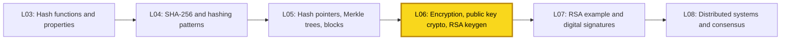

[[L05 - Basic Cryptographic Primitives III]] finished the hash-function part: hash pointers, hash chains and Merkle trees build the tamper-evident chain of blocks. This lecture moves to **key-based cryptography**. [[L07 - Basic Cryptographic Primitives V]] works through an RSA example and shows how public key cryptography produces **digital signatures**, which prove who created each blockchain transaction. Course map: [[00 - START HERE (Course Overview)]].

## 🗺️ Structure at a glance

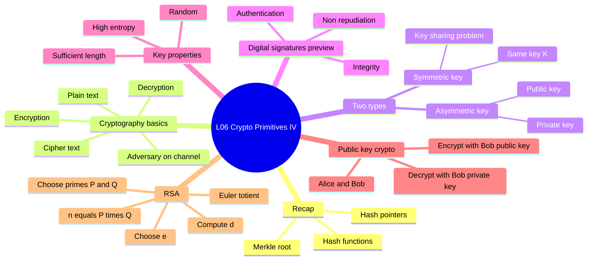

1. **Recap** – what hash functions gave us, and why they cannot do this lecture's job.
2. **What is cryptography** – sender, insecure channel, receiver; encryption and decryption.
3. **Why hashing is not encryption** – nobody can undo a hash, including the receiver.
4. **Symmetric vs asymmetric key cryptography** – one key vs a key pair; the key-distribution problem.
5. **Digital signatures (preview)** – authentication, integrity, non-repudiation.
6. **What is a key and its properties** – random, long, high entropy.
7. **Public key cryptography in action** – Alice to Bob with Bob's public key.
8. **RSA** – the core idea and the two-way property.
9. **RSA key generation** – the five steps, plus a small numeric walk-through.

---

## 0. Quick recap of L03–L05

- A **cryptographic hash function** $H$ maps a message $M$ to a fixed-size **digest** $H(M)$.
- Properties: **collision resistant** (collision-free), **hiding**, **puzzle friendly**.
- Puzzle-friendliness and the **nonce**: we can require the hash to have a number of **leading zeros**. Finding such a nonce takes a lot of computation.
- **Hash pointers** link blocks into a **blockchain**. A **Merkle tree** hashes transactions pair by pair up to a single **Merkle root**.
- Change any transaction and every hash up to the root must be recomputed. That is expensive, so tampering is hard and easy to spot.

> [!note] What changes now
> Hashing is finished. This lecture is about cryptography that uses **keys**, so the right person can **undo** the scrambling.

---

## 1. What is cryptography?

**What it is** – Cryptography lets a sender **A** send a message to a receiver **B** over an **insecure channel**, so that an **adversary** listening on the channel can neither **read** it nor **change** it without being noticed.

Terms:

| Term | Meaning |
|---|---|
| **Plain text** | The original readable message (data $D$ or $M$) |
| **Cipher text** | The scrambled version that actually travels on the channel |
| **Encryption** | Turning plain text into cipher text using a key |
| **Decryption** | Turning cipher text back into plain text using a key |
| **Adversary** | Someone on the channel who tries to read or change the data |

> [!example] Analogy
> You put a letter in a locked box and post the box. The postman (the channel) can see and carry the box but cannot open it. Only the friend with the right key can open it and read the letter.

**How it works**
1. A has plain text $M$. A does **not** send $M$ as it is.
2. A **encrypts**: $C = E(M, K_{enc})$.
3. The cipher text $C$ travels over an insecure channel, where an adversary can snoop.
4. B **decrypts**: $M = D(C, K_{dec})$.
5. Goals:
   - **Confidentiality** – from $C$ alone, the adversary cannot work out $M$.
   - **Integrity** – if the adversary changes $C$, B should be able to detect it.

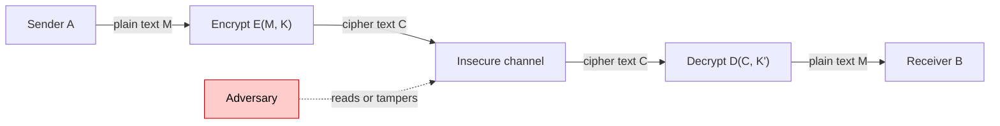

**Why it matters** – A blockchain runs over the open internet among people who do not trust each other. Every security feature, including signatures, wallets and addresses, rests on these primitives.

---

## 2. Why not just use a hash function?

You might think: "Hash the plain text and send the digest. The adversary can't reverse it." That is true. But **the intended receiver can't reverse it either.** A hash is one-way for **everyone**.

| | Hash function | Encryption |
|---|---|---|
| Uses a key? | No | Yes |
| Reversible? | No, for anyone | Yes, for whoever holds the right key |
| Output size | Fixed (e.g. 256 bits) | Depends on message length |
| Main use | Integrity, fingerprints, PoW, linking blocks | Confidentiality, signatures |

> [!warning] Common mistake
> "Hashing = encryption" is **wrong**. Hashing is one-way and has no key. Encryption is two-way, and a key unlocks it.

---

## 3. Symmetric vs asymmetric key cryptography

### 3a. Symmetric key cryptography

**What it is** – The **same key** $K_1$ is used to encrypt and to decrypt. Examples: AES, DES.

$$C = E(M, K_1), \qquad M = D(C, K_1)$$

> [!example] Analogy
> One house key and its copy. Whoever has a copy can lock and unlock the door. The hard part is getting the copy to your friend safely.

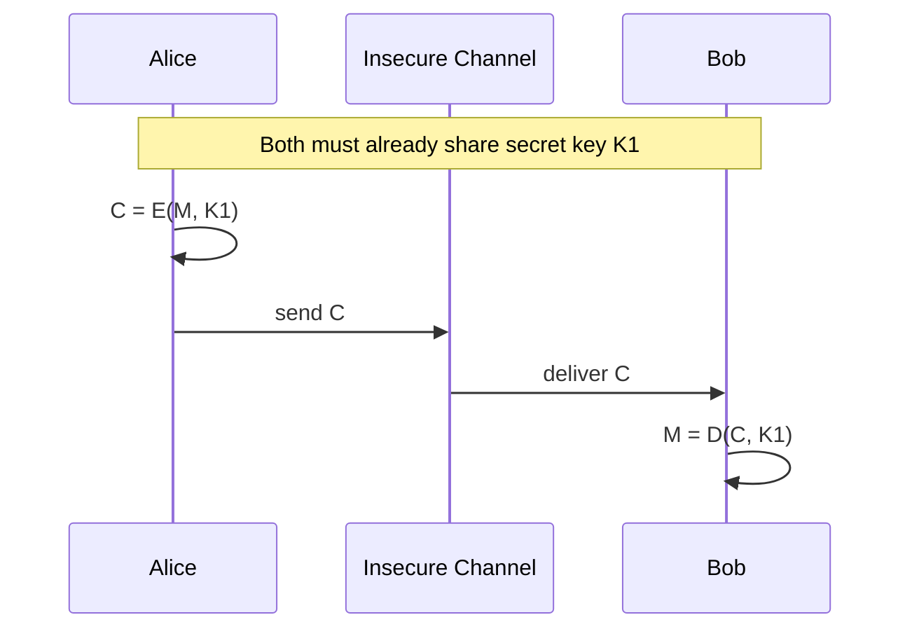

**The key-sharing problem** – The key must reach the other side **secretly** before any secure talk can begin. If you send it over the same insecure channel, the adversary sees it. The lecture says symmetric keys "cannot address certain requirements" that public key cryptography handles, such as those in blockchains.

### 3b. Asymmetric (public key) cryptography

**What it is** – **Two different keys**: one key $K$ encrypts and a different key $K'$ decrypts. Each user owns a **key pair**:
- **Public key** – shown to the whole world.
- **Private key** – known only to its owner.

$$C = E(M, K), \qquad M = D(C, K'), \qquad K \neq K'$$

> [!example] Analogy
> Bob hands out open **padlocks** (public key) to everyone and keeps the only **padlock key** (private key). Anyone can snap a padlock shut on a box for Bob. Only Bob can open it.

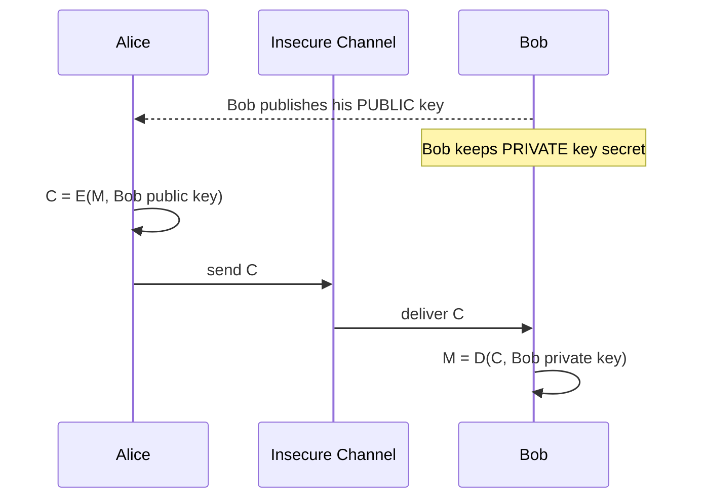

### 3c. Side-by-side

| Feature | Symmetric key | Asymmetric (public) key |
|---|---|---|
| Number of keys | 1 shared secret key | 2 per user (public + private) |
| Encrypt with | $K$ | Receiver's **public** key |
| Decrypt with | Same $K$ | Receiver's **private** key |
| Key distribution | Hard; needs a secure channel first | Easy; publish the public key |
| Speed | Fast | Slower (heavy maths) |
| Digital signatures? | No | Yes |
| Examples | AES, DES | RSA, ECC (Bitcoin uses ECDSA) |
| Other names | Secret key / private key crypto | Asymmetric crypto |

### 3d. How many keys does a group need? (extra, standard textbook fact)

This is not worked out in the lecture, but it explains the key-sharing problem. With $n$ users who each want to talk privately with every other user:

- **Symmetric**: every pair needs its own secret key, so $\binom{n}{2} = \dfrac{n(n-1)}{2}$ keys, each shared in secret.
- **Public key**: each user has one pair, so $2n$ keys in total, and only the $n$ public ones need to be published.

| Users $n$ | Symmetric $n(n-1)/2$ | Public key $2n$ |
|---|---|---|
| 4 | 6 | 8 |
| 10 | 45 | 20 |
| 1,000 | 499,500 | 2,000 |
| 1,000,000 | about $5 \times 10^{11}$ | 2,000,000 |

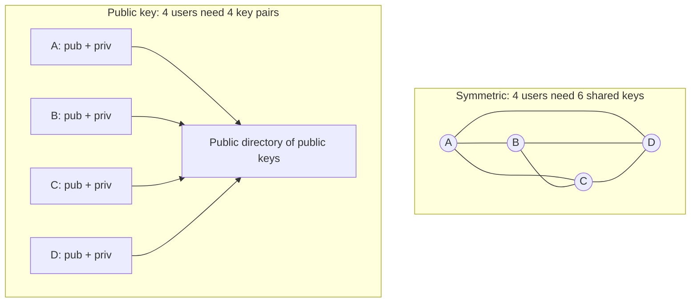

**Why it matters** – A blockchain may have millions of strangers. They cannot meet in secret to swap keys, so blockchains are built on **public key** cryptography.

> [!tip] Memory trick
> **Sym**metric = **Sam**e key. **A**symmetric = **A** pair of keys.

---

## 4. Digital signatures (preview)

**What it is** – A **digital code** attached to an electronically sent document. It proves:
1. **Authentication** – the document really came from the claimed sender (A).
2. **Integrity** – nobody changed $M$ into $M'$ along the way. If they did, B can detect it.
3. **Non-repudiation** – the sender **cannot later deny** sending it.

> [!example] Lecture's example: the bank cheque
> - Only **I** (the signing authority) can sign my cheque.
> - **Anyone** (for example the bank) can **verify** the signature against my signature on record.
> - A signature belongs to **one document**. Signing cheque no. 1 does not make my signature valid on other cheques. **It cannot be copied to another document.**

> [!example] Non-repudiation in money terms
> If A transfers money to B, A cannot later say "I never sent that money." The signature proves A did. Blockchain transactions rely on exactly this.

| Property of a signature | Physical cheque | Digital signature |
|---|---|---|
| Only owner can sign | Yes | Yes (needs private key) |
| Anyone can verify | Bank compares with record | Anyone, using the public key |
| Tied to one document | Mostly | Strictly; it depends on the document's content |
| Forgery | Possible | Computationally infeasible |

> [!note] Coming next
> How signatures are actually made (sign with the **private** key, verify with the **public** key) is in [[L07 - Basic Cryptographic Primitives V]]. This lecture first builds the public key idea that signatures need.

---

## 5. What is a key, and what makes a good one?

**What it is** – A **key** is a parameter that determines the output of a cryptographic algorithm. The same algorithm with a different key gives a completely different cipher text.
- Encryption: $E(\text{plain text}, K) = \text{cipher text}$
- Decryption: $D(\text{cipher text}, K') = \text{plain text}$
- In symmetric crypto $K' = K$. In public key crypto $K' \neq K$.

**Three properties of a good key**

| Property | Meaning | Why |
|---|---|---|
| **Fully random** | Generated randomly, not chosen by a human | The attacker cannot guess it, like a good password |
| **Sufficient length** | Many bits | Stops **brute force** (trying every key one by one) |
| **High entropy** | Every bit is equally unpredictable | No pattern for the attacker to use |

**Brute force example from the lecture** – If the key were only **2 decimal digits**, an attacker could try 00, 01, 02 … 99. That is only **100 tries**, and one of them will decrypt the cipher text. A key of $k$ bits has $2^k$ possible values:

$$\text{key space} = 2^{k} \quad (k = 128 \Rightarrow 2^{128} \approx 3.4 \times 10^{38})$$

**Entropy example** – If every key always **starts with bit 1** (or starts and ends with 1), the attacker fixes those bits and searches only the rest. So all bits must be equally random.

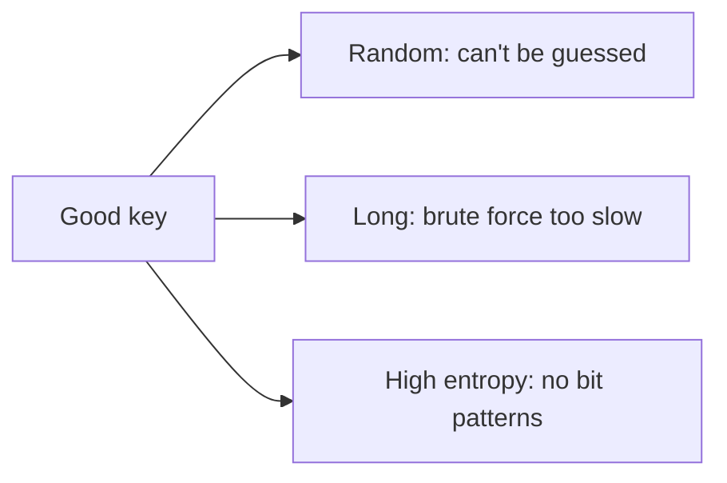

> [!warning] Common mistake
> A long key is **not** enough on its own. A 2048-bit key built from a predictable pattern is weak. You need **length and randomness together**.

---

## 6. Public key cryptography in action: Alice sends a secret to Bob

**Notation** (as on the slides)
- $K_B^{pub}$ = Bob's public key, known to everyone.
- $K_B^{priv}$ = Bob's private key, known only to Bob (the transcript's "pry").
- Alice also has $K_A^{pub}$ and $K_A^{priv}$.

**Each party's rule**: generate a key pair, **keep the private key**, **publish the public key**.

**How it works (confidentiality only, no signature yet)**
1. Bob generates $(K_B^{pub}, K_B^{priv})$ and publishes $K_B^{pub}$.
2. Alice wants to send message $M$ to Bob.
3. Alice encrypts with **Bob's public key**: $M' = E(M, K_B^{pub})$. $M'$ is the cipher text.
4. $M'$ travels over a non-secure link. An adversary may capture $M'$.
5. Bob decrypts with **his own private key**: $M = D(M', K_B^{priv})$.
6. The adversary has $M'$ but not $K_B^{priv}$, so the adversary **cannot** recover $M$.

$$M' = E(M, K_B^{pub}) \qquad M = D(M', K_B^{priv})$$

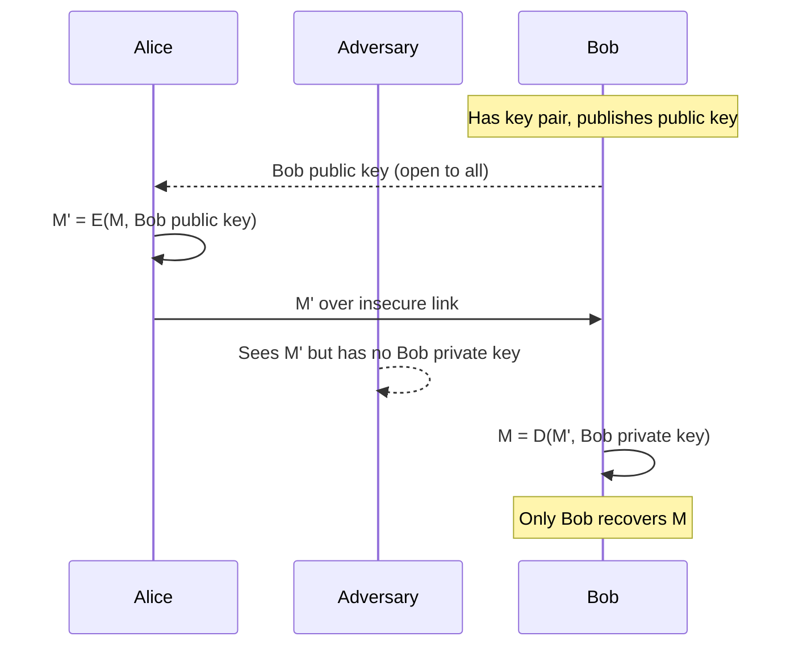

**Anyone can send to Bob** – Alice, Tom or anyone else can encrypt with Bob's public key, and Bob can always decrypt. Only Bob can read the result.

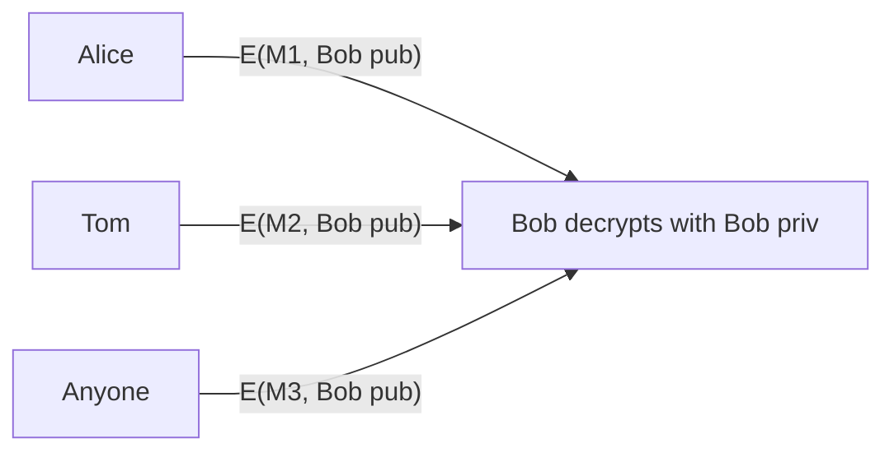

> [!warning] Which key? (very common exam trap)
> To send a **secret to Bob**, use **Bob's public key**, not Alice's. Encrypt with the **receiver's public** key and decrypt with the **receiver's private** key.
> This part of the lecture is only about **confidentiality**, not signatures.

> [!tip] Memory trick
> "**P**ublic to **P**ack, **P**rivate to **P**eek." Anyone can pack a box for Bob. Only Bob can peek inside.

---

## 7. RSA: the idea

**What it is** – **RSA**, named after **Rivest, Shamir and Adleman** (1977), was one of the pioneering public key algorithms. (The transcript's "reversed Shamir and Adulman" and "RS algorithm" mean RSA.)
- Encryption key = **public**. Decryption key = **private**, kept secret.
- Anyone can encrypt data for the key owner.

**The four broad steps of using RSA**
1. **Key generation** – create the key pair.
2. **Key distribution** – publish the public key and keep the private key secret.
3. **Encryption** – the sender encrypts with the receiver's public key.
4. **Decryption** – the receiver decrypts with their private key.

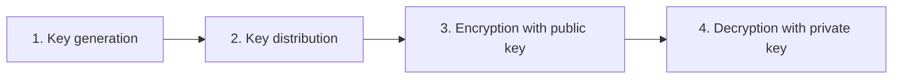

**The core maths** (from Stallings) – It is feasible to find three very large positive integers $e$, $d$, $n$ such that, for every integer $0 \le M < n$:

$$(M^{e})^{d} \equiv M \pmod n$$

and also the other way round:

$$(M^{d})^{e} \equiv M \pmod n$$

- **Public key** = $(e, n)$. **Private key** = $(d, n)$.
- Security: even if you know $e$, $n$ (and $M$), it is **very hard to find $d$**. This rests on how hard it is to factor $n$ back into $P$ and $Q$.

**Encryption and decryption formulas**

$$C = M^{e} \bmod n \qquad M = C^{d} \bmod n$$

**The two-way property** (important for L07)

| Encrypt with | Decrypt with | Used for |
|---|---|---|
| Public key $(e, n)$ | Private key $(d, n)$ | **Confidentiality** (this lecture) |
| Private key $(d, n)$ | Public key $(e, n)$ | **Digital signatures** (next lecture) |

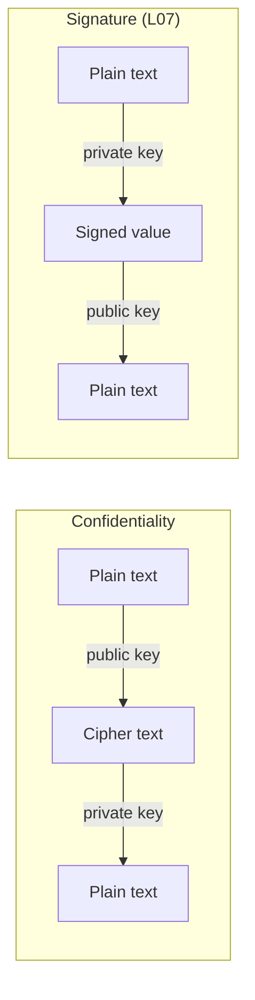

> [!note] Transcript fix
> The transcript says "$(M^e)^d$, if we divide by $d$ we get remainder $M$". The correct statement is: divide by **$n$** (mod $n$). The second identity is $(M^d)^e \equiv M \pmod n$.

---

## 8. RSA key generation (step by step)

The lecture shows these steps "for completeness". To understand blockchain you do not need the deep number theory behind them, but you should know the steps.

1. **Choose two distinct large primes** $P$ and $Q$, at random, for high security.
2. **Compute the modulus** $n = P \times Q$. The length of $n$ in bits is the **key length** (for example 2048-bit RSA).
3. **Compute Euler's totient** $\phi(n) = (P-1)(Q-1)$. (The transcript's "torsion" and "$P$ minus $n$" mean totient and $P-1$.)
4. **Choose $e$** with $1 < e < \phi(n)$ and $\gcd(e, \phi(n)) = 1$, so $e$ and $\phi(n)$ are **co-prime** (no common factor).
5. **Compute $d$** $\equiv e^{-1} \pmod{\phi(n)}$. $d$ is the **modular multiplicative inverse** of $e$, so
   $$d \cdot e \equiv 1 \pmod{\phi(n)}$$
   meaning $d \cdot e$ divided by $\phi(n)$ leaves remainder 1.
6. **Publish** $(e, n)$ as the public key. **Keep** $(d, n)$ as the private key, and keep $P$, $Q$ and $\phi(n)$ secret too.

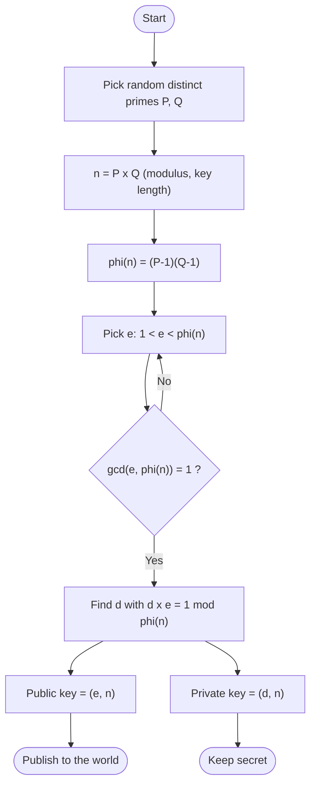

### Worked example (small numbers, the same ones used in L07)

Real RSA uses primes hundreds of digits long. Small numbers make each step easy to follow.

1. **Primes**: $P = 17$, $Q = 11$.
2. **Modulus**: $n = 17 \times 11 = 187$.
3. **Totient**: $\phi(n) = (17-1)(11-1) = 16 \times 10 = 160$.
4. **Choose $e = 7$**. Check: $160 = 2^5 \times 5$, and 7 shares no factor with it, so $\gcd(7, 160) = 1$. ✔
5. **Find $d$** with $7d \equiv 1 \pmod{160}$ using the extended Euclidean algorithm:
   - $160 = 22 \times 7 + 6$
   - $7 = 1 \times 6 + 1$
   - Back-substitute: $1 = 7 - 6 = 7 - (160 - 22 \times 7) = 23 \times 7 - 160$
   - So $d = 23$. Check: $7 \times 23 = 161 = 160 + 1 \equiv 1 \pmod{160}$. ✔
6. **Keys**: public $= (7, 187)$, private $= (23, 187)$.

**Quick encryption check** (message $M = 88$, which must be less than $n$):
- $C = 88^{7} \bmod 187$
  - $88^2 = 7744 \equiv 77$
  - $88^4 \equiv 77^2 = 5929 \equiv 132$
  - $88^7 = 88^4 \cdot 88^2 \cdot 88 \equiv 132 \times 77 \times 88$
  - $132 \times 77 = 10164 \equiv 66$, then $66 \times 88 = 5808 \equiv 11$
  - So $C = 11$.
- Decrypt: $M = 11^{23} \bmod 187 = 88$. ✔ We get the original message back.

| Symbol | Value |
|---|---|
| $P, Q$ | 17, 11 |
| $n$ | 187 |
| $\phi(n)$ | 160 |
| $e$ | 7 |
| $d$ | 23 |
| Public key | (7, 187) |
| Private key | (23, 187) |
| $M \to C$ | $88 \to 11$ |

> [!tip] Practical note from the lecture
> You will not do these steps by hand in practice. Every programming language has libraries that generate RSA key pairs, and there are websites for it too. L07 uses one.

> [!warning] Common mistakes
> - $\phi(n)$ is $(P-1)(Q-1)$, **not** $(P-1)(Q-1)-1$ and **not** $P \times Q$.
> - $d$ is the inverse **mod $\phi(n)$**, not mod $n$.
> - Encryption and decryption use **mod $n$**, not mod $\phi(n)$.
> - If $P$ or $Q$ leaks, anyone can compute $\phi(n)$ and then $d$.

**Why it matters** – In blockchains your **private key** controls your coins and signs your transactions. Your **public key** (or its hash, which becomes your address) lets everyone verify them. Bitcoin and Ethereum use elliptic-curve keys (ECDSA) instead of RSA, but the public/private idea is the same.

---

## 🔑 Key Points (short)

- Cryptography protects data on an insecure channel: **confidentiality** and **integrity**.
- Plain text → **encryption** → cipher text → **decryption** → plain text.
- Hash functions cannot encrypt: **nobody**, including the receiver, can reverse them.
- **Symmetric**: same key for encryption and decryption; the hard part is **sharing the key securely**.
- **Asymmetric / public key**: different keys; the **public** key is shared and the **private** key is kept secret.
- Symmetric needs $n(n-1)/2$ keys for $n$ users; public key needs only $2n$.
- To send a secret to Bob: $M' = E(M, K_B^{pub})$, then $M = D(M', K_B^{priv})$.
- Anyone can encrypt for Bob; only Bob can decrypt.
- Good keys are **random**, **long enough** to stop brute force, and **high entropy**.
- A digital signature gives **authentication**, **integrity**, **non-repudiation**; only the owner signs, anyone verifies, and it is tied to **one document**.
- RSA = **Rivest–Shamir–Adleman**; $C = M^e \bmod n$, $M = C^d \bmod n$.
- RSA keygen: primes $P, Q$ → $n = PQ$ → $\phi(n) = (P-1)(Q-1)$ → $e$ co-prime to $\phi(n)$ → $d = e^{-1} \bmod \phi(n)$.
- Public key $(e, n)$, private key $(d, n)$; the bit length of $n$ is the key length.
- Encrypt with public and decrypt with private gives **confidentiality**. Encrypt with private and decrypt with public gives **signatures** (L07).

## 📖 Glossary

| Term | Meaning (plain English) |
|---|---|
| Adversary | Attacker who listens to or changes data on the channel |
| Asymmetric key cryptography | Public key cryptography; one key locks, a different key unlocks |
| Authentication | Proof that the message came from who it claims |
| Brute force | Trying every possible key one by one |
| Cipher text | The scrambled message that travels on the channel |
| Co-prime | Two numbers with no common factor except 1 |
| Decryption | Turning cipher text back into plain text |
| Digital signature | Code attached to a document proving who sent it and that it is unchanged |
| Encryption | Turning plain text into cipher text with a key |
| Entropy | How unpredictable (random) a key's bits are |
| Euler's totient $\phi(n)$ | Count of numbers below $n$ co-prime to $n$; for $n = PQ$ it is $(P-1)(Q-1)$ |
| Integrity | The message was not changed on the way |
| Key | Parameter that decides the output of a crypto algorithm |
| Key length | Number of bits in the key (for RSA, the bit length of $n$) |
| Modular inverse | $d$ such that $d \cdot e \bmod \phi(n) = 1$ |
| Modulus $n$ | $P \times Q$; all RSA arithmetic is done mod $n$ |
| Non-repudiation | The sender cannot later deny sending the message |
| Plain text | The original readable message |
| Private key | The secret half of a key pair, known only to the owner |
| Public key | The shared half of a key pair, known to everyone |
| RSA | Rivest–Shamir–Adleman public key algorithm |
| Symmetric key cryptography | The same secret key is used to encrypt and decrypt |

## 🧮 Formulas & Numbers

| Formula / number | Meaning of symbols |
|---|---|
| $C = E(M, K)$, $M = D(C, K')$ | Encrypt and decrypt; $K = K'$ in symmetric, $K \neq K'$ in public key |
| $M' = E(M, K_B^{pub})$ | Alice encrypts $M$ with Bob's public key |
| $M = D(M', K_B^{priv})$ | Bob decrypts with his private key |
| $n(n-1)/2$ vs $2n$ | Keys needed for $n$ users: symmetric vs public key |
| $2^k$ | Number of possible $k$-bit keys (the brute-force search space) |
| $n = P \times Q$ | RSA modulus from two primes |
| $\phi(n) = (P-1)(Q-1)$ | Euler's totient |
| $1 < e < \phi(n)$, $\gcd(e, \phi(n)) = 1$ | Conditions for the public exponent |
| $d \cdot e \equiv 1 \pmod{\phi(n)}$ | $d$ is the private exponent (inverse of $e$) |
| $(M^e)^d \equiv (M^d)^e \equiv M \pmod n$ | RSA works in both directions |
| $C = M^e \bmod n$, $M = C^d \bmod n$ | RSA encryption and decryption, with $0 \le M < n$ |
| Example | $P=17, Q=11, n=187, \phi=160, e=7, d=23$; $88 \to 11 \to 88$ |

## 🎯 Exam Corner

### Likely questions

**Q1. Why can't a hash function be used to send a secret message?**
A hash is one-way for everyone. The adversary can't reverse it, but neither can the intended receiver, so the message can never be recovered.

**Q2. Difference between symmetric and asymmetric key cryptography?**
Symmetric uses one shared key for encryption and decryption, and that key must be shared secretly. Asymmetric uses a key pair: encrypt with the public key, decrypt with the private key, so no secret key exchange is needed.

**Q3. What is the main problem with symmetric key cryptography?**
Key distribution. The shared key must reach the other party over a secure channel, and $n$ users need $n(n-1)/2$ keys.

**Q4. Alice wants to send a confidential message to Bob. Which keys are used?**
Alice encrypts with **Bob's public key**: $M' = E(M, K_B^{pub})$. Bob decrypts with **Bob's private key**: $M = D(M', K_B^{priv})$.

**Q5. List three properties of a good cryptographic key.**
It must be randomly generated, of sufficient length (to resist brute force), and have high entropy (all bits equally random).

**Q6. What three things does a digital signature guarantee?**
Authentication of the sender, integrity of the content, and non-repudiation. Only the owner can sign, anyone can verify, and the signature is tied to one document.

**Q7. Give the RSA key generation steps.**
Choose primes $P, Q$; $n = PQ$; $\phi(n) = (P-1)(Q-1)$; choose $e$ with $\gcd(e, \phi(n)) = 1$; find $d = e^{-1} \bmod \phi(n)$. Public key $(e, n)$, private key $(d, n)$.

**Q8. With $P = 17$, $Q = 11$, $e = 7$, find $n$, $\phi(n)$ and $d$.**
$n = 187$, $\phi(n) = 160$, $d = 23$ since $7 \times 23 = 161 \equiv 1 \pmod{160}$.

### MCQs

**1.** In symmetric key cryptography, the keys for encryption and decryption are:
A) Different B) The same C) Both public D) Not needed
> [!check]- Answer
> **B** – Symmetric means the same key does both jobs.

**2.** The main challenge of symmetric key cryptography is:
A) Key generation B) Key distribution C) Encryption speed D) Hashing
> [!check]- Answer
> **B** – The shared secret key must be delivered securely to the other party.

**3.** Which is NOT true of public key cryptography?
A) It uses two different keys B) The public key is kept secret C) The private key is known only to the owner D) Anyone can encrypt data for the owner
> [!check]- Answer
> **B** – The public key is shared with everyone. Only the private key is secret.

**4.** Alice sends a confidential message to Bob. She encrypts it with:
A) Her private key B) Her public key C) Bob's public key D) Bob's private key
> [!check]- Answer
> **C** – Encrypt with the receiver's public key so that only the receiver's private key can decrypt it.

**5.** An adversary intercepts the cipher text $M'$. What can they do?
A) Read $M$ easily B) Nothing useful without Bob's private key C) Generate Bob's private key from it D) Decrypt with Bob's public key
> [!check]- Answer
> **B** – Without $K_B^{priv}$ the plain text can't be recovered.

**6.** "Entropy" of a cryptographic key refers to:
A) Its randomness B) Its length C) Encryption speed D) Distribution method
> [!check]- Answer
> **A** – High entropy means every bit is equally unpredictable.

**7.** "Non-repudiation" means:
A) The sender can deny sending B) The sender cannot deny sending C) The message is encrypted D) The message is compressed
> [!check]- Answer
> **B** – For example, A cannot later deny transferring money to B.

**8.** The first step of RSA key generation is:
A) Compute $d$ B) Choose two distinct primes $P$ and $Q$ C) Publish the public key D) Encrypt the message
> [!check]- Answer
> **B** – Everything else is derived from $P$ and $Q$.

**9.** In RSA, $e$ is:
A) The private exponent B) The public exponent C) The modulus D) The message
> [!check]- Answer
> **B** – $(e, n)$ is the public key; $e$ must be co-prime to $\phi(n)$.

**10.** In RSA, $d$ satisfies:
A) $d \cdot e \equiv 1 \pmod n$ B) $d \cdot e \equiv 1 \pmod{\phi(n)}$ C) $d = P \times Q$ D) $d = \phi(n) - e$
> [!check]- Answer
> **B** – $d$ is the modular multiplicative inverse of $e$ mod $\phi(n)$.

## 📝 Summary

This lecture moved from hash functions to key-based cryptography. Encryption turns plain text into cipher text so an adversary on an insecure channel can neither read it nor tamper with it unnoticed, and decryption lets the intended receiver recover it. Hashing can't do this job, because nobody can undo a hash. Symmetric cryptography uses one shared key and runs into the key-distribution problem. Public key cryptography gives each user a public and private key pair: to send a secret to Bob, anyone encrypts with Bob's public key and only Bob can decrypt with his private key. Good keys must be random, long and high-entropy. RSA (Rivest–Shamir–Adleman) builds the key pair from two primes: $n = PQ$, $\phi(n) = (P-1)(Q-1)$, $e$ co-prime to $\phi(n)$, and $d = e^{-1} \bmod \phi(n)$. Next, [[L07 - Basic Cryptographic Primitives V]] runs a full RSA example and uses the reverse direction (sign with the private key, verify with the public key) to build digital signatures, which secure every blockchain transaction.
