# L07 · Basic Cryptographic Primitives – V

> [!summary] TL;DR — the whole lecture in 30 seconds
> This is the last of the five lectures on cryptographic primitives (Prof. Shamik Sural, IIT Kharagpur). First it works through a full **RSA** example by hand: P = 17, Q = 11, n = 187, φ(n) = 160, e = 7, d = 23. The message 88 encrypts to 11 and decrypts back to 88. Then it turns RSA around to build a **digital signature**. Alice **hashes** the message, signs the hash with her **private key**, and anyone can check it with her **public key**. Last, it shows how signed transactions in a blockchain prove who made a payment. The owner cannot deny it later (non-repudiation) and no one else can claim it.

## 🧭 Where this fits

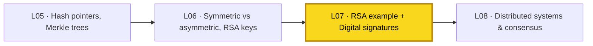

[[L06 - Basic Cryptographic Primitives IV]] showed how RSA keys are made. This lecture **uses** those keys: first to encrypt, then to sign. The hashes from [[L03 - Basic Cryptographic Primitives I]] to [[L05 - Basic Cryptographic Primitives III]] come back here as the "message digest" that gets signed. Next, [[L08 - Distributed Systems for Decentralization]] leaves cryptography and moves on to consensus. Course map: [[00 - START HERE (Course Overview)]].

## 🗺️ Structure at a glance

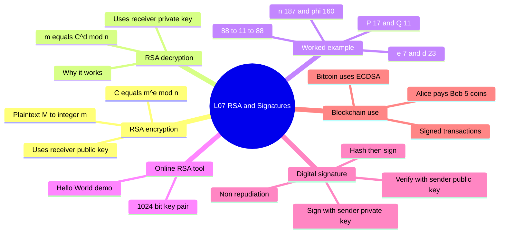

1. **RSA encryption and decryption**: the two formulas, and which person's key is used.
2. **Worked RSA example**: key generation, finding d with extended Euclid, and modular exponentiation by hand.
3. **RSA in practice**: library and website key generators (the "Hello World" demo).
4. **Digital signatures**: sign with the private key, verify with the public key.
5. **Hash-then-sign**: signing the digest h(M) instead of the whole message.
6. **Encryption vs signature**: which key is used where.
7. **Signatures in blockchain**: signed transactions, non-repudiation, ECDSA.

---

## 1. RSA Encryption and Decryption

**What it is.** RSA is a **public-key** (asymmetric) cipher. Each user has a key pair:
- **Public key** $(e, n)$. Anyone may know it.
- **Private key** $(d, n)$. Only the owner knows it.

What one key locks, only the other key can unlock.

> [!example] Analogy — a padlock you hand out
> Bob gives open padlocks (his public key) to everyone. Anyone can snap one shut on a box. Only Bob has the key (his private key) that opens them. So a thief who grabs the locked box on the way gets nothing.

**How it works**

1. Alice wants to send Bob the message **M** (the plaintext).
2. She turns M into an integer **m**. It must satisfy $0 \le m < n$.
3. She gets **Bob's** public key $(e, n)$. She does **not** use her own key.
4. **Encrypt:**
   $$C = m^{e} \bmod n$$
5. She sends the ciphertext **C** over the network.
6. **Decrypt:** Bob uses his private key $(d, n)$:
   $$m = C^{d} \bmod n$$
7. Bob turns m back into M.

**Why decryption gives back m:**
$$C^{d} \bmod n = (m^{e} \bmod n)^{d} \bmod n = m^{e\cdot d} \bmod n = m$$
This holds because $e \cdot d \equiv 1 \pmod{\varphi(n)}$. By Euler's theorem, raising to the power $ed$ is the same as raising to the power 1, modulo n.

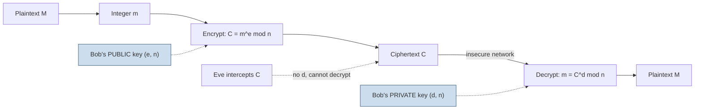

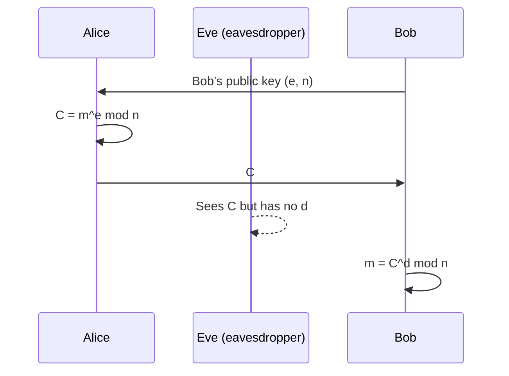

**Why it matters.** This gives **confidentiality**: only the person the message is for can read it. A blockchain mainly needs the **opposite** use, the signature (Section 4). That use comes straight from the same maths.

> [!warning] Common mistake
> To keep a message secret, Alice uses **Bob's** public key. Her own keys play no part in encryption. Students often write "Alice encrypts with her private key". That is **signing**, not secret-keeping.

> [!tip] Memory trick
> **E**ncrypt uses **e**, and e is public. **D**ecrypt uses **d**, and d is private. Both share the same **n**.

---

## 2. Worked RSA Example (from Stallings)

The lecture takes this example from William Stallings, *Cryptography and Network Security*. Real primes have hundreds of digits. Here they are kept small so you can work it by hand.

### 2.1 Key generation

| Step | Rule | Value |
|---|---|---|
| 1 | Pick two primes P, Q | $P = 17,\ Q = 11$ |
| 2 | $n = P \times Q$ | $n = 17 \times 11 = 187$ |
| 3 | $\varphi(n) = (P-1)(Q-1)$ | $\varphi(n) = 16 \times 10 = 160$ |
| 4 | Pick e with $1 < e < \varphi(n)$ and $\gcd(e, \varphi(n)) = 1$ | $e = 7$, since $\gcd(7,160) = 1$ |
| 5 | Find d with $d \cdot e \equiv 1 \pmod{\varphi(n)}$ and $d < \varphi(n)$ | $d = 23$ |
| 6 | Public key | $(e, n) = (7, 187)$ |
| 7 | Private key | $(d, n) = (23, 187)$ |

**Check for d:** $23 \times 7 = 161 = 1 \times 160 + 1$, so $161 \bmod 160 = 1$. ✔

> [!note] Why e = 7 is allowed
> $160 = 2^5 \times 5$. The number 7 shares no factor with 160, so they are coprime. Values like 2, 4, 5 or 10 would **fail** this test.

### 2.2 How to *find* d: the extended Euclidean algorithm

The lecture just states d = 23. Here is how you compute it. We need the **modular inverse** of 7 mod 160.

**Step A: forward Euclid.** Divide repeatedly until the remainder is 1.
$$160 = 22 \times 7 + 6$$
$$7 = 1 \times 6 + 1$$

**Step B: back-substitute.** Write 1 using 160 and 7.
$$1 = 7 - 1 \times 6$$
$$6 = 160 - 22 \times 7$$
$$\Rightarrow\ 1 = 7 - (160 - 22 \times 7) = 23 \times 7 - 1 \times 160$$

So $23 \times 7 \equiv 1 \pmod{160}$, which gives $\boxed{d = 23}$.

| Row | a | b | q = ⌊a/b⌋ | r = a mod b |
|---|---|---|---|---|
| 1 | 160 | 7 | 22 | 6 |
| 2 | 7 | 6 | 1 | 1 |
| 3 | 6 | 1 | 6 | 0 |

The last non-zero remainder is 1, so gcd = 1 and an inverse exists.

> [!tip] Exam shortcut for small numbers
> Look for a multiple of 160 plus 1 that 7 divides: 161 ÷ 7 = 23. ✔ This "try $k\varphi+1$" trick is quick when the numbers are small.

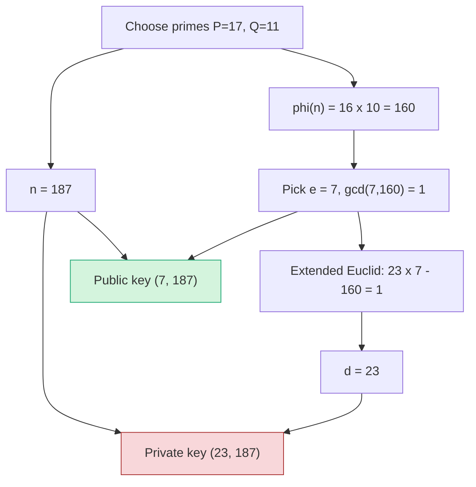

### 2.3 Encryption: $C = 88^{7} \bmod 187$

Computing $88^7$ in full gives a huge number. The trick, which the lecture calls "a little bit of jugglery", is to **split the exponent** into powers of 2. You reduce mod 187 after **every** multiplication, so the numbers stay small.

**Rule used:** $(a \times b) \bmod n = \big((a \bmod n)(b \bmod n)\big) \bmod n$.

**Split:** $7 = 4 + 2 + 1$, so $88^7 = 88^4 \cdot 88^2 \cdot 88^1$.

**Repeated squaring** (each line squares the line above):

| Power | Calculation | Result mod 187 |
|---|---|---|
| $88^1$ | 88 | **88** |
| $88^2$ | $88^2 = 7744 = 41 \times 187 + 77$ | **77** |
| $88^4$ | $77^2 = 5929 = 31 \times 187 + 132$ | **132** |

**Multiply the pieces:**
$$C = (88 \times 77 \times 132) \bmod 187 = 894432 \bmod 187$$
$$894432 = 4783 \times 187 + 11$$
$$\boxed{C = 11}$$

You can also reduce step by step: $88 \times 77 = 6776 \equiv 44$, then $44 \times 132 = 5808 \equiv 11 \pmod{187}$. ✔

### 2.4 Decryption: $m = 11^{23} \bmod 187$

Bob receives only **C = 11**. He uses his private exponent d = 23.

**Split:** $23 = 16 + 4 + 2 + 1$ in binary, which is $10111_2$. The lecture writes it as $1 + 2 + 4 + 8 + 8$. That is the same total and saves computing $11^{16}$.

| Power | Calculation | Result mod 187 |
|---|---|---|
| $11^1$ | 11 | **11** |
| $11^2$ | 121 | **121** |
| $11^4$ | $121^2 = 14641 = 78 \times 187 + 55$ | **55** |
| $11^8$ | $55^2 = 3025 = 16 \times 187 + 33$ | **33** |

**Lecture's way** ($1+2+4+8+8$):
$$m = (11 \times 121 \times 55 \times 33 \times 33) \bmod 187 = 79720245 \bmod 187$$
$$79720245 = 426311 \times 187 + 88$$
$$\boxed{m = 88}\ \checkmark$$
(The garbled "7, 9, 7, 2, 0, 2, 4, 5" in the transcript is this number, 79 720 245.)

**Step by step** (numbers stay small):
- $11 \times 121 = 1331 \equiv 22$
- $22 \times 55 = 1210 \equiv 88$
- $88 \times 33 = 2904 \equiv 99$
- $99 \times 33 = 3267 \equiv 88$

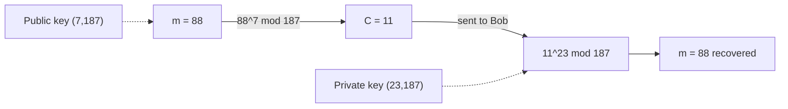

### 2.5 Square-and-multiply: the general method

To compute $a^{k} \bmod n$:
1. Write k in binary. For example, $23 = 10111_2$.
2. Square repeatedly to get $a^1, a^2, a^4, a^8, a^{16}, \dots$, reducing mod n each time.
3. Multiply together the powers whose bit is 1, reducing mod n after each multiplication.

This takes about $2\log_2 k$ multiplications instead of k. That is why RSA is practical even with 2048-bit exponents.

> [!warning] Common mistakes in hand calculation
> - Forgetting to reduce mod n after each step. The numbers then blow up.
> - Adding the pieces instead of multiplying them. Exponents add ($4+2+1$); the powers **multiply** ($88^4 \cdot 88^2 \cdot 88^1$).
> - Using φ(n) = 160 as the modulus for $C$ or $m$. φ(n) is used **only** to find d. All encryption and decryption is **mod n = 187**.

### 2.6 The keys work in both orders

The lecture stresses one key property: the key pair works **in either order**.
$$(m^{e})^{d} \bmod n = m = (m^{d})^{e} \bmod n$$

**Check with the same numbers:**
- "Encrypt" 88 with the **private** key: $88^{23} \bmod 187 = 11$.
- "Decrypt" with the **public** key: $11^{7} \bmod 187 = (11 \times 121 \times 55) \bmod 187 = 73205 \bmod 187 = 88$. ✔

(Here $88^{23}$ also happens to be 11 mod 187, the same as $88^7$. That is a coincidence of these small numbers.)

Using the private key first is exactly what a **digital signature** does (Section 4).

**Why it matters.** The worked example is the most likely numerical exam question. You must be able to go from P, Q, e to n, φ, d, C and m without a calculator.

---

## 3. RSA in Practice: Libraries and Online Tools

**What it is.** In real systems nobody picks primes by hand. Programming languages provide **library functions**, such as OpenSSL or Python's `cryptography`, that create key pairs of 1024, 2048 or 4096 bits.

**Lecture demo (an online RSA tool):**
1. Pick a key size (1024 bits) and click **Generate RSA key pair**. A public key and a private key appear.
2. **Confidentiality demo.** Treat the pair as Bob's. Type "Hello World", choose the **public** key, and click Encrypt. You get Base64-encoded ciphertext.
3. Paste the ciphertext on the decrypt side. Choose the **private** key and click Decrypt. "Hello World" comes back.
4. **Signature demo** (Section 4). Treat the new pair as Alice's. Encrypt with her **private** key, then decrypt with her **public** key. "Hello World" comes back again.

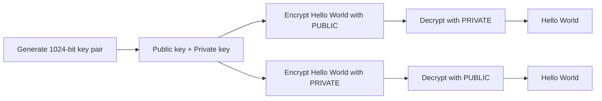

> [!example] Analogy
> A calculator does long division for you, but you still need to know what division means. In the same way, libraries do RSA for you, but you must know **which key to use when**.

> [!tip] Try it yourself
> The lecture's suggested exercise: hash "Hello World" first (for example with the SHA-256 tool from [[L04 - Basic Cryptographic Primitives II]]). Then encrypt the **digest** with the private key, and check that the digest comes back.

---

## 4. Digital Signatures

**What it is.** A digital signature is a value only the sender could have made, and anyone can check it. It proves:
- **Authenticity (origin):** the message really came from Alice.
- **Integrity:** the message was not changed on the way.
- **Non-repudiation:** Alice cannot later deny she sent it.

Formally, the signer applies her **private** key to the message, or to its hash. The verifier applies the signer's **public** key and compares the result.

> [!example] Analogy — a wax seal
> A king stamps letters with a seal ring that only he owns (the private key). Everyone knows what his seal looks like (the public key). Anyone can check the seal, but no one else can make it, and the king cannot say "that wasn't me".

### 4.1 Basic version: sign the whole message

1. Alice computes $M' = \text{Encrypt}_{\text{PrivA}}(M)$, which in RSA is $M' = m^{d_A} \bmod n_A$.
2. She sends **(M, M′)** to Bob. M itself is **not** secret here. Anyone may read it. The goal is proof of origin, not secrecy.
3. Bob computes $\text{Decrypt}_{\text{PubA}}(M') = (M')^{e_A} \bmod n_A$.
4. If the result equals M, then M′ must have been made with Alice's private key. So Alice sent it.

Bob's own keys are **not used at all** here. The lecture also corrects its slide: Bob's step is a **decryption** with Alice's public key, not an encryption.

**The problem:** signing the whole message is slow, and the signature is as large as the message.

### 4.2 Better version: hash, then sign

Alice signs only the short, fixed-size **digest h(M)**, for example 256 bits from SHA-256.

**Steps:**
1. Alice computes the digest $h(M)$.
2. Alice signs the digest: $S = h(M)^{d_A} \bmod n_A$.
3. Alice sends **(M, S)**.
4. Bob decrypts the signature: $h' = S^{e_A} \bmod n_A$.
5. Bob hashes the received message himself and gets $h(M)$.
6. **Compare:** if $h' = h(M)$, the signature is **valid**. Otherwise **reject**.

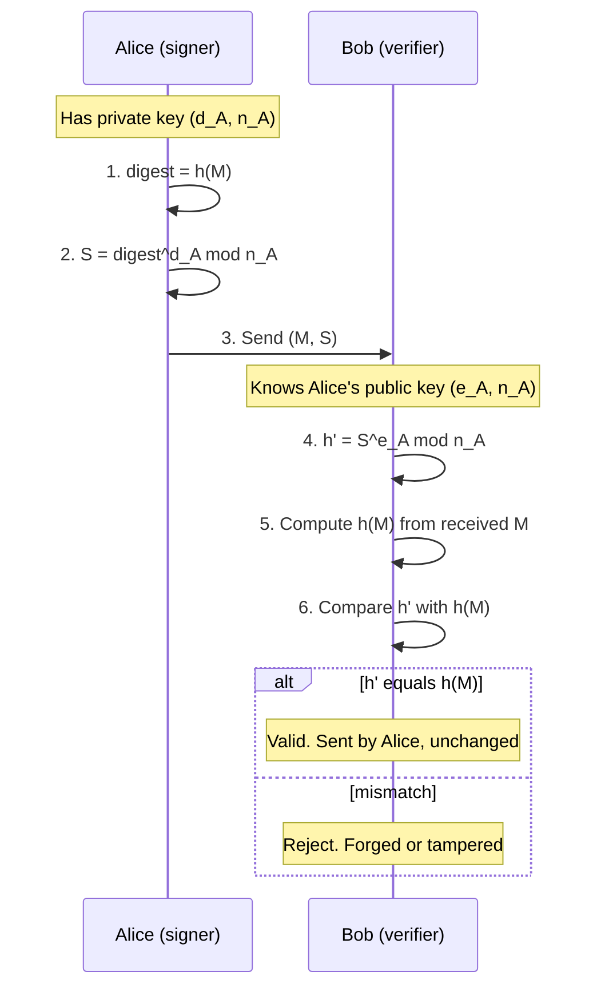

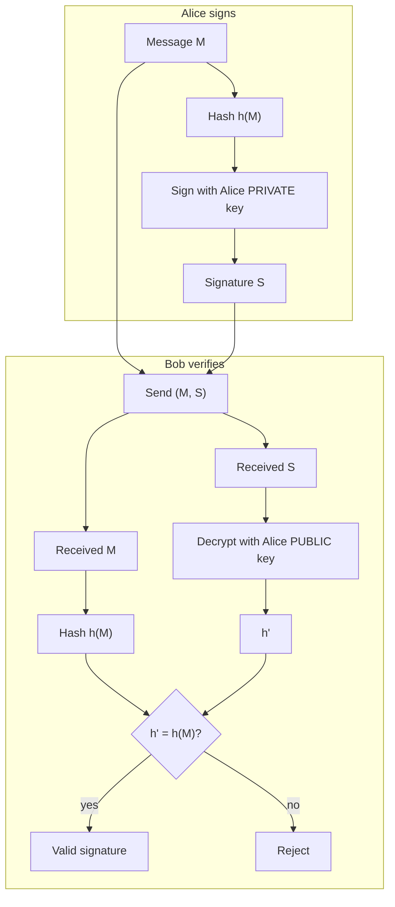

**Toy numbers (using our RSA keys as Alice's).** Say $h(M) = 88$ and Alice's keys are $(e, n) = (7, 187)$ and $(d, n) = (23, 187)$.
- Sign: $S = 88^{23} \bmod 187 = 11$.
- Verify: $11^{7} \bmod 187 = 88 = h(M)$. ✔ Valid.
- If an attacker changes M, then $h(M)$ is no longer 88 and the check fails.

**Why hashing helps:**

| Benefit | Reason |
|---|---|
| Smaller signature | You sign 256 bits, not the whole message |
| Faster | One RSA operation on a small number |
| Integrity | Collision resistance (from [[L03 - Basic Cryptographic Primitives I]]): a changed M gives a different h(M) |
| Works for any length | The hash squeezes any message into a fixed size |

> [!warning] Myth
> "A signature hides the message." It does **not**. M travels in the clear. A signature gives authenticity, integrity and non-repudiation, **not confidentiality**. If you need both, sign first, then encrypt with the receiver's public key.

> [!tip] Memory trick
> **S**ign with **S**ecret (private). **V**erify with **V**isible (public).

---

## 5. Encryption vs Digital Signature: Which Key Where?

| Aspect | RSA Encryption (confidentiality) | Digital Signature (authenticity) |
|---|---|---|
| Goal | Only the receiver can read it | Prove who sent it and that it is unchanged |
| Key used by **sender** | **Receiver's public** key | **Sender's private** key |
| Key used by **receiver** | **Receiver's private** key | **Sender's public** key |
| Who can do the final step | Only the receiver | Anyone |
| Is the message hidden? | Yes | No (sent in the clear) |
| What is processed | The message m | Usually the hash h(M) |
| Formula (sender) | $C = m^{e_B} \bmod n_B$ | $S = h(M)^{d_A} \bmod n_A$ |
| Formula (receiver) | $m = C^{d_B} \bmod n_B$ | check $S^{e_A} \bmod n_A = h(M)$ |
| Security property | Confidentiality | Authenticity, integrity, non-repudiation |
| Main use in blockchain | Rare | Every transaction |

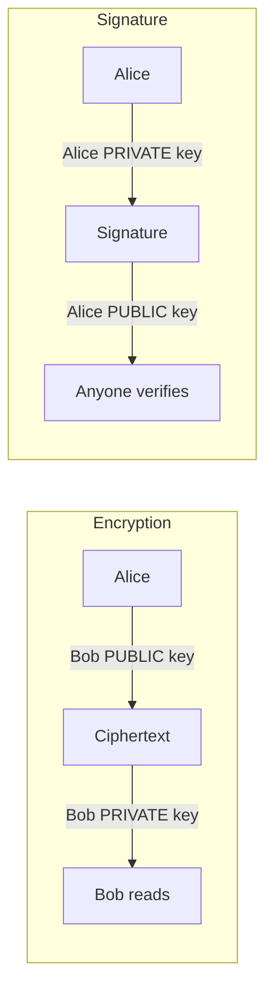

> [!tip] One-line rule
> Encryption is done **for** the receiver, using the receiver's keys. A signature is done **by** the sender, using the sender's keys.

---

## 6. Digital Signatures in Blockchain

**What it is.** A blockchain stores **transactions**. Each transaction is signed with the **private key of the person spending**, so every node can check it with that person's public key.

**What signatures give a blockchain:**
1. **Proof of origin.** Each transaction really comes from the owner of the coins.
2. **Non-repudiation.** Alice cannot later deny her own transaction.
3. **No false claims.** Carol cannot claim Alice's transaction as hers. A signature made with Alice's private key checks out only against **Alice's** public key, not Carol's.
4. **No central authority needed.** Any node can verify using public keys alone. This is what makes decentralisation possible ([[L01 - The Model of Decentralization]]).

**The lecture's example** (assume one transaction per block):
- **Block 1:** "Alice generates 10 coins". Signed with Alice's private key, giving the signature $S_A$.
- **Block 2:** "Alice → Bob : 5 coins". Signed again by Alice, giving $S_A$.
- Each block links to the previous one by a **hash pointer** ([[L05 - Basic Cryptographic Primitives III]]).

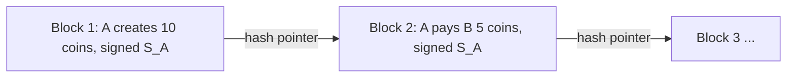

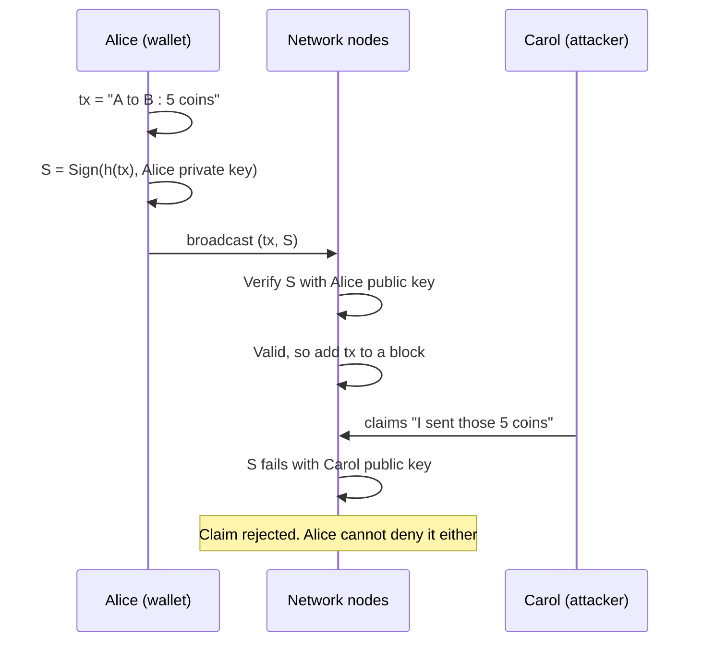

**Hashing and signatures together:**

| Primitive | Protects | Blockchain role |
|---|---|---|
| Hash pointers / Merkle trees | Integrity of the **history** (blocks cannot be changed) | Links blocks, summarises transactions |
| Digital signatures | **Who** made each transaction | Authorises spending, gives non-repudiation |

**Algorithms used in real blockchains.** Many public-key schemes exist. **Bitcoin uses ECDSA** (Elliptic Curve Digital Signature Algorithm), not RSA. Elliptic-curve keys are much smaller for the same security, and good randomness in key generation is critical. Other blockchains may use other schemes, such as Ed25519 or Schnorr.

> [!warning] Common mistake
> "Bitcoin uses RSA signatures." **False.** It uses ECDSA on the secp256k1 curve, and Taproot also uses Schnorr signatures. RSA is taught here because its maths is the easiest way to understand signatures.

> [!example] Analogy
> A bank cheque needs your handwritten signature. A blockchain transaction is a cheque that every node checks. Only you can sign it, and everyone can confirm the signature is yours.

---

## 7. Wrap-up of the Cryptography Unit (L03–L07)

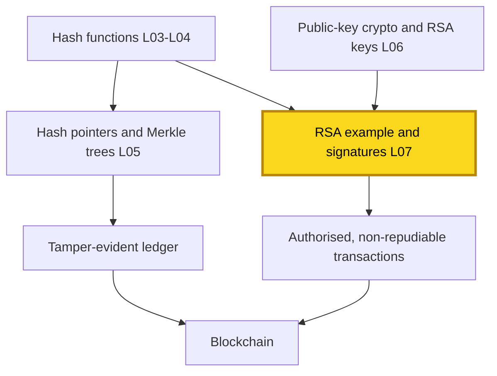

The two main tools that blockchain takes from cryptography are **cryptographic hash functions** and **digital signatures**. References: W. Stallings, *Cryptography and Network Security*, and D. Drescher, *Blockchain Basics*.

---

## 🔑 Key Points (short)

- RSA encryption: $C = m^e \bmod n$. Decryption: $m = C^d \bmod n$.
- For secrecy, Alice encrypts with **Bob's public key**. Only Bob's private key can decrypt.
- Key generation: $n = PQ$, $\varphi(n) = (P-1)(Q-1)$, $\gcd(e,\varphi) = 1$, $de \equiv 1 \pmod{\varphi}$.
- Worked example: P = 17, Q = 11, n = 187, φ = 160, e = 7, d = 23.
- Public key (7, 187), private key (23, 187). 88 → 11 → 88.
- d is found with the **extended Euclidean algorithm**: $23 \cdot 7 - 160 = 1$.
- Modular exponentiation: split the exponent into powers of 2 and reduce mod n after each step.
- RSA works in both orders: private then public also gives back m. This is the basis of signatures.
- Signature: **sign with your private key**, anyone **verifies with your public key**.
- Hash-then-sign: sign h(M), not M. Smaller, faster, and protects integrity.
- Verify: decrypt S with the sender's public key and compare with h(M) computed from the received M.
- A signature gives authenticity, integrity and **non-repudiation**, but **not** confidentiality.
- In a blockchain, every transaction is signed by the spender. Others cannot claim it, and the spender cannot deny it.
- Bitcoin uses **ECDSA** (elliptic curve), not RSA.
- Example ledger: "A creates 10 coins, signed S_A", then "A → B 5 coins, signed S_A".

## 📖 Glossary

| Term | Meaning (plain English) |
|---|---|
| Plaintext (M / m) | The original readable message, or its integer form |
| Ciphertext (C) | The scrambled message after encryption |
| Public key (e, n) | The shared half of a key pair. Used to encrypt or to verify |
| Private key (d, n) | The secret half. Used to decrypt or to sign |
| Modulus n | $P \times Q$. All RSA arithmetic is done mod n |
| Euler's totient φ(n) | How many numbers below n are coprime to n. For $n = PQ$ it is $(P-1)(Q-1)$ |
| Coprime / relatively prime | Two numbers whose gcd is 1 |
| Modular inverse | The number d with $d \cdot e \bmod \varphi = 1$ |
| Extended Euclidean algorithm | A method that finds the gcd and the modular inverse |
| Square-and-multiply | A fast way to compute large powers mod n by repeated squaring |
| Digital signature | A value made with a private key that proves the origin of a message |
| Message digest h(M) | The fixed-size hash of a message |
| Authenticity | Proof of who sent the message |
| Integrity | Proof that the message was not changed |
| Non-repudiation | The sender cannot deny sending the message |
| Confidentiality | Only the intended receiver can read the message |
| ECDSA | Elliptic Curve Digital Signature Algorithm, used by Bitcoin |
| Transaction | A signed record in a blockchain, for example "A pays B 5 coins" |

## 🧮 Formulas & Numbers

| Formula / Number | Meaning |
|---|---|
| $n = P \times Q$ | Modulus. P and Q are large secret primes |
| $\varphi(n) = (P-1)(Q-1)$ | Euler's totient. Used only to find d |
| $1 < e < \varphi(n)$, $\gcd(e, \varphi(n)) = 1$ | Rule for the public exponent e |
| $d \cdot e \equiv 1 \pmod{\varphi(n)}$ | d is the inverse of e mod φ(n) |
| $C = m^{e} \bmod n$ | Encryption with the receiver's public key |
| $m = C^{d} \bmod n$ | Decryption with the receiver's private key |
| $S = h(M)^{d_A} \bmod n_A$ | Signing with the sender's private key |
| $S^{e_A} \bmod n_A \stackrel{?}{=} h(M)$ | Verifying with the sender's public key |
| $(m^e)^d \equiv (m^d)^e \equiv m \pmod n$ | The keys work in either order |
| P = 17, Q = 11 | Example primes |
| n = 187, φ(n) = 160 | Example modulus and totient |
| e = 7, d = 23 | Example exponents ($7 \times 23 = 161 \equiv 1$) |
| $88^2 \equiv 77,\ 88^4 \equiv 132$ | Encryption intermediate values (mod 187) |
| $88 \times 77 \times 132 = 894432 \equiv 11$ | Ciphertext C = 11 |
| $11^2 = 121,\ 11^4 \equiv 55,\ 11^8 \equiv 33$ | Decryption intermediate values (mod 187) |
| $11 \cdot 121 \cdot 55 \cdot 33 \cdot 33 = 79720245 \equiv 88$ | Recovered m = 88 |
| 1024 bits | Key size used in the online tool demo |

## 🎯 Exam Corner

### Likely questions

**Q1. With P = 17, Q = 11, e = 7, find n, φ(n) and d.**
n = 187 and φ = 160. Find d with $7d \equiv 1 \pmod{160}$. Extended Euclid gives $23 \cdot 7 - 160 = 1$, so d = 23.

**Q2. Encrypt m = 88 with the public key (7, 187).**
$88^2 \equiv 77$ and $88^4 \equiv 132$. Then $C = 88 \cdot 77 \cdot 132 \bmod 187 = 11$.

**Q3. Decrypt C = 11 with the private key (23, 187).**
$23 = 1+2+4+8+8$. The powers are 11, 121, 55, 33, 33. Their product mod 187 is **88**.

**Q4. Alice sends Bob a secret message. Which keys are used?**
Alice encrypts with **Bob's public** key. Bob decrypts with **Bob's private** key. Alice's keys are not involved.

**Q5. How does Bob verify Alice's digital signature?**
He decrypts S with **Alice's public** key to get h′. He hashes the received M himself. If h′ = h(M), the signature is valid.

**Q6. Why sign h(M) instead of M?**
The digest is short and fixed-size, so the signature is smaller and faster to make. Collision resistance means any change to M gets caught.

**Q7. How do signatures stop fraud in a blockchain?**
Each transaction is signed with the spender's private key. Alice cannot deny her transfer to Bob (non-repudiation). Carol cannot claim it, because the signature fails with Carol's public key.

**Q8. Does a digital signature provide confidentiality?**
No. M is sent in the clear. A signature gives authenticity, integrity and non-repudiation only.

### MCQs

**1.** In RSA encryption, the ciphertext is computed as
A) $C = m^d \bmod n$  B) $C = m^e \bmod n$  C) $C = m \cdot e \bmod n$  D) $C = e^m \bmod n$
> [!check]- Answer
> **B.** Encryption raises m to the public exponent e, mod n.

**2.** In the lecture's example, the chosen primes were
A) 11 and 13  B) 17 and 19  C) 17 and 11  D) 23 and 29
> [!check]- Answer
> **C.** P = 17 and Q = 11, giving n = 187 (Stallings' example).

**3.** With φ(n) = 160 and e = 7, the private exponent d is
A) 7  B) 160  C) 23  D) 187
> [!check]- Answer
> **C.** $7 \times 23 = 161 \equiv 1 \pmod{160}$.

**4.** $88^7 \bmod 187$ equals
A) 88  B) 11  C) 77  D) 132
> [!check]- Answer
> **B.** $88 \cdot 77 \cdot 132 = 894432 \equiv 11 \pmod{187}$.

**5.** To decrypt the cipher text, the recipient uses
A) the sender's public key  B) their own private key  C) the plaintext  D) the sender's private key
> [!check]- Answer
> **B.** Only the receiver's private key (d, n) undoes encryption done with their public key.

**6.** To create a digital signature, Alice encrypts the message (or its digest) with
A) her public key  B) her private key  C) Bob's public key  D) a symmetric key
> [!check]- Answer
> **B.** Only Alice has her private key, so only she can produce the signature.

**7.** Bob verifies Alice's signature by
A) encrypting with Alice's private key  B) decrypting the signature with Alice's public key  C) using his own private key  D) comparing ciphertext with plaintext
> [!check]- Answer
> **B.** Anyone can verify using the signer's public key.

**8.** "Non-repudiation" means
A) the sender can deny sending  B) the sender cannot deny sending  C) the message can be altered  D) anyone can read the message
> [!check]- Answer
> **B.** Only Alice's private key could have made the signature, so she cannot deny it.

**9.** Why hash the message before signing?
A) To encrypt it  B) To get a short, unique representation to sign  C) To generate the public key  D) To decrypt it
> [!check]- Answer
> **B.** A fixed-size digest makes the signature small and fast, and still catches tampering.

**10.** Which algorithm does Bitcoin use for digital signatures?
A) RSA  B) DSA  C) ECDSA  D) AES
> [!check]- Answer
> **C.** The Elliptic Curve Digital Signature Algorithm. AES is a symmetric cipher and cannot sign at all.

## 📝 Summary

This lecture finished the cryptography unit by putting RSA to work. With P = 17 and Q = 11, we got n = 187 and φ(n) = 160. We chose e = 7 and found d = 23 with the extended Euclidean algorithm. Then 88 encrypted to $88^7 \bmod 187 = 11$, and 11 decrypted back to $11^{23} \bmod 187 = 88$. Splitting the exponent into powers of 2 and reducing mod n at every step keeps the numbers small. Because RSA keys work in either order, the same maths gives a **digital signature**. Alice hashes the message and signs the digest with her private key. Anyone can check it with her public key, which gives authenticity, integrity and non-repudiation, but not secrecy. In a blockchain, every transaction, such as "Alice pays Bob 5 coins", carries the spender's signature. Real systems like Bitcoin use ECDSA for this. Next, [[L08 - Distributed Systems for Decentralization]] moves from cryptography to the distributed-systems problem of getting many nodes to agree: consensus, the FLP impossibility result and Paxos.
