# L08 · Distributed Systems for Decentralization

> [!summary] TL;DR — the whole lecture in 30 seconds
> Every node in a blockchain keeps its own copy of the ledger. When one node proposes a new block, **all the others must agree** on it. This is the classic **distributed consensus problem**, and computer scientists have studied it since the 1970s–80s. Prof. Sandip Chakraborty explains it with a "burger or pizza?" example. A leader (centralized) needs fewer calls but you have to trust the leader. Everyone-calls-everyone (distributed) needs no trust but more calls. Then come the hard parts: **Byzantine** nodes that lie, and the **FLP impossibility theorem** (1985), which says a fully asynchronous system cannot guarantee both **safety** and **liveness** if even one node can crash. The lecture ends with a short history: Paxos, ZooKeeper, Multi-Paxos, Raft and PBFT.

## 🧭 Where this fits

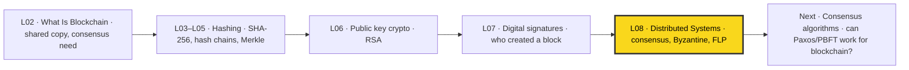

[[L07 - Basic Cryptographic Primitives V]] finished the crypto toolkit (hashes, Merkle trees, signatures) taught by Prof. Shamik Sural. This lecture starts the **second pillar**, distributed systems. It picks up the consensus problem first raised in [[L02 - What Is Blockchain]]. The next lectures cover consensus algorithms in detail and ask whether the classical ones can be used for blockchain. Course map: [[00 - START HERE (Course Overview)]].

## 🗺️ Structure at a glance

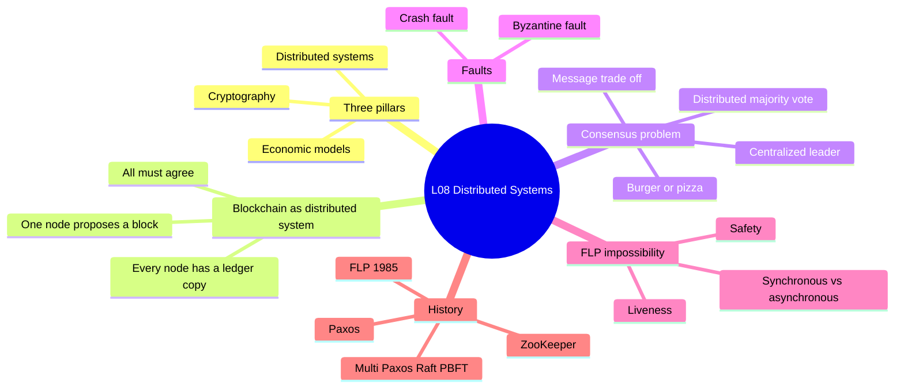

1. **Three pillars of blockchain**: distributed systems, cryptography, economic models.
2. **Blockchain as a distributed system**: copies of the ledger everywhere, and agreement on each new block.
3. **The distributed consensus problem**: what it is and who the "peers" are.
4. **Burger vs pizza**: the centralized (leader) way vs the distributed (everyone calls everyone) way.
5. **Trade-off**: message count vs trust.
6. **Byzantine behaviour**: a node that tells different people different things.
7. **Synchronous vs asynchronous systems**.
8. **Crash faults vs Byzantine faults**.
9. **Safety and liveness**, the two properties of consensus.
10. **FLP impossibility theorem** and what it means.
11. **History of consensus**: Paxos → ZooKeeper → Multi-Paxos, Raft, PBFT.

---

## 1. Blockchain Has Old Roots: The Three Pillars

- **What it is** – Blockchain became famous around **2014–2015**, but its core ideas are much older. They come from **1970s–1980s** research on distributed systems. Blockchain *borrows* ideas from several fields and combines them into one platform.
- **The three pillars** behind blockchain design:

| Pillar | What it gives blockchain | Covered in |
|---|---|---|
| **Distributed systems** | Many nodes keep the same data and agree on changes | This lecture onwards |
| **Cryptographic techniques** | Hashes, Merkle trees, digital signatures (integrity, identity) | [[L03 - Basic Cryptographic Primitives I]] to [[L07 - Basic Cryptographic Primitives V]] |
| **Economic models** | Incentives that make people behave honestly, mainly in cryptocurrencies | Later lectures |

> [!example] Analogy
> Blockchain is like a new dish made from old ingredients. Distributed systems, cryptography and economics already existed. Blockchain is the recipe that puts them together.

> [!warning] Common myth
> "Blockchain was invented in 2014." False. It became **popular** then (Bitcoin itself came out in 2008–2009). The building blocks are decades older.

- **Why it matters** – If you know the old distributed-systems results (FLP, Paxos, PBFT), you understand *why* blockchain consensus is designed the way it is.

---

## 2. Blockchain as a Distributed System

- **What it is** – A **distributed system** is a set of independent computers (nodes) that talk by passing messages and work towards a common goal. In a blockchain, each node keeps its **own local copy** of the chain of blocks.
- **The core problem**: Suppose **node 6** proposes a new block. Every other node must:
  1. **Receive** the proposed block.
  2. **Check** that it is valid and comes from a real participant (signatures from L07, hashes from L03–L05).
  3. **Agree** with everyone else that this block is the next one.
  4. **Append** it to its local copy.
- After this, **everyone has the same copy of the database**, so everyone is "on the same page".

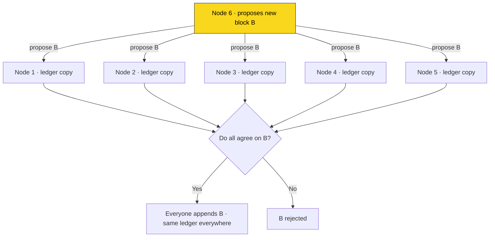

### The ledger before and after consensus

```
Before:  Node1: [G]-[B1]-[B2]        Node6: [G]-[B1]-[B2]-[B]  (proposed)
After:   Node1: [G]-[B1]-[B2]-[B]    Node6: [G]-[B1]-[B2]-[B]  (agreed, identical)
```

### Who are the peers?

The peers are the **organizations** in the blockchain network. In the course's **petroleum supply chain** example they are:

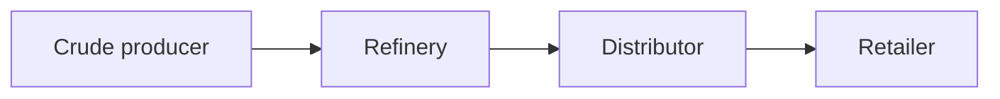

- Example: a **refinery** creates a block saying "today we produced X litres of each product using Y barrels of crude oil".
- The other players check the block, agree on it, and add it to their copies. No single company controls the record.

> [!example] Analogy
> Think of a class WhatsApp group where everyone keeps a notebook of "official decisions". If one student writes "exam moved to Friday", everyone else must agree before writing it in their notebook. Otherwise the notebooks stop matching.

- **Why it matters** – Without agreement, different nodes would end up with **different ledgers**, and the "single shared truth" promise of blockchain breaks.

---

## 3. The Distributed Consensus Problem

- **What it is** – One node **proposes** a value (here, a new block). All the peers must **collectively decide** whether to accept it, and every correct node must end with the **same decision**.
- **Formal idea** – Each process starts with an input value. The protocol must make all correct processes **decide on one common value**, and that value must be valid (someone actually proposed it).
- It is a **classical problem** in distributed systems with **many variants**: crash faults or Byzantine faults, synchronous or asynchronous networks, known or unknown participants.

> [!tip] Memory trick
> **Consensus = "Propose, Check, Agree, Append."** The proposer suggests, the peers check, the group agrees, and everyone appends.

---

## 4. Burger or Pizza? Centralized vs Distributed Decision

**Setup (the lecture's example):** You and **three friends (4 people)** want to eat together after class, either **burger** or **pizza**. Everyone is at home (pandemic), so you decide by phone.

### 4a. Centralized approach: one leader

**How it works**
1. One friend becomes the **leader**.
2. The leader calls the other 3 and collects their choices (**3 calls**).
3. The leader works out the majority.
4. The leader calls the 3 again to announce the decision (**3 calls**).
5. Total = **3 + 3 = 6 calls**.

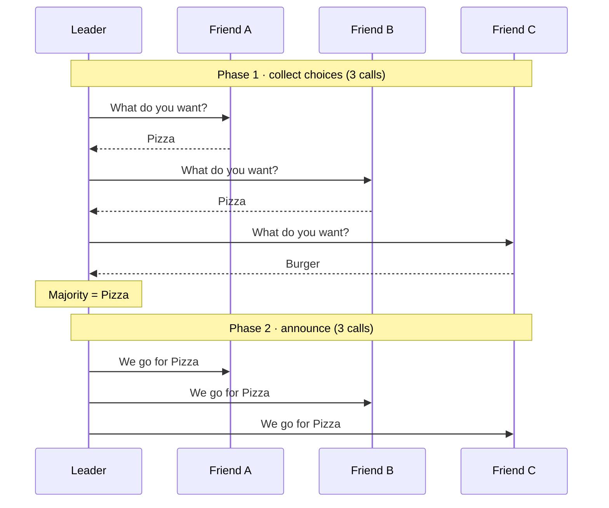

**The catch: you must trust the leader.** Suppose three friends want pizza but the leader loves burger. The leader can simply lie: "Everyone agreed on burger!" Nobody can check.


### 4b. Distributed approach: everyone calls everyone

Blockchain wants a **trustless** setup, so we remove the leader.

**How it works**
1. Each person calls **each of the other 3** and tells them their choice.
2. With 4 people: $4 \times 3 = 12$ calls.
3. Now **every person holds every choice** (X likes burger, Y likes pizza, ...).
4. Each person **locally** takes the **majority vote** and reaches the same answer.
5. No leader, no single point of trust.

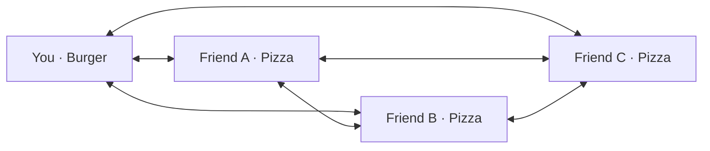

Each line above is used once in **each direction**: 6 pairs × 2 = 12 calls. Every person then computes Pizza = 3, Burger = 1, so the decision is **Pizza**.

### 4c. The trade-off

| Aspect | Centralized (leader) | Distributed (all-to-all) |
|---|---|---|
| Calls for 4 people | **6** (3 collect + 3 inform) | **12** (4 × 3) |
| General formula, $n$ people | $2(n-1)$ | $n(n-1)$ |
| Who decides | Leader alone | Everyone, locally, by majority |
| Trust needed | Must trust the leader | No single person needs trusting |
| Weak point | Leader can lie, or crash (single point of failure) | More messages, more delay, scales badly |
| Fits blockchain? | No (needs a trusted party) | Yes, this is the spirit of decentralization |

**Worked example**

$$\text{Centralized: } 2(n-1) = 2(4-1) = 6 \qquad \text{Distributed: } n(n-1) = 4 \times 3 = 12$$

So for 4 people the distributed method **doubles** the calls, as the lecture says. For bigger groups it is much worse: with $n = 100$, centralized needs $198$ messages and distributed needs $9{,}900$.

> [!tip] Memory trick
> **"Trust costs nothing, distrust costs messages."** Fewer messages = more trust needed. More messages = less trust needed.

> [!warning] Common mistake
> The "doubling" is true only for $n = 4$. In general the ratio is $\frac{n(n-1)}{2(n-1)} = \frac{n}{2}$, so it grows with group size.

- **Why it matters** – Every blockchain consensus design makes this trade-off: how much communication you pay in exchange for not trusting anyone.

---

## 5. Byzantine Behaviour: When a Friend Lies Differently to Different People

- **What it is** – Even in the all-to-all scheme, a friend can be **two-faced**. When calling the girls they say "I want **pizza**", and when calling the boy they say "I want **burger**". The node sends **different values to different peers**. This is called **Byzantine behaviour** (from Lamport, Shostak and Pease's 1982 "Byzantine Generals Problem").

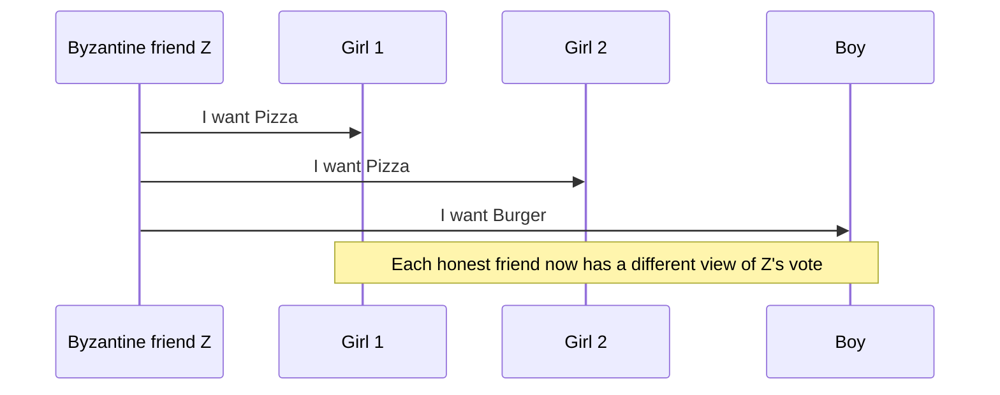

**Why this breaks simple majority voting** (worked example)
1. Honest votes: **Girl 1 = Pizza, Girl 2 = Pizza, Boy = Burger**. Z is the Byzantine friend.
2. Z tells both girls "Pizza" and tells the Boy "Burger".
3. Girl 1 and Girl 2 each count: Pizza 3 (G1, G2, Z), Burger 1 (Boy). They decide **Pizza**.
4. The Boy counts: Pizza 2 (G1, G2), Burger 2 (Boy, Z). For him it is a **tie**, and he may pick **Burger**.
5. Honest nodes now hold **different tallies** and may **decide differently**. Consensus fails, even though nobody but Z lied.

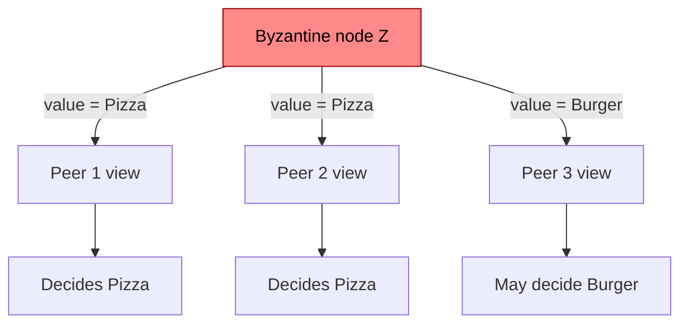

> [!example] Analogy
> A gossip who tells one group "the party is on Saturday" and another group "the party is on Sunday". Each group trusts what it heard, and the plans fall apart.

- **Why it matters** – In a public blockchain anyone can join, so some nodes **will** be malicious. Consensus algorithms that survive Byzantine nodes (PBFT, and the ones used in blockchains) are covered in later lectures.

---

## 6. Synchronous vs Asynchronous Systems

Before FLP we need to know how messages travel.

| | **Synchronous** | **Asynchronous** |
|---|---|---|
| Delivery time | Known, bounded ("real time") | **No bound** on message delay |
| Lecture's example | **Phone call**: you speak, they hear it at once | **SMS**: may arrive late, next day, or get lost |
| Can you tell "slow" from "dead"? | Yes (wait for the bound, then declare it dead) | **No** (it might still be on its way) |
| Real-world networks | Rare | **The Internet** is mostly asynchronous |

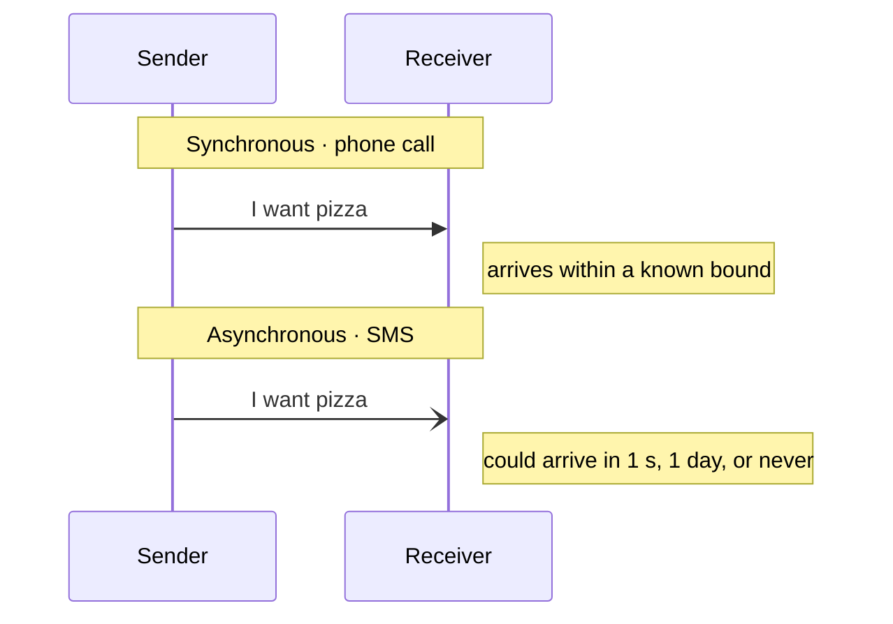

- On the Internet, packets can be **delayed, dropped or reordered**, so you cannot promise "this message arrives within T seconds". That is why practical systems are treated as **asynchronous**.

> [!tip] Memory trick
> **Sync = Speaking (phone). Async = SMS.**

---

## 7. Two Kinds of Faults

| Fault | What happens | Example from lecture | Difficulty |
|---|---|---|---|
| **Crash fault** | Node **stops responding** (hardware or software failure) | Friend's phone dies or has no connectivity | **Easier**: you get *no* information |
| **Byzantine fault** | Node keeps talking but sends **wrong or inconsistent** info | Friend says pizza to some, burger to others | **Harder**: you get *wrong* information |

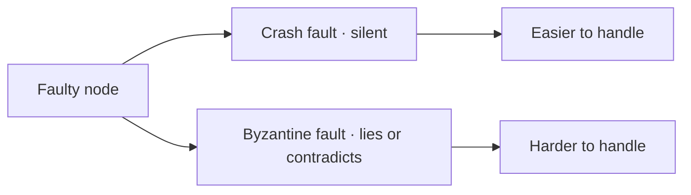

> [!warning] Common mistake
> Byzantine faults are **not** easier than crash faults. A silent node is only missing. A lying node actively misleads you. Every crash fault is a special case of Byzantine behaviour, but not the other way round.

---

## 8. Safety and Liveness: The Two Properties of Consensus

- **Safety** – *"Nothing bad happens."* **Correct processes yield the correct output.** All correct (non-faulty) nodes agree on the **same, valid** value. No two honest nodes decide differently.
- **Liveness** – *"Something good eventually happens."* The output is produced **within a finite time**. The algorithm **eventually terminates**.
- A **correct process** = one that has neither a crash fault nor a Byzantine fault.

| Property | Plain meaning | Guarantees | If violated |
|---|---|---|---|
| **Safety** | Never a wrong or conflicting decision | Agreement + validity | Honest nodes hold different ledgers (e.g. double spending) |
| **Liveness** | A decision is eventually made | Termination / progress | System gets stuck, no new blocks |

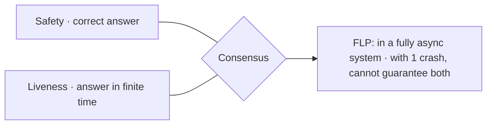

> [!example] Analogy
> A jury. **Safety**: they never give a wrong verdict. **Liveness**: they eventually give *some* verdict. A jury that waits forever is safe but not live. A jury that flips a coin is live but not safe.

> [!tip] Memory trick
> **S**afety = **S**ame and correct answer. **L**iveness = **L**ands (terminates) eventually.

---

## 9. The FLP Impossibility Theorem (1985)

- **Who** – **Michael Fischer, Nancy Lynch and Michael Paterson**. FLP = the first letters of their surnames. Paper: *"Impossibility of Distributed Consensus with One Faulty Process"*, Journal of the ACM, **1985**. (The transcript spells it "Patterson"; the correct name is **Paterson**.)
- **Statement** – *Consensus is impossible in a fully asynchronous system even with a single crash fault.*
- More precisely: **no deterministic** consensus algorithm can guarantee **both safety and termination (liveness)** in a fully asynchronous system if even **one** process may crash.

**Why (intuition)**
1. In an async system, there is no bound on message delay.
2. A node waiting for a message cannot tell whether the sender has **crashed** or is just **slow**.
3. If it **waits forever** for the slow node, liveness is lost.
4. If it **stops waiting and decides**, the "slow" node may wake up with a different value and break safety.
5. So you can always be pushed into one of these two bad cases.

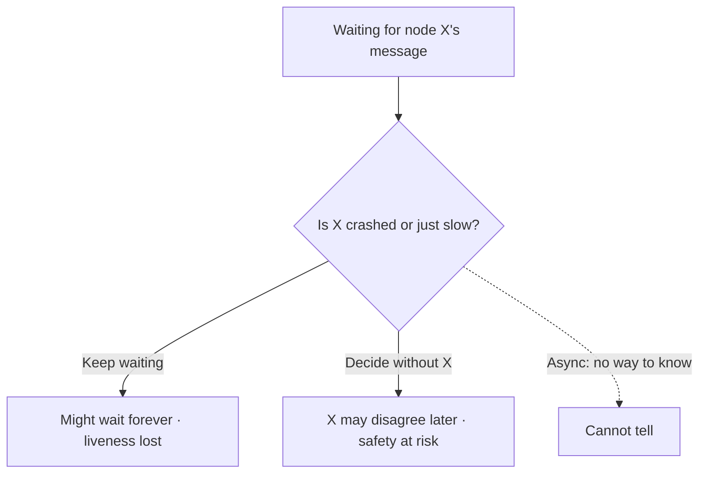

**What researchers did next** – The theorem did not end the field. It told researchers: **don't try to guarantee both; give priority to one.** Classical distributed-systems work chose **safety over liveness**: never decide wrongly, even if the protocol sometimes stalls.

| Way around FLP | Idea |
|---|---|
| Prioritise safety | Always correct, may stall in bad network periods (Paxos, Raft, PBFT) |
| Partial synchrony | Assume the network is *eventually* well-behaved, so liveness returns |
| Randomization | Use coin flips so termination happens with probability 1 |
| Probabilistic finality | Accept "very likely final" (Bitcoin's Nakamoto consensus, covered later) |

> [!warning] Common mistake
> FLP does **not** say "consensus is always impossible". It applies only to **fully asynchronous** systems with **deterministic** algorithms where at least one node may crash. Real systems work by relaxing one of these assumptions.

- **Why it matters** – Every blockchain consensus protocol is a choice about which side of FLP to give up, or which assumption to relax.

---

## 10. History of Distributed Consensus

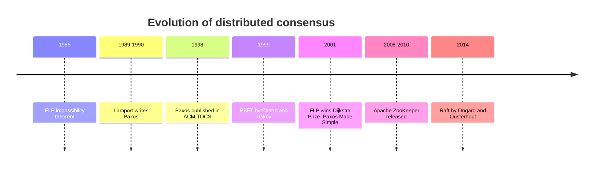

### Paxos (Leslie Lamport)
- **Leslie Lamport** is a pioneer of distributed systems and won the **Turing Award (2013)**.
- He developed **Paxos** around **1989** (the paper *"The Part-Time Parliament"* was written and submitted in **1990**).
- Paxos gives **priority to safety over liveness**: it never lets nodes decide differently, but it may fail to terminate in bad conditions.
- Through the 1990s people were confused by it and doubted it worked (it was written as a story about a fictional Greek parliament on the island of Paxos).
- It was finally published in **1998** in **ACM Transactions on Computer Systems (TOCS)**, almost **10 years** later.
- **Lesson** from the lecture: even a very fundamental idea can take a decade to be accepted.

### 2001
- The FLP paper received the **Dijkstra Prize** (then called the PODC Influential Paper Award) in **2001**. The transcript's "we instead die extra price" is this prize.
- Lamport also published *"Paxos Made Simple"* in 2001. Once people trusted Paxos, they believed practical distributed systems were really possible.

### Apache ZooKeeper (~2009)
- The transcript's "Ju Kippur" is **Apache ZooKeeper**, a coordination service for managing distributed applications (configuration, naming, leader election, locks).
- It started at Yahoo!, became an Apache project around 2008, and its main paper appeared in 2010. The lecture says "around 2009".
- It uses **ZAB** (ZooKeeper Atomic Broadcast), a Paxos-like protocol.

### 2010 onwards: many algorithms
| Algorithm | Fault model | Key idea |
|---|---|---|
| **Multi-Paxos** | Crash | Runs Paxos repeatedly with a stable leader to agree on a *log* of values |
| **Raft** (2014) | Crash | Designed to be **easier to understand** than Paxos; leader election + log replication |
| **PBFT** (Practical Byzantine Fault Tolerance) | **Byzantine** | Tolerates $f$ lying nodes out of $n \ge 3f + 1$ |

> [!warning] Fact check
> The lecture groups PBFT with "2010 onwards". PBFT was actually published in **1999** by Miguel Castro and Barbara Liskov. It became widely used (and studied for blockchains) in the 2010s.

- Paxos and PBFT will be studied **in detail** in later lectures.

---

## 11. Closing Question: Can We Use These Algorithms for Blockchain?

- Blockchain needs consensus every time a new block is proposed.
- A huge body of consensus algorithms already exists (Paxos, Raft, PBFT, ...).
- **Open question for the next class:** *Can we use these classical algorithms directly for blockchain?* (Hint: they assume a known, fixed set of participants, which a public blockchain like Bitcoin does not have.)

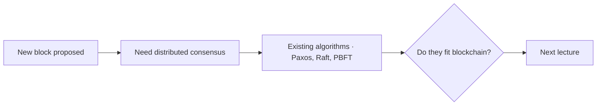

---

## 🔑 Key Points (short)

- Blockchain became popular in 2014–15, but its ideas come from 1970s–80s distributed systems.
- Three pillars: **distributed systems, cryptography, economic models**.
- Every node keeps a **local copy** of the blockchain.
- When one node proposes a block, all others must agree: the **distributed consensus problem**.
- Peers are organizations, e.g. crude producer, refinery, distributor, retailer.
- Centralized (leader): **6 calls** for 4 people, but you must trust the leader.
- Distributed (all-to-all): **12 calls** for 4 people, no trust needed, decide by majority.
- **Byzantine behaviour**: a node sends **different values to different peers**.
- **Crash fault** = node goes silent (easier); **Byzantine fault** = node lies (harder).
- **Synchronous** = bounded delay (phone call); **asynchronous** = no bound (SMS, Internet).
- **Safety** = correct nodes give the correct, same output; **liveness** = output in finite time.
- **FLP (1985, Fischer–Lynch–Paterson)**: no deterministic consensus in a fully async system with even one crash fault.
- After FLP, classical protocols prioritised **safety over liveness**.
- **Paxos**: Lamport, ~1989, published 1998 in ACM TOCS, safety over liveness.
- Later: **ZooKeeper** (~2009), **Multi-Paxos**, **Raft** (2014), **PBFT** (1999, Byzantine-tolerant).

## 📖 Glossary

| Term | Meaning (plain English) |
|---|---|
| Asynchronous system | Network with no upper limit on how long a message takes |
| Byzantine behaviour / fault | A node that lies or sends different values to different peers |
| Centralized solution | One leader collects input and decides for everyone |
| Consensus | All correct nodes agreeing on one value |
| Correct process | A node with no crash fault and no Byzantine fault |
| Crash fault | A node stops working and stays silent |
| Distributed consensus problem | One node proposes a value; all peers must collectively agree on it |
| Distributed system | Independent computers working together by passing messages |
| FLP impossibility | No deterministic consensus in a fully async system with even one crash |
| Liveness | The algorithm eventually finishes and gives an answer |
| Majority voting | Picking the option most participants chose |
| Multi-Paxos | Paxos repeated with a stable leader to agree on a sequence of values |
| Paxos | Lamport's crash-tolerant consensus algorithm, safety over liveness |
| PBFT | Practical Byzantine Fault Tolerance; consensus that survives lying nodes |
| Peer | A participant node (in permissioned blockchains, usually an organization) |
| Raft | An understandable crash-tolerant consensus algorithm (2014) |
| Safety | Correct nodes never decide wrong or conflicting values |
| Synchronous system | Network where messages arrive within a known time bound |
| Trustless setup | A system where you don't need to trust any single participant |
| ZooKeeper | Apache service for coordinating distributed applications |

## 🧮 Formulas & Numbers

| Formula / number | Meaning |
|---|---|
| $2(n-1)$ | Calls in centralized scheme: $n-1$ to collect, $n-1$ to inform ($n$ = people) |
| $n(n-1)$ | Calls in distributed scheme: each of $n$ people calls the other $n-1$ |
| $n = 4 \Rightarrow 6$ vs $12$ | Lecture's burger/pizza numbers; distributed doubles the calls |
| Ratio $= n/2$ | How many times more messages distributed needs than centralized |
| $n \ge 3f + 1$ | PBFT: nodes needed to tolerate $f$ Byzantine nodes (details later) |
| 1985 | FLP impossibility theorem published |
| 1989 / 1990 | Paxos developed / paper submitted |
| 1998 | Paxos published (ACM TOCS) |
| ~10 years | Delay before Paxos was accepted |
| 2001 | FLP wins Dijkstra Prize; "Paxos Made Simple" |
| ~2009 | ZooKeeper released (as per lecture) |
| 2014–2015 | Blockchain becomes popular |

## 🎯 Exam Corner

### Likely questions

**Q1. What is the distributed consensus problem and why does blockchain need it?**
One node proposes a value (a new block) and all peers must collectively agree on it. Blockchain needs it so every node keeps an identical copy of the ledger.

**Q2. Compare centralized and distributed decisions in the burger/pizza example.**
Centralized: a leader makes 3 + 3 = 6 calls but must be trusted. Distributed: everyone calls everyone, 4 × 3 = 12 calls, no trust needed, majority decided locally.

**Q3. What is Byzantine behaviour?**
A node sends inconsistent information to different peers (pizza to some, burger to others), so honest nodes may reach different conclusions.

**Q4. Differentiate crash faults and Byzantine faults.**
Crash: node stops responding (no info, easier to handle). Byzantine: node sends wrong or conflicting info (harder to handle).

**Q5. State the FLP impossibility theorem.**
Fischer, Lynch and Paterson (1985): consensus is impossible in a fully asynchronous system even with a single crash fault. Safety and liveness cannot both be guaranteed.

**Q6. Define safety and liveness.**
Safety: correct processes yield the correct (same) output. Liveness: the output is produced in finite time, i.e. the algorithm terminates.

**Q7. Synchronous vs asynchronous communication?**
Synchronous: messages arrive in bounded, real time (phone call). Asynchronous: no bound on delay, messages may be late or lost (SMS, Internet).

**Q8. What is the significance of Paxos?**
Lamport's Paxos (~1989, published 1998) was the landmark consensus protocol after FLP. It prioritises safety over liveness and took about 10 years to be accepted.

### MCQs

**1.** What does the distributed consensus problem aim to solve in blockchain?
A) Data encryption B) Reducing fees C) Agreement among nodes on new blocks D) Faster mining
> [!check]- Answer
> **C** — Consensus is about all nodes agreeing on the proposed block.

**2.** Which is NOT one of the three pillars of blockchain design?
A) Distributed systems B) Cryptographic techniques C) Economic models D) Centralized databases
> [!check]- Answer
> **D** — Blockchain explicitly avoids a central database.

**3.** With 4 friends, how many calls does the centralized (leader) method need?
A) 4 B) 6 C) 8 D) 12
> [!check]- Answer
> **B** — 3 calls to collect choices + 3 calls to announce = 6.

**4.** With 4 friends, how many calls does the fully distributed method need?
A) 6 B) 8 C) 12 D) 16
> [!check]- Answer
> **C** — Each of 4 people calls the other 3: 4 × 3 = 12.

**5.** A crash fault means:
A) Node sends inconsistent info B) Node stops responding C) Network delay D) Only the leader fails
> [!check]- Answer
> **B** — A crashed node goes silent due to hardware/software failure.

**6.** A characteristic of Byzantine faults is:
A) Node stops entirely B) Node gives inconsistent info to different peers C) Node always correct D) Reliable communication
> [!check]- Answer
> **B** — Byzantine nodes tell different peers different things.

**7.** The FLP impossibility theorem states:
A) Consensus is always achievable B) Consensus is impossible in a fully asynchronous system with even one crash fault C) Consensus needs a leader D) Consensus is easy in distributed systems
> [!check]- Answer
> **B** — Fischer, Lynch, Paterson, 1985.

**8.** A key feature of a fully asynchronous system is:
A) Real-time delivery B) No bound on message delay C) All nodes always online D) Centralized communication
> [!check]- Answer
> **B** — You never know when (or if) a message will arrive.

**9.** "Liveness" means:
A) Correct outputs B) Consensus reached in finite time C) Handling many faults D) Crash recovery
> [!check]- Answer
> **B** — Liveness = eventual termination.

**10.** Which algorithm is described as giving priority to safety over liveness?
A) Raft B) Paxos C) Proof of Work D) ZooKeeper
> [!check]- Answer
> **B** — The lecture highlights Paxos as the safety-first protocol after FLP.

## 📝 Summary

Blockchain is, at its heart, a distributed system: every participant keeps its own copy of the ledger, and whenever one node proposes a new block, all the others must agree on it. This is the classical distributed consensus problem, which the lecture explained with four friends choosing burger or pizza. A leader-based (centralized) decision needs only 6 calls but requires trusting the leader, while an everyone-calls-everyone (distributed) decision needs 12 calls but needs no trust. Things get harder with Byzantine nodes that tell different peers different things, and with asynchronous networks like the Internet, where you cannot tell a slow node from a crashed one. The FLP impossibility theorem (1985) proves that in a fully asynchronous system, even one crash fault makes it impossible to guarantee both safety and liveness, so researchers chose to favour safety. That led to Paxos (Lamport, ~1989, published 1998), then ZooKeeper, Multi-Paxos, Raft and the Byzantine-tolerant PBFT. Next, the course asks whether these classical consensus algorithms can be used directly for blockchain.
